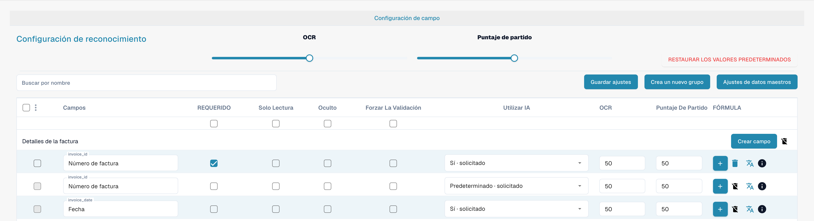

# Campos

Los campos definen qué datos recoge un tipo de documento y cómo se revisan. Abra el tipo de documento en los ajustes y seleccione sus campos.

<figure><figcaption>
Resumen de campos del tipo de documento Factura.
</figcaption></figure>

## Propiedades y reconocimiento

* **Obligatorio** exige que exista un valor para la validación.
* **Solo lectura** impide editar el valor; **Oculto** lo retira de la vista habitual.
* La **validación forzada** exige una comprobación explícita del campo. No crea reglas de comparación ni expresiones regulares; las reglas de validación personalizadas se configuran aparte.
* **OCR** establece un umbral numérico de confianza de reconocimiento. No es un interruptor para activar OCR.
* **Puntuación de coincidencia** establece un umbral numérico de coincidencia. No es un texto de referencia ni una lista de valores.
* La opción de **IA** controla la extracción solicitada para el campo.

Busque por nombre para localizar un campo y compruebe su fila antes de cambiar propiedades. Puede organizar grupos, añadir campos y abrir las opciones de fórmula o datos maestros. Las acciones disponibles dependen del campo y de los permisos; los campos estándar pueden tener restricciones de eliminación.

Guarde únicamente los cambios previstos y compruebe la validación con documentos representativos. Las imágenes no demuestran cambios guardados.

Consulte [Propiedades de los campos](configuring-field-properties-1.md), [Validación y Match Score](setting-validation-and-match-score.md) y [Campos con cargos](new-fields-with-charges.md).
