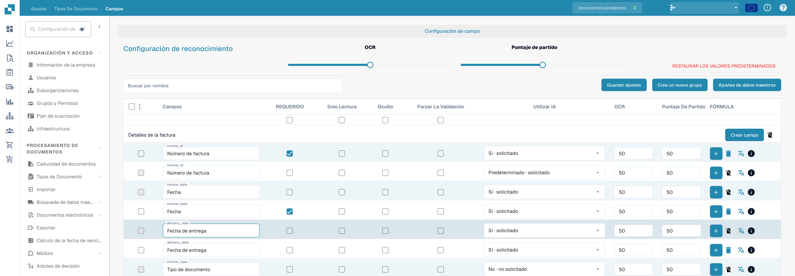
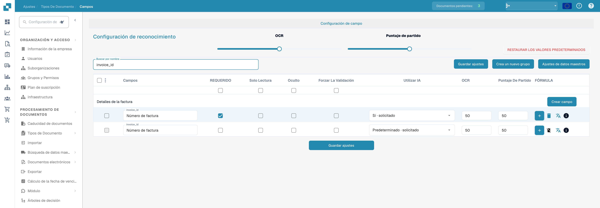

# Configuración de propiedades de campo

Utilice **Configuración → Tipos de documento → Campos** para controlar cómo se comportan los campos de un tipo de documento. Seleccione primero el tipo de documento; el siguiente ejemplo muestra **Factura** en la interfaz en inglés.

<figure><figcaption>
Propiedades de los campos: obligatorio, solo lectura, oculto y validación.
</figcaption></figure>

## Buscar un campo y cambiar sus propiedades

1. En **Buscar por nombre**, introduzca el nombre o la etiqueta del campo. Esto filtra la lista; no modifica el campo.
2. Localice la fila del campo. Por ejemplo, **Número de factura** tiene el nombre técnico `invoice_id`.
3. Ajuste los controles de esa fila y, a continuación, seleccione **Guardar ajustes**. El mismo botón de guardado está disponible encima y debajo de la tabla.

<figure><figcaption>
Campos filtrados por invoice_id con OCR y Match Score visibles.
</figcaption></figure>

| Control | Para qué se utiliza |
| --- | --- |
| **Obligatorio** | Marca la información que debe estar presente para la validación. Compruebe el resultado de validación del documento después de cambiar esta configuración. |
| **Solo lectura** | Muestra un campo sin permitir que los usuarios editen su valor. |
| **Oculto** | Mantiene el campo fuera de la vista normal del documento. |
| **Force Validation** | Exige que el campo supere la validación. Configure las reglas detalladas por separado; esta casilla no es un editor de reglas. |
| **Utilizar IA** | Solicita o detiene la extracción mediante IA para este campo. La fila muestra si la extracción está solicitada. |
| **OCR** | Introduzca el umbral de confianza de OCR del campo. Es un número, no un interruptor de activación ni una configuración de idioma. |
| **Match Score** | Introduzca el umbral de coincidencia del campo. Es un número, no un interruptor de activación. |

Los controles deslizantes **OCR** y **Match Score** de **Recognition Settings** aplican valores a toda la lista de campos. Las casillas situadas justo debajo de los títulos de las columnas aplican **Obligatorio**, **Solo lectura**, **Oculto** o **Force Validation** a toda la lista. Revise las filas afectadas antes de seleccionar **Guardar ajustes**. **Restore Defaults** restablece la configuración de los campos; utilícelo solo cuando desee reemplazar sus cambios.

## Otros controles de esta vista

- **Crear un nuevo grupo** y **Crear campo** añaden un grupo o un campo. Consulte [Adding and Editing Fields](adding-and-editing-fields.md).
- **Ajustes de datos maestros** abre la [configuración de datos maestros](master-data-settings.md).
- Las casillas situadas en el extremo izquierdo seleccionan campos. El menú contiguo ofrece **Reasignar el grupo de campo** para los campos seleccionados.
- El botón más de **Fórmula** abre el editor de fórmulas de ese campo. El icono de **info** muestra información del campo. El icono de eliminar no está disponible para los campos estándar.

Para más información sobre validación y coincidencia, consulte [Setting Validation and Match Score](setting-validation-and-match-score.md).
