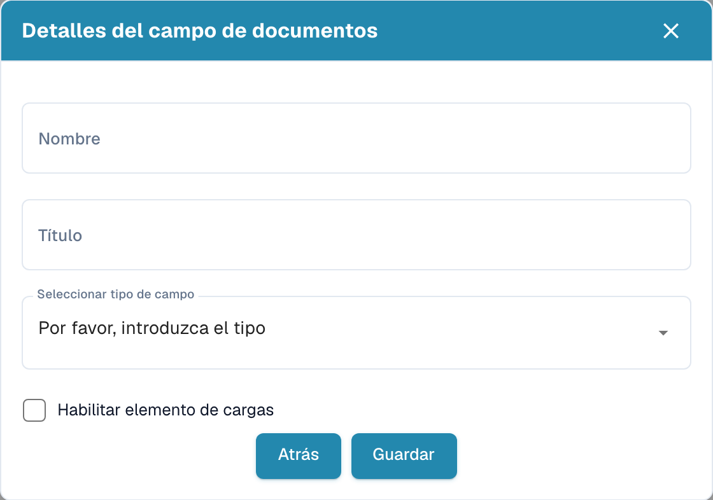
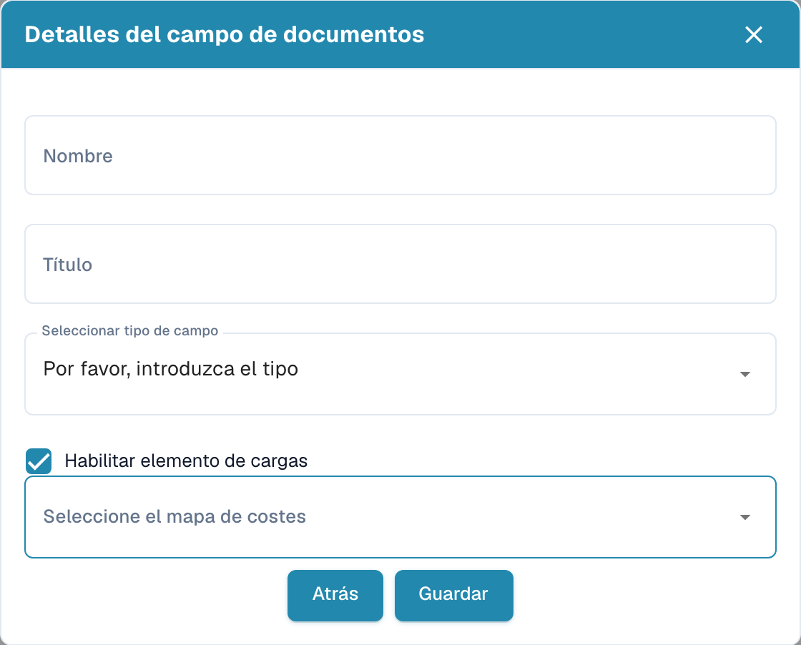

# Crear campos con gastos adicionales

Abra **Ajustes → Tipos de Documento**, seleccione el tipo de documento y abra **Campos**. En el grupo correspondiente, seleccione **Crear campo**.

<figure><figcaption>
Detalles del campo antes de crear un campo nuevo.
</figcaption></figure>

## Asignar gastos

1. Introduzca el nombre técnico y un título legible en los detalles del campo.
2. Seleccione el tipo de dato.
3. Active la casilla que el producto muestra como **Habilitar elemento de cargas**. Aparece el selector de asignación de costes.
4. Seleccione la asignación prevista para el gasto. Las opciones dependen de la configuración de su organización.

<figure><figcaption>
Borrador de campo con la opción de gastos adicionales activada.
</figcaption></figure>

El ejemplo es un borrador sin guardar. **Guardar** crea el campo; vuelva atrás si no desea crearlo. Después revise por separado las propiedades de obligatoriedad, validación, OCR y Match Score de la lista de campos.
