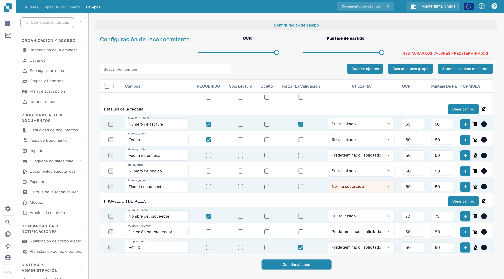
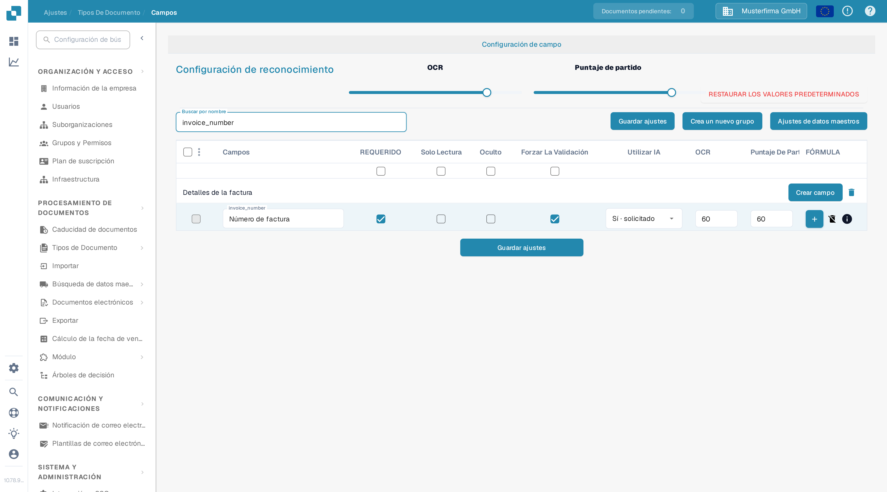

# Validación y puntuación de coincidencia

En **Campos**, puede establecer los umbrales de validación y reconocimiento de un tipo de documento. Esta página utiliza **Factura** en una organización de prueba de la documentación. Explica la casilla **Forzar La Validación** y los controles de **Puntaje De Partido** actuales.

## Abrir la configuración de campos

1. Vaya a **Ajustes → Tipos De Documento → Factura → Campos**.
2. Use **Buscar por nombre** para encontrar un campo, por ejemplo `invoice_number` (que se muestra como **Número de factura**).
3. Revise la fila del campo antes de cambiar una configuración. **REQUERIDO**, **Solo Lectura**, **Oculto** y **Forzar La Validación** son casillas independientes.

<figure><figcaption>
Los controles de reconocimiento aparecen encima de la lista de campos.
</figcaption></figure>

## Forzar La Validación

Marque **Forzar La Validación** en la fila del campo para aplicar una validación más estricta a ese campo. La casilla es independiente de **REQUERIDO**: marcar un campo como requerido no selecciona Forzar La Validación automáticamente. La casilla puede no estar disponible cuando un campo está oculto o es de solo lectura. Haga clic en **Guardar ajustes** después de cambiar la configuración del campo.

Las instrucciones antiguas sugerían introducir aquí límites numéricos o expresiones regulares. La tabla de Campos actual no muestra un editor de reglas en la celda de Forzar La Validación. Para reglas específicas de cada campo, consulte [Configuración de propiedades de campo](configuring-field-properties-1.md).

## Puntaje De Partido

**Puntaje De Partido** es un umbral numérico, no un valor de referencia fijo. El control deslizante **PUNTAJE DE PARTIDO** en **Configuración de reconocimiento** aplica su valor a las filas de campos del tipo de documento; utilice el campo **Puntaje De Partido** de una fila para un valor individual. El ejemplo muestra **60** en la fila `invoice_number`. Elija el umbral adecuado para su tipo de documento. Revise los campos afectados y haga clic en **Guardar ajustes**.

<figure><figcaption>
La fila invoice_number muestra Forzar La Validación marcada y un umbral de coincidencia de 60.
</figcaption></figure>

**OCR** es un umbral de reconocimiento independiente situado junto al Puntaje De Partido. **RESTAURAR LOS VALORES PREDETERMINADOS** restablece la configuración; utilícelo solo cuando desee descartar sus umbrales personalizados. Para otras opciones de campos, consulte la [Descripción general de Campos](README.md).
