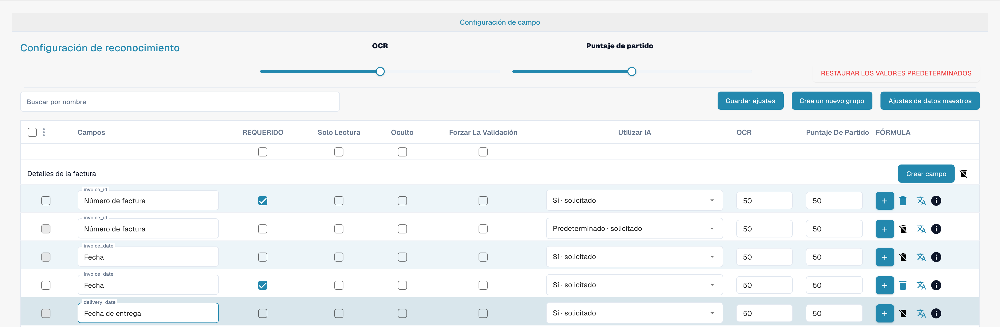
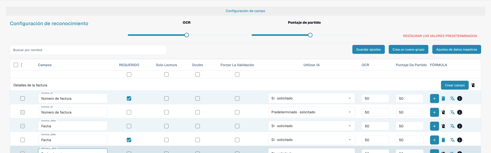
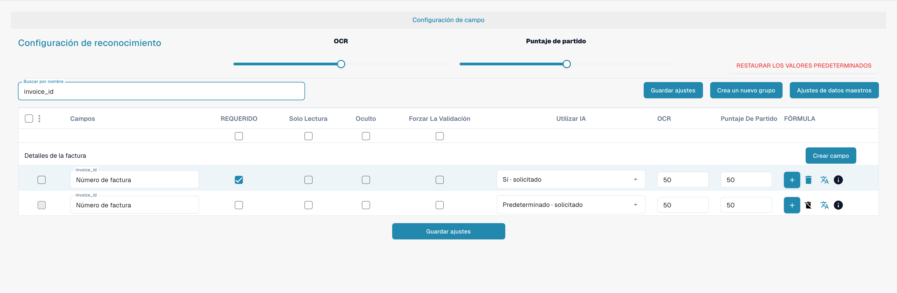

# Validación y puntuación de coincidencia

La obligatoriedad, la validación forzada, OCR y Match Score son propiedades diferentes de un campo. Abra **Ajustes → Tipos de Documento → Campos** para revisarlas.

<figure><figcaption>
Columnas separadas de validación, OCR y Match Score.
</figcaption></figure>

## Validación forzada

**Forzar la validación** solicita una revisión explícita del campo. No crea por sí sola una expresión regular ni una regla de comparación. Las reglas de validación personalizadas se configuran por separado.

<figure><figcaption>
Configuración de validación y reconocimiento de cada campo.
</figcaption></figure>

## OCR y Match Score

OCR define el umbral de reconocimiento del campo. Match Score define un umbral numérico de coincidencia; no es un texto de referencia ni un selector llamado «Valor de coincidencia». La interfaz española muestra actualmente la traducción incorrecta **Puntaje de partido** para este control.

<figure><figcaption>
Número de factura filtrado con validación y Match Score.
</figcaption></figure>

Revise el comportamiento con documentos representativos antes de guardar los ajustes. La casilla **REQUERIDO** indica obligatoriedad y no sustituye a la validación forzada.
