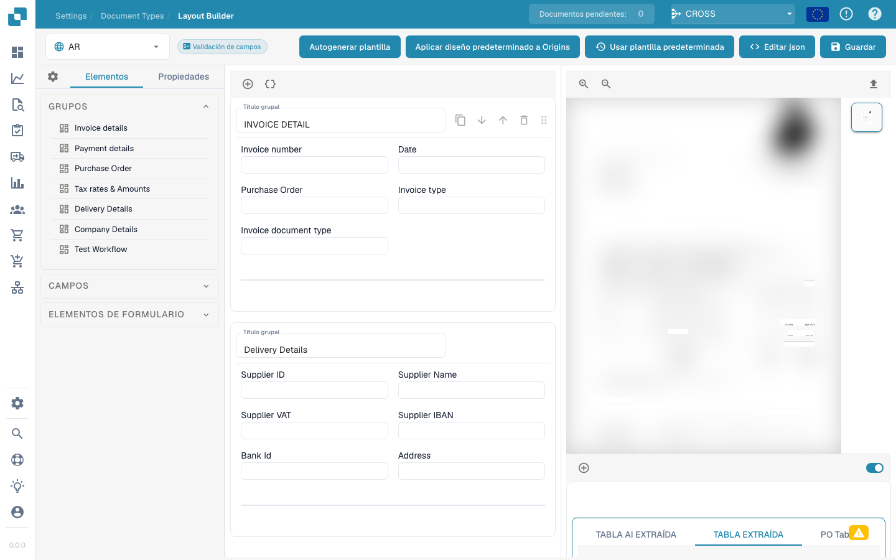

# Gestor de diseños

<figure><figcaption></figcaption></figure>

#### Descripción general

El gestor de diseños permite a los administradores configurar y modificar visualmente el diseño de los tipos de documentos estableciendo propiedades para varios campos y grupos de datos dentro de un documento. Esta interfaz ayuda a garantizar que los modelos de extracción y los puntos de entrada manual de datos se alineen con precisión con la estructura del documento escaneado o cargado en Docbits.

#### Componentes principales

1. **Grupos y Campos**:
   * **Grupos**: unidades organizativas dentro de un tipo de documento que categorizan campos relacionados (por ejemplo, Detalles de factura, Detalles de pago). Estos se pueden expandir o contraer y organizar para reflejar la agrupación lógica en el documento real.
   * **Campos**: puntos de datos individuales dentro de cada grupo (por ejemplo, número de factura, condiciones de pago). Cada campo se puede personalizar según cómo se capturan, muestran y procesan los datos.
2. **Properties Panel**:
   * Este panel muestra las propiedades del campo o grupo seleccionado, lo que permite una configuración detallada, como por ejemplo:
     * **Label**: la etiqueta visible para el campo en la interfaz de usuario.
     * **Nombre de campo**: El identificador técnico utilizado dentro del sistema.
     * **Ancho del elemento en porcentaje**: Determina el ancho del campo en relación con el diseño del documento.
     * **Índice de tabulación**: controla el orden de tabulación para la navegación.
     * **Ejecutar script al cambiar**: si se debe ejecutar un script cuando cambia el valor del campo.
     * **Mostrar etiqueta a la izquierda**: si la etiqueta se muestra a la izquierda del campo o encima de él.
     * **Is Textarea**: Especifica si el campo debe ser un área de texto, acomodando grandes cantidades de texto.
     * **Seleccionar tipo de modelo**: Opción para seleccionar qué tipo de modelo manejará la extracción de este campo.
     * **Longitud del campo**: Longitud máxima de datos que se aceptarán en este campo.
     * **Palabras clave prohibidas**: Palabras clave que no están permitidas dentro del campo.
3. **Template Preview**:
   * Muestra una vista previa en tiempo real de cómo aparecerá el documento según la configuración de diseño actual. Esto ayuda a garantizar que el diseño coincida con la estructura real del documento y es vital para probar y perfeccionar la configuración del procesamiento de documentos.



