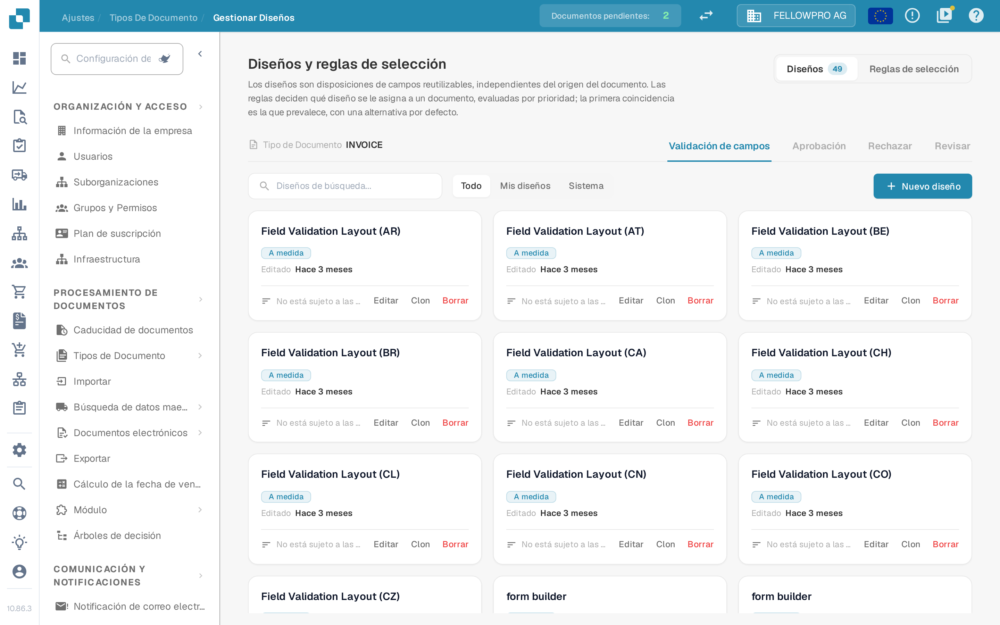

# Gestor de diseños

<figure><figcaption>El gestor de diseños para el tipo de documento Invoice.</figcaption></figure>

El **gestor de diseños** determina cómo ve un tipo de documento quien valida, aprueba, rechaza y revisa documentos: qué campos y grupos aparecen en pantalla, en qué orden y cómo se comporta cada campo. Cada tipo de documento tiene sus propios diseños.

La página se abre como **Diseños y reglas de selección**: los diseños son disposiciones de campos reutilizables, independientes del origen del documento, y las reglas deciden qué diseño se le asigna a un documento.

#### Pantallas y tipos de diseño

Validación, aprobación, rechazo y revisión son pantallas distintas, y cada una tiene sus propios diseños, sus propias reglas y su propio diseño predeterminado: una regla de aprobación nunca cambia la pantalla de validación. Cambie de pantalla con las pestañas **Validación de campos**, **Aprobación**, **Rechazar** y **Revisar**.

#### Tarjetas de diseño

En la pestaña **Diseños**, cada diseño de la pantalla seleccionada es una tarjeta. La tarjeta muestra el nombre del diseño, si pertenece a su organización (**A medida**) o es el diseño predeterminado del sistema, cuándo se editó por última vez y si alguna regla de selección lo utiliza. **Editar** abre el diseño en el Layout Builder, **Clon** lo copia con el nombre que elija y **Borrar** lo elimina; el diseño predeterminado del sistema solo puede consultarse, no modificarse ni borrarse. **Nuevo diseño** pide un nombre y abre el Layout Builder con el diseño nuevo y vacío. El filtro situado sobre las tarjetas alterna entre **Todo**, **Mis diseños** y **Sistema**.

#### El Layout Builder

**Editar** abre el [Layout Builder](navigating-the-layout-manager.md):

* **Estructura**, **Campos** y **Elementos** a la izquierda: el diseño como árbol, cada campo del tipo de documento con un contador de los campos ya colocados, y los grupos y elementos de formulario que puede arrastrar al lienzo.
* El **lienzo** del centro muestra el diseño tal como lo ve el usuario. **Diseño principal** y **Tabla** alternan entre la página y una tabla de líneas, y **Documento** abre el documento de ejemplo al lado.
* El panel **Propiedades** de la derecha sigue al elemento seleccionado; sus ajustes se agrupan en visualización, comportamiento, valores y listas, automatización, y bordes y espaciado.

**Guardar** en la cabecera almacena el diseño. Para el resto de acciones de la cabecera, consulte [Guardar y aplicar cambios](save-and-apply-changes.md).

#### Qué diseño recibe un documento

La pestaña **Reglas de selección** de cada pantalla contiene las reglas que eligen el diseño: se evalúan por prioridad, prevalece la primera coincidencia y se aplica una alternativa por defecto cuando ninguna regla coincide. Consulte [Reglas de selección de diseño](layout-selection-rules.md).
