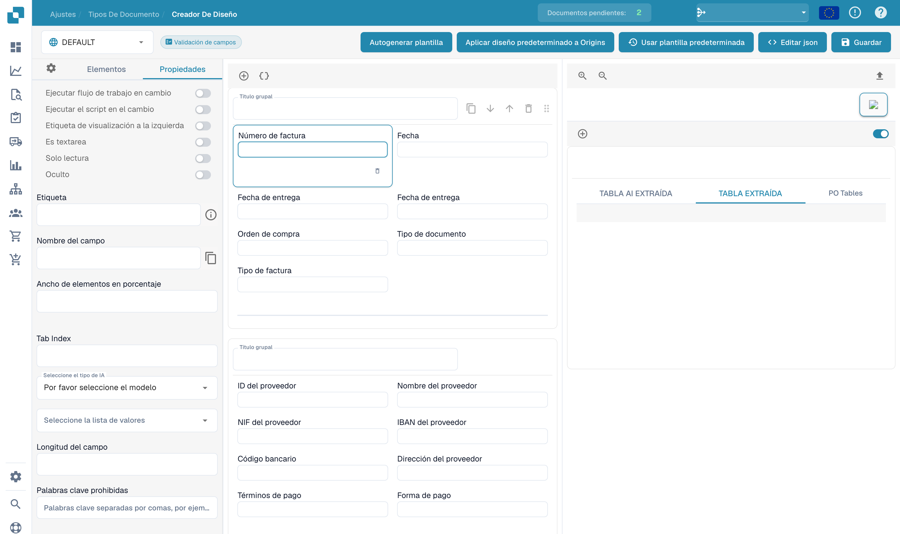

# Configurar las propiedades de un campo

Abra un diseño existente en **Creador de diseño** y seleccione un campo de la vista previa. El panel **Propiedades** muestra sus controles.

<figure><figcaption>
Propiedades de un campo en el editor de diseños.
</figcaption></figure>

Revise la etiqueta, el nombre técnico, el ancho porcentual y el índice de tabulación. Según el elemento, también puede configurar solo lectura, visibilidad, posición de la etiqueta, entrada multilínea y ejecución de un flujo o script cuando cambia el valor.

Seleccione el modelo de IA o lista de valores adecuado cuando el campo lo permita. La longitud y las palabras no permitidas añaden restricciones. Los nombres técnicos y los nombres de origen configurados no cambian con el idioma de la interfaz.

Compruebe la vista previa después de modificar una propiedad. Guarde únicamente los cambios previstos y pruebe la pantalla de validación con documentos representativos. La validación y los umbrales de reconocimiento del tipo de documento se configuran por separado.
