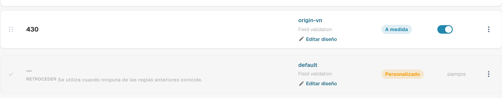
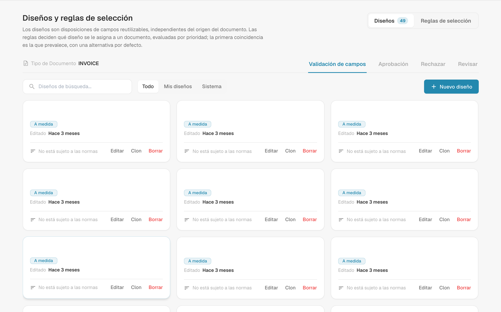
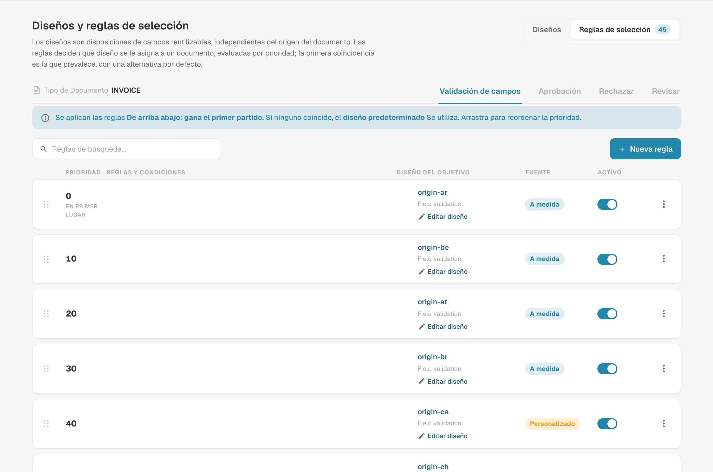
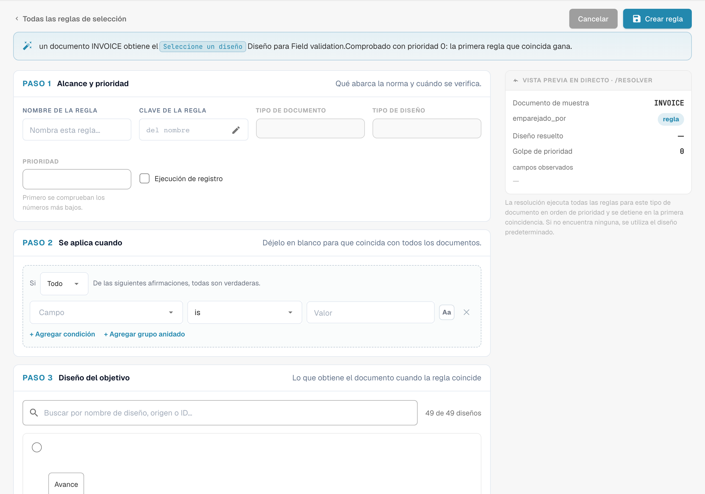
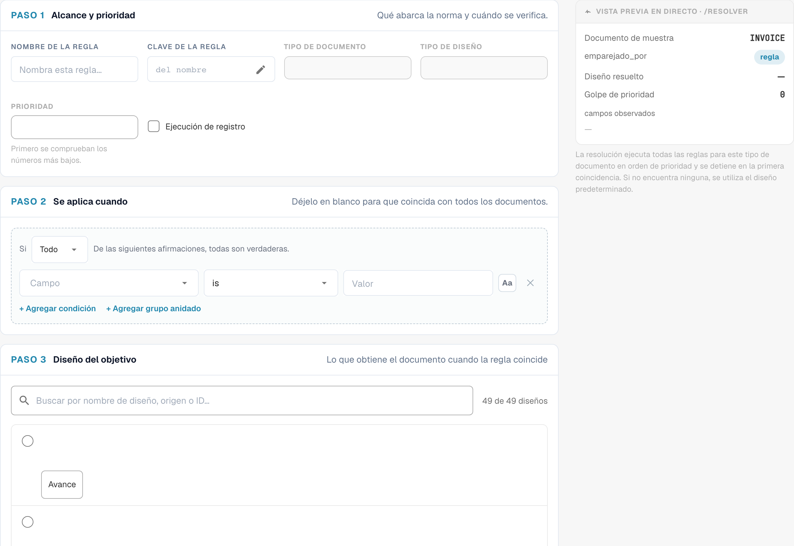

# Layout Selection Rules

## Descripción general

Un **layout** (diseño) decide qué campos y grupos ve un usuario, y en qué orden, en las pantallas de **validación**, **aprobación**, **rechazo** y **revisión** de un documento. Los diseños se crean en el [Layout Manager](README.md).

Tradicionalmente, DocBits elegía el diseño según el **origen** del documento: el país o la región tomados de los ajustes de idioma del documento, como `DE` o `US`. Cada origen tenía su propia copia del diseño y nada más podía influir en la elección.

Con las **reglas de selección de diseño**, los diseños pasan a ser bloques reutilizables e independientes del origen, y las **reglas** deciden qué diseño recibe un documento:

> *Cuando* el documento cumple una condición, *entonces* recibe este diseño. Las reglas se comprueban de arriba abajo; **gana la primera regla que coincide**. Si ninguna regla coincide, se utiliza el **diseño predeterminado**.

El origen sigue estando disponible, como una condición más entre muchas. Una regla puede mirar igualmente al proveedor, al importe, al estado del documento, al método de extracción o a cualquier campo de cabecera.

### Problemas que resuelven

| Requisito | Diseños clásicos basados en el origen | Con reglas de selección |
| --- | --- | --- |
| Las facturas de un proveedor necesitan campos adicionales (proyecto, número de aduanas) | imposible sin un origen nuevo | regla *Supplier ID is 20723* → diseño “Invoice with project fields” |
| Los documentos DE, AT y CH deben tener el mismo aspecto | tres copias del mismo diseño que mantener | un diseño, una regla por origen (o un grupo ANY) que apunta a él |
| Las facturas electrónicas necesitan una pantalla más sencilla que los PDF escaneados | no es posible | regla *Extraction Method is ELECTRONIC_DOCUMENT* → diseño “E-invoice” |
| Las facturas de gran importe necesitan más campos en la pantalla de aprobación | no es posible | regla de Approval *Total Amount greater than 10000* → diseño “High value approval” |
| El segundo aprobador debe ver una pantalla distinta de la del primero | un tipo de diseño “second approval” aparte | regla de Approval *Document Status is Pending second approval* → diseño “Second approval” |

## Activar los diseños basados en reglas

Los diseños basados en reglas los activa **por tipo de documento** un **administrador de la organización**.

1. Vaya a **Settings → Global Settings → Document Types**.
2. Haga clic en el icono de **ajustes** (engranaje) de la tarjeta del tipo de documento.
3. Abra **Gestionar diseños** y active el interruptor.

<figure><figcaption>
El interruptor Manage Layouts en los ajustes adicionales de un tipo de documento
</figcaption></figure>

El enlace **Diseños** de la tarjeta del tipo de documento ahora abre **Diseños y reglas de selección**.

### Qué ocurre al activarlo

DocBits convierte sus diseños existentes basados en el origen en reglas, una sola vez, para este tipo de documento y para cada pantalla:

* El diseño del origen **DEFAULT** pasa a ser el **diseño predeterminado** (el de reserva).
* Cada diseño de un origen concreto pasa a ser una regla **“Layout for XX”** con la condición *Document Origin is XX*, que apunta a ese diseño. Estas reglas reciben prioridades en pasos de 10 (por ejemplo 2000, 2010, 2020 …), de modo que puede colocar sus propias reglas antes, entre o después de ellas.

<figure><figcaption>
Diseño predeterminado al final de las reglas de selección.
</figcaption></figure>

No se elimina ni se modifica nada en los propios diseños. Por tanto, justo después de la activación cada documento recibe exactamente el diseño que recibía antes. El comportamiento solo cambia cuando usted añade o modifica reglas.

**Al desactivarlo**, el tipo de documento vuelve de inmediato a la selección basada en el origen. Las reglas se conservan pero no se utilizan, y vuelven a surtir efecto cuando se reactiva el interruptor.

## La pantalla Layouts & Selection Rules

<figure><figcaption>
Resumen con las pestañas de diseños y reglas de selección.
</figcaption></figure>

* **Layouts / Selection rules** (arriba a la derecha) alternan entre la lista de diseños y la lista de reglas. Los números indican cuántos hay.
* **Field Validation / Approval / Reject / Review** cambian la **pantalla**. Cada pantalla tiene sus propios diseños, sus propias reglas y su propio diseño predeterminado: una regla de Approval nunca cambia la pantalla de validación.
* En la pestaña **Diseños** puede crear, editar, clonar y eliminar diseños. Cada tarjeta indica si una regla utiliza el diseño (“Not targeted by rules” cuando ninguna lo hace). Filtre con **All / My layouts / System**; los diseños del sistema se incluyen con DocBits y se pueden ver y clonar, pero no modificar.


La primera y la segunda aprobación comparten los diseños y las reglas de **Aprobación**. Para dar a la segunda fase de aprobación su propia pantalla, añada una regla de Approval con la condición *Document Status is Pending second approval*; consulte el [ejemplo](#pantallas-distintas-para-la-primera-y-la-segunda-aprobacion).


## Cómo se elige un diseño

Cada vez que se abre un documento, y de nuevo después de guardarlo, DocBits decide su diseño para la pantalla actual:

1. Se comprueban las **reglas activas** de la pantalla por orden de **prioridad** (primero el número más bajo). **Gana la primera regla cuya condición es verdadera** y se utiliza su diseño.
2. Si ninguna regla coincide, se utiliza el **diseño predeterminado**.
3. Si tampoco hay diseño predeterminado, DocBits recurre a la elección clásica basada en el origen.

Las reglas cuyo diseño se ha eliminado o está vacío se omiten.

### Un ejemplo práctico

Reglas de la pantalla **Validación de campos**:

| Prioridad | Regla | Condición | Diseño |
| --- | --- | --- | --- |
| 5 | Behaelterbau invoices | *Supplier ID is HP0000278* | Invoice with project fields |
| 10 | E-invoices | *Extraction Method is ELECTRONIC_DOCUMENT* | E-invoice |
| 2020 | Layout for DE | *Document Origin is DE* | Field Validation Layout (DE) |
| — | Default layout | — | Field Validation Layout (Base) |

Qué diseño recibe cada documento:

| Documento | Proveedor | Extracción | Origen | Diseño | Porque |
| --- | --- | --- | --- | --- | --- |
| 1 | HP0000278 | factura electrónica | DE | Invoice with project fields | la prioridad 5 coincide primero; las reglas posteriores no se comprueban |
| 2 | 10040 | factura electrónica | DE | E-invoice | la prioridad 5 no coincide, la 10 sí |
| 3 | 10040 | PDF escaneado | DE | Field Validation Layout (DE) | solo coincide la regla de origen |
| 4 | 10040 | PDF escaneado | US | Field Validation Layout (Base) | ninguna regla coincide → predeterminado |

**El orden importa**: coloque las reglas específicas (un proveedor) por encima de las generales (un país).

### Cuando un usuario cambia un campo que miran las reglas

El diseño se elige siempre a partir de los valores **actuales** del documento. Si un usuario corrige, por ejemplo, el proveedor en la pantalla de validación, DocBits vuelve a elegir el diseño tras el guardado y la pantalla puede cambiar a otro diseño. No se pierde ningún dato: un campo que no forma parte del nuevo diseño conserva su valor; simplemente no se muestra hasta que vuelva a aplicarse un diseño que lo contenga.

## Gestionar las reglas de selección

<figure><figcaption>
Reglas de selección de diseño con los nombres configurados ocultos.
</figcaption></figure>

Cada fila muestra la **prioridad** (la primera fila está marcada como **FIRST**), el **nombre y la clave de la regla** con sus **condiciones**, el **diseño de destino**, la insignia de **origen** y un interruptor **Activo**.

| Tarea | Cómo |
| --- | --- |
| Crear una regla | **Nueva regla** |
| Editar una regla | Haga clic en la fila |
| Cambiar el orden | Arrastre el tirador de la izquierda de una fila hacia arriba o hacia abajo. El nuevo orden se guarda de inmediato. |
| Desactivar una regla | Interruptor **Activo**. Las reglas inactivas se ignoran. |
| Duplicar o eliminar | Menú **⋮** de la fila |
| Buscar una regla | **Search rules…** |

La insignia de **origen** indica de dónde procede una regla: las reglas **Sistema** se incluyen con DocBits. Al editar una se crea una copia para su organización, que se muestra como **Personalizado**; el original permanece intacto y se puede restaurar. Las reglas que usted crea son **A medida**.

### El diseño predeterminado

La última fila, marcada como **RETROCEDER** e **es_predeterminado**, es el diseño predeterminado: se utiliza siempre que ninguna regla anterior coincide y no tiene condición. Se crea al activar la función (a partir del diseño del origen DEFAULT).


Para usar otro diseño de reserva, cree una regla **sin ninguna condición** y asígnele el número de prioridad más alto, de modo que se compruebe en último lugar. Coincide con todos los documentos con los que no coincidió ninguna regla anterior, antes de llegar al diseño predeterminado.


## Crear una regla

Haga clic en **Nueva regla** en la pestaña Selection rules de la pantalla que desea cambiar.

<figure><figcaption>
Ámbito, condiciones y diseño de destino en el editor de reglas.
</figcaption></figure>

La frase de la parte superior resume la regla a medida que la construye: “When header.supplier_id = HP0000278, an INVOICE document gets the Field Validation Layout (Base) layout for Field validation. Checked at priority 5 — the first matching rule wins.”

### Paso 1 — Scope & priority

| Ajuste | Qué hace |
| --- | --- |
| **Nombre de la regla** | Se muestra en la lista de reglas. Describa el caso de negocio: “Behaelterbau invoices”, “E-invoices”, “High value approval”. |
| **Clave de la regla** | Se genera a partir del nombre; se mantiene igual cuando cambia el nombre de la regla. |
| **Tipo de Documento** / **Tipo de diseño** | El tipo de documento y la pantalla a los que se dirige la regla. Se toman del lugar donde hizo clic en **Nueva regla**. |
| **Prioridad** | Los números más bajos se comprueban primero. Deje huecos (5, 10, 20 …) para poder insertar reglas más adelante. |

### Paso 2 — Applies when

La condición que debe cumplir un documento. Puede utilizar:

* **atributos del documento**: Document Origin, Extraction Method, Document Status, Sub Document Type,
* **campos de cabecera**: Supplier ID, Total Amount, Currency, Purchase Order y todos los demás campos del tipo de documento,
* una **ruta JSON personalizada** (Advanced).

Las columnas de tabla no están disponibles: el diseño se elige una sola vez para todo el documento.

Deje el paso vacío para que coincida con todos los documentos en esta prioridad. Cómo funcionan las condiciones (ALL / ANY, grupos anidados, todos los operadores, valores vacíos, mayúsculas/minúsculas) se explica en [Rule Conditions (Applies when)](../rule-conditions-applies-when.md).

### Paso 3 — Target layout

Haga clic en el diseño que debe recibir el documento. La lista muestra sus propios diseños y los diseños del sistema de la pantalla seleccionada. Un diseño no se puede eliminar mientras una regla siga apuntando a él.

### Vista previa en vivo · /resolve

El panel de la derecha muestra lo que hace la regla para un documento de muestra que tiene los valores de sus condiciones:

| Línea | Significado |
| --- | --- |
| **Documento de muestra** | Los valores utilizados para la vista previa, tomados de sus condiciones |
| **emparejado_por** | `rule` si coincidió una regla; en caso contrario, el predeterminado |
| **Diseño resuelto** | El diseño que recibiría el documento de muestra |
| **Golpe de prioridad** | La prioridad de la regla que coincidió |
| **campos observados** | Los campos de los que depende la elección del diseño. Cuando un usuario cambia uno de ellos, el diseño se vuelve a elegir. |

Haga clic en **Crear regla** (o **Regla de guardado** al editar) para guardar. **Cancelar** vuelve a la lista de reglas.

## Ejemplos

### Campos adicionales para un proveedor

Pantalla **Validación de campos** · prioridad **5** · *Supplier ID is HP0000278* · destino *Invoice with project fields* (un clon de su diseño estándar con los campos adicionales de proyecto y centro de coste).

### Un diseño para varios países

Pantalla **Validación de campos** · prioridad **100** · **ANY of**: *Document Origin is Deutsch*, *Document Origin is Austria*, *Document Origin is Switzerland* · destino *DACH invoice*. Desactive las reglas migradas “Layout for AT” y “Layout for CH” si apuntan a copias más antiguas.

### Una pantalla más sencilla para facturas electrónicas

Pantalla **Validación de campos** · prioridad **10** · *Extraction Method is ELECTRONIC_DOCUMENT* · destino *E-invoice* (sin campos relacionados con el OCR).

### Una pantalla de aprobación más estricta para importes altos

Pantalla **Aprobación** · prioridad **10** · *Total Amount greater than 10000* · destino *High value approval* (que muestra centro de coste, responsable del presupuesto y número de contrato).

### Pantallas distintas para la primera y la segunda aprobación

Pantalla **Aprobación** · prioridad **5** · *Document Status is Pending second approval* · destino *Second Approval Layout*. Los documentos en la primera fase de aprobación no coinciden y reciben el diseño predeterminado de Approval.

<figure><figcaption>
Borrador sin guardar de una regla de selección de diseño.
</figcaption></figure>

### Una pantalla de rechazo especial para algunos proveedores

Pantalla **Rechazar** · prioridad **10** · *Supplier ID is one of* `10040, 10041` · destino *Reject with reason codes*.

## Buenas prácticas

* **Lo específico antes que lo general.** Las reglas de proveedor por encima de las de país, y las de país por encima del predeterminado.
* **Deje huecos en las prioridades** (5, 10, 20 …) para que las reglas nuevas encajen sin renumerar.
* **Base las condiciones en campos fiables.** El proveedor y el origen se establecen pronto y rara vez cambian. Las condiciones sobre campos que los usuarios editan con frecuencia hacen que la pantalla cambie de diseño mientras trabajan.
* **Clone, no empiece desde cero.** Clone su diseño estándar y ajústelo, para que todos los diseños mantengan la misma estructura básica.
* **Compruebe la vista previa en vivo** y abra un documento real de cada tipo después de cambiar reglas.
* **Mantenga un diseño predeterminado con sentido** para cada pantalla, de modo que ningún documento se quede sin diseño.

## Resolución de problemas

| Síntoma | Qué comprobar |
| --- | --- |
| Un documento recibe el diseño equivocado | Coincide antes una regla anterior. Revise las reglas situadas por encima o el **Golpe de prioridad** de la vista previa. |
| Se usa el predeterminado aunque una regla debería coincidir | ¿Está la regla **Activo**? ¿La condición coincide con el valor exacto (mayúsculas, espacios)? ¿Está la regla en la pestaña de **pantalla** correcta? |
| El diseño cambia mientras un usuario trabaja | Se ha cambiado un campo de **campos observados**. Base la regla en un campo más estable. |
| Un diseño no se puede eliminar | Una regla todavía apunta a él. Cambie el destino de esa regla o elimínela primero. |
| No se muestra ningún diseño | Ninguna regla coincidió, no hay predeterminado y no existe un diseño basado en el origen para esta pantalla. Añada una regla sin condición como regla comodín. |
| No cambió nada tras la activación | Es lo esperado: la activación reproduce la elección anterior basada en el origen. Añada sus propias reglas. |
| La segunda aprobación muestra el diseño de la primera aprobación | Añada una regla de Approval sobre *Document Status is Pending second approval* por encima de las demás reglas de Approval. |

## Relacionado

* [Rule Conditions (Applies when)](../rule-conditions-applies-when.md)
* [Custom Validation Rules](../custom-validation-rules.md)
* [Transformation Rules](../transformation-rules.md)
* [Navigating the Layout Manager](navigating-the-layout-manager.md)
