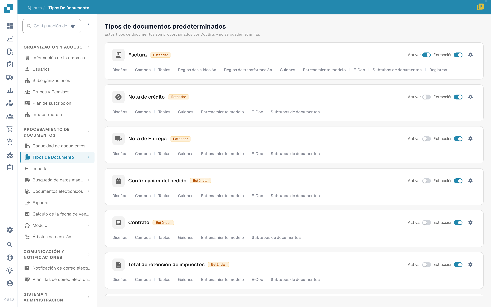
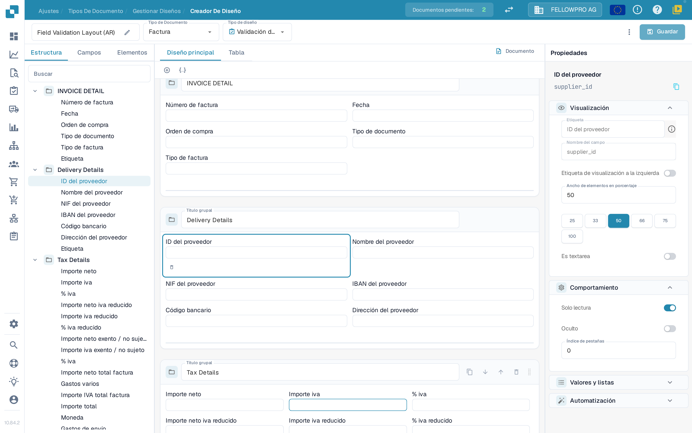
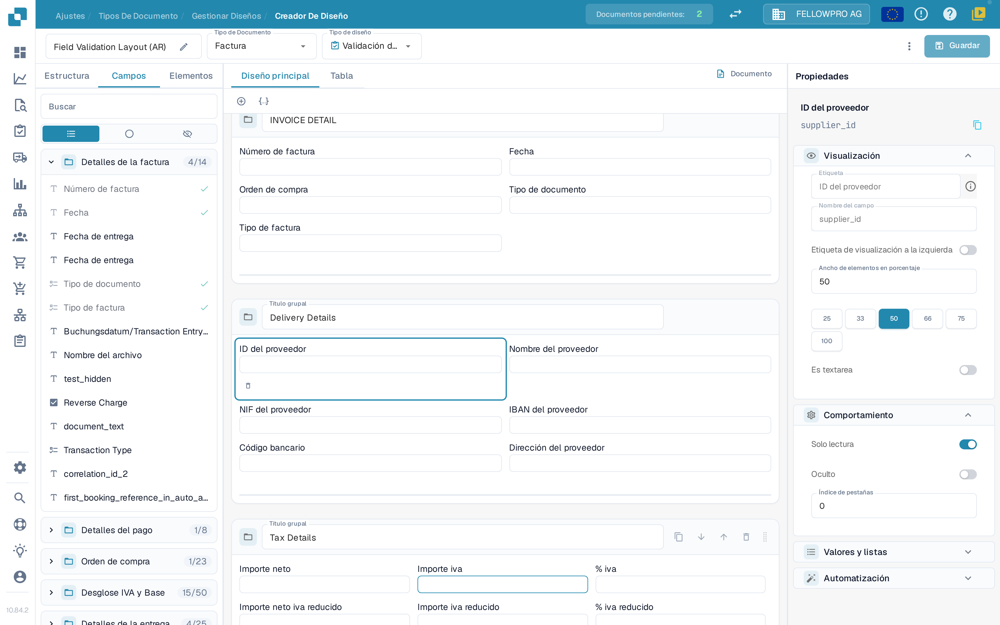
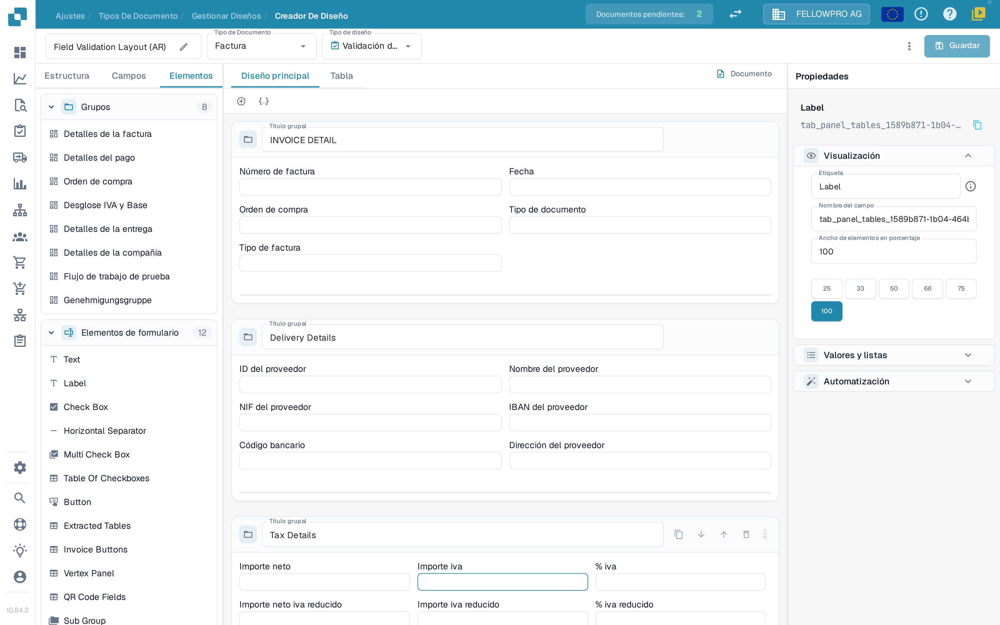

# Navegando el Administrador de Diseño

Utilice el **Administrador de Diseño** para organizar los grupos y campos que las personas ven en un documento. Esta guía utiliza el tipo de documento **Factura** en una organización de pruebas, y las capturas de pantalla muestran la interfaz en español.

## Abrir el diseño de factura

1. Vaya a **Configuración → Tipos de documento**.
2. Localice **Factura** y seleccione **Diseños** debajo de su nombre. Se abre el Administrador de Diseño para ese tipo de documento.
3. La barra superior muestra el nombre del diseño (puede cambiarlo con el lápiz), el **Tipo de Documento** y el **Tipo de diseño**. Utilice **Tipo de diseño** para cambiar a otro diseño del mismo tipo de documento.

<figure><figcaption>
Abra <strong>Diseños</strong> desde la tarjeta de Factura.
</figcaption></figure>

## Trabajar con las tres pestañas del panel

El panel de la izquierda tiene tres pestañas: **Estructura**, **Campos** y **Elementos**. El administrador se abre en **Campos**.

**Estructura** muestra el diseño como un árbol, en el mismo orden en el que los grupos y los campos aparecen en el documento. Despliegue un grupo con su flecha para ver los campos que contiene; el nombre técnico del campo aparece en el panel **Propiedades**. El cuadro **Buscar** filtra el árbol y, al seleccionar una fila, se selecciona el mismo elemento en el lienzo.

<figure><figcaption>
El árbol de <strong>Estructura</strong>, el lienzo y el panel <strong>Propiedades</strong>.
</figcaption></figure>

**Campos** enumera todos los campos que ofrece el tipo de documento, organizados por sus grupos. El contador situado junto al nombre de un grupo indica cuántos de sus campos ya están colocados, por ejemplo **4/14**. Los tres botones situados debajo del cuadro de búsqueda son solo iconos y cambian la lista entre todos los campos, únicamente los que todavía no se utilizan y únicamente los que están ocultos. Cada fila muestra la etiqueta del campo; una marca de verificación verde a la derecha señala los campos que ya forman parte del diseño, que aparecen atenuados.

<figure><figcaption>
Filtre los campos y reconozca los ya colocados por su marca de verificación.
</figcaption></figure>

**Elementos** contiene los bloques que se arrastran al lienzo: **Grupos**, con los grupos de este diseño, y **Elementos de formulario**, con Text, Label, Check Box, Horizontal Separator, Multi Check Box, Table Of Checkboxes, Button, Extracted Tables, Invoice Buttons, Vertex Panel, QR Code Fields y Sub Group.

<figure><figcaption>
Las paletas <strong>Grupos</strong> y <strong>Elementos de formulario</strong>.
</figcaption></figure>

## Colocar y organizar elementos

- Arrastre un campo desde **Campos**, o un elemento desde **Elementos**, hasta el grupo en el que debe aparecer. Los campos ya colocados llevan una marca de verificación en la pestaña **Campos**.
- Arrastre un campo dentro de un grupo o entre grupos para reordenarlo.
- El **+** situado encima del lienzo añade un grupo vacío; el icono de JSON contiguo crea un grupo a partir de una definición en JSON.
- En la cabecera de un grupo puede cambiar su nombre en **Título grupal**, copiar su JSON, bajar o subir el grupo, o eliminarlo. Utilice el control de arrastre situado a la derecha de la cabecera para mover el grupo.
- Seleccione un campo en el lienzo para abrir sus propiedades a la derecha. La pequeña barra de herramientas que aparece debajo del campo seleccionado lo quita del diseño.

## El panel Propiedades

El panel de la derecha permanece siempre abierto y sigue al elemento que haya seleccionado. Sus ajustes se agrupan en **Visualización**, **Comportamiento**, **Valores y listas** y **Automatización**. **Visualización** contiene la etiqueta, el tipo de campo y el **Ancho de elementos en porcentaje**, que se elige entre los valores predefinidos 25, 33, 50, 66, 75 y 100. Consulte [Configuración de propiedades de campo](configuring-field-properties.md) para conocer cada una de las opciones.

Los ajustes de validación, OCR y coincidencia pertenecen al campo en sí, no al diseño: configúrelos en la [configuración de Campos](../fields/configuring-field-properties-1.md) independiente.

## Vista previa y guardado

El lienzo muestra el diseño tal como se verá en el documento. Utilice las pestañas **Diseño principal** y **Tabla** para alternar entre la página y una tabla de posiciones, y **Documento** para abrir el documento de ejemplo junto al lienzo. Consulte [Uso de la vista previa de la plantilla](using-the-template-preview.md).

Seleccione **Guardar** en la barra superior cuando haya terminado. Consulte [Guardar y aplicar cambios](save-and-apply-changes.md) para conocer las demás acciones de la barra superior, incluidas la generación de plantillas, las plantillas predeterminadas y la aplicación de un diseño a los orígenes.
