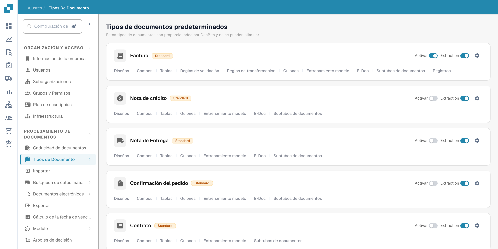
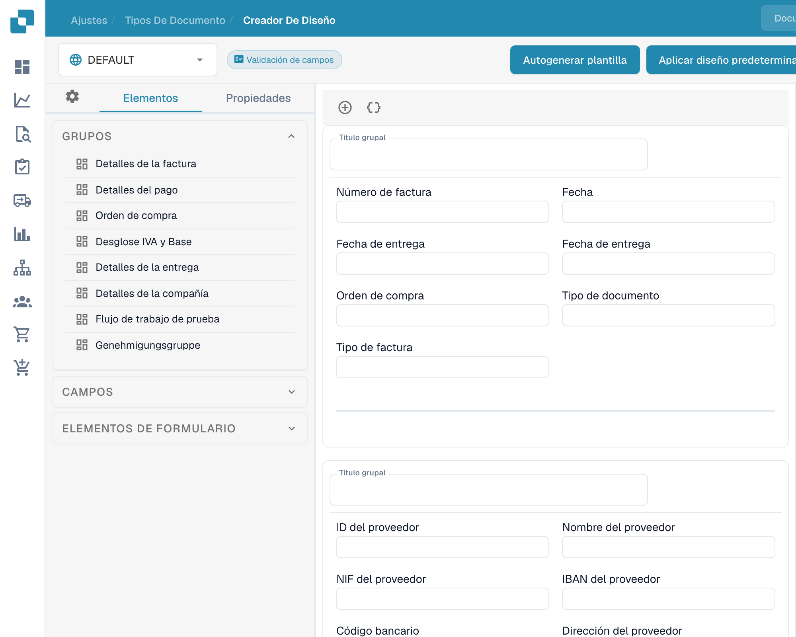
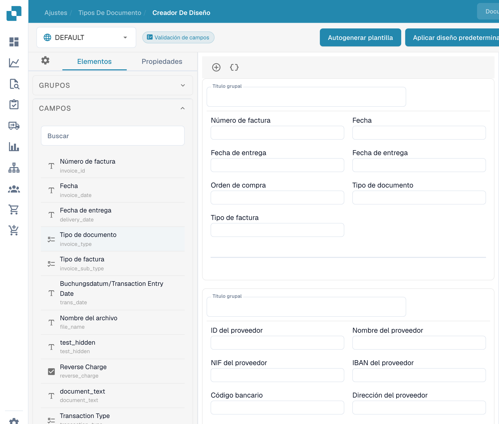
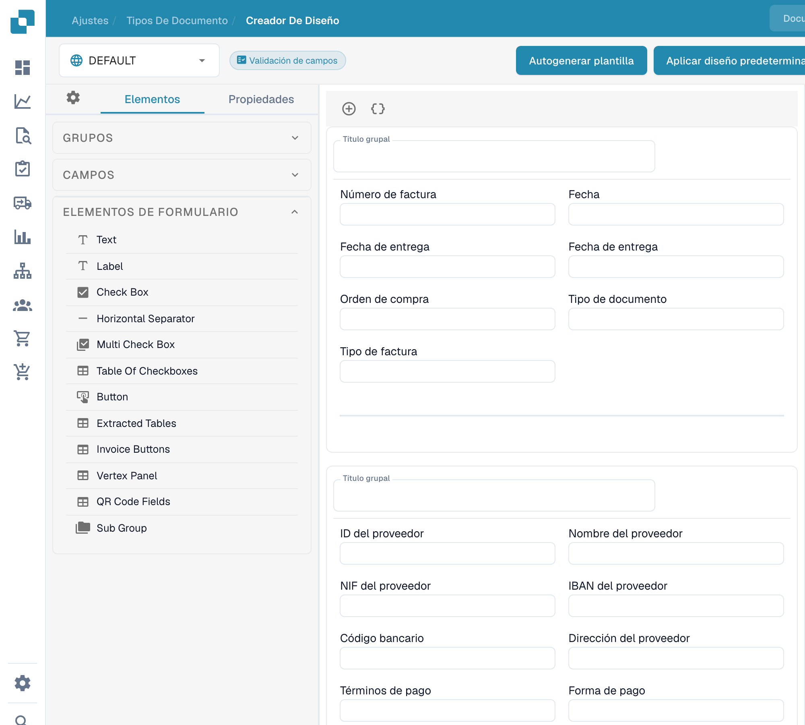

# Navegación por el Constructor de diseño

Utilice el **Creador de diseño** para organizar los campos y grupos que las personas ven en un documento. Esta guía utiliza el diseño de **Factura** en inglés de una organización sandbox.

## Abrir el diseño de Invoice

1. Vaya a **Configuración → Tipos de documento**.
2. Localice **Factura** y seleccione **Diseños** en su tarjeta. Se abre el Layout Builder para ese tipo de documento.
3. Compruebe el selector de diseño en la parte superior izquierda. El ejemplo siguiente muestra **DEFAULT**.

<figure><figcaption>
Acceso a los tipos de documento desde los ajustes.
</figcaption></figure>

## Encontrar grupos y campos

El panel izquierdo **Elementos** tiene tres secciones. **Grupos** enumera las secciones del documento; el lienzo central muestra su disposición actual. Seleccione un campo en el lienzo y abra **Propiedades** para cambiar su configuración de visualización. Consulte [Configuración de propiedades de campo](configuring-field-properties.md) para ver las opciones disponibles.

<figure><figcaption>
Panel de elementos y grupos de un diseño existente.
</figcaption></figure>

Abra **Campos** para encontrar los campos de documento disponibles. Utilice su cuadro de búsqueda cuando la lista sea larga y, a continuación, arrastre el campo al grupo deseado en el lienzo. Los campos que ya están colocados en el diseño pueden aparecer como no disponibles en la lista.

<figure><figcaption>
Campos disponibles en el creador de diseños.
</figcaption></figure>

Abra **Elementos de formulario** para ver controles visuales como Text, Label, Check Box, separador, Button y Sub Group. Arrastre el elemento que necesite al lienzo y, a continuación, compruebe sus **Propiedades**.

<figure><figcaption>
Elementos de formulario disponibles en el creador de diseños.
</figcaption></figure>

## Organizar y guardar

- Seleccione el título de un grupo en el lienzo para cambiarlo. El **+** situado encima del lienzo añade un grupo; el icono de llaves contiguo abre el formulario avanzado de grupo en JSON.
- Pase el cursor sobre un grupo para ver las acciones de copiar JSON, subir, bajar, eliminar y el control de arrastre. Para reordenar campos, arrástrelos dentro de un grupo o entre grupos.
- Seleccione un campo en el lienzo para abrir **Propiedades**. Su icono de eliminar lo quita de este diseño. Para configurar la validación, el OCR o la coincidencia, utilice la [configuración de Campos](../fields/configuring-field-properties-1.md) independiente.
- Seleccione **Guardar** en la barra superior después de editar. Consulte [Save and Apply Changes](save-and-apply-changes.md) antes de usar las demás acciones de la barra superior, incluidas la generación de plantillas, las plantillas predeterminadas y la aplicación de un diseño a los orígenes.
