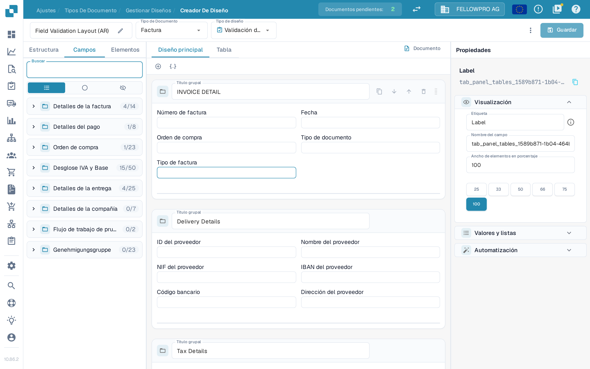
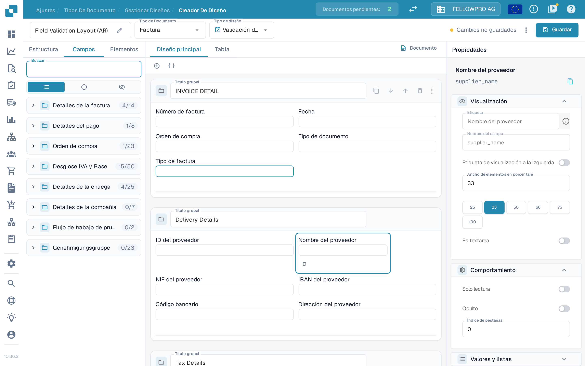
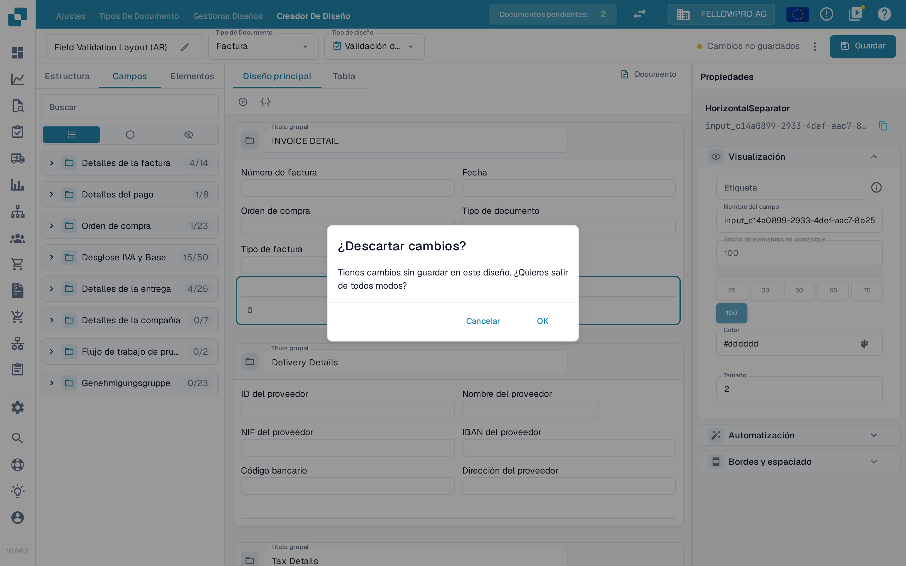
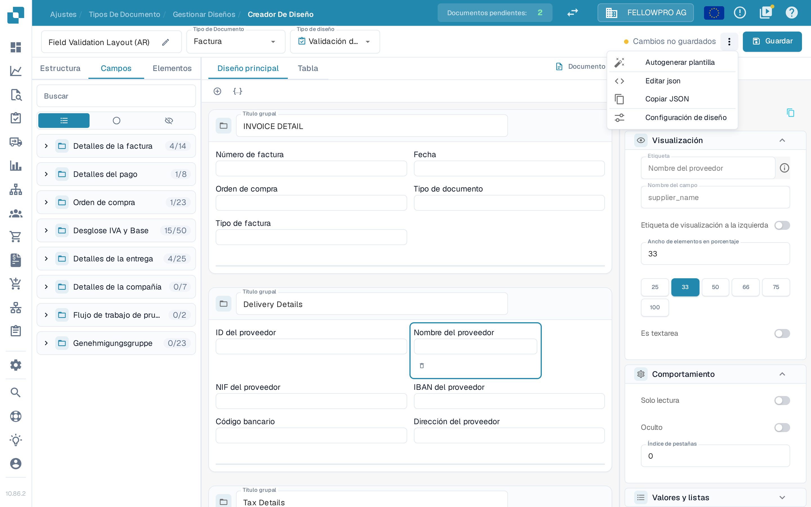

# Guardar y aplicar cambios

Los cambios realizados en el Layout Builder no surten efecto hasta que los guarda. Al guardar, el diseño queda asociado al tipo de documento para que los documentos nuevos lo utilicen.

## Guardar los cambios

Después de editar el diseño, seleccione **Guardar** en la parte superior derecha de la cabecera.

<figure><figcaption>El botón **Guardar** se encuentra en la parte superior derecha del Layout Builder.</figcaption></figure>

Mientras trabaja, la cabecera muestra el estado de sus cambios:

- Un botón **Guardar** sin ningún mensaje al lado significa que el diseño no ha cambiado.
- **Cambios no guardados** aparece en cuanto modifica el diseño. Seleccione **Guardar** para conservarlos.

<figure><figcaption>El indicador **Cambios no guardados** aparece mientras el diseño todavía no se ha guardado.</figcaption></figure>

Tras guardar correctamente, el indicador se sustituye por la hora del último guardado. Volver a seleccionar **Guardar** no supone ningún riesgo: si nada ha cambiado desde el último guardado, no se escribe nada.

Si sale del Layout Builder con cambios sin guardar, DocBits pregunta **¿Descartar cambios?**. Seleccione **Cancelar** para quedarse y guardar, u **OK** para salir sin guardar.

<figure><figcaption>Confirmación que se muestra al salir con cambios sin guardar.</figcaption></figure>

## Otras acciones de la cabecera

El menú de tres puntos situado junto a **Guardar** contiene el resto de acciones de diseño:

- **Autogenerar plantilla**: crea un diseño automáticamente a partir de los campos del tipo de documento.
- **Editar json**: edita directamente la definición del diseño en formato JSON.
- **Copiar JSON**: copia la definición del diseño al portapapeles.
- **Configuración de diseño**: abre la configuración general del diseño.

**Autogenerar plantilla** sustituye el diseño existente, así que compruebe antes qué diseño está abierto. **Editar json** está pensado para usuarios avanzados y solo debería utilizarse si conoce el formato de la plantilla.

<figure><figcaption>Las acciones disponibles en el menú de tres puntos.</figcaption></figure>

## Aplicar los cambios

Una vez guardado, el flujo de trabajo de procesamiento de documentos utiliza el diseño para ese tipo de documento:

- Los documentos nuevos procesados con este tipo de documento utilizan el diseño actualizado.
- Los documentos ya procesados conservan el diseño con el que se capturaron.

## Probar los cambios

Después de guardar, abra un documento de ese tipo de documento y compruebe que los campos y los grupos aparecen como esperaba. Si falta algo, vuelva al Layout Builder, ajuste el diseño y guarde de nuevo.
