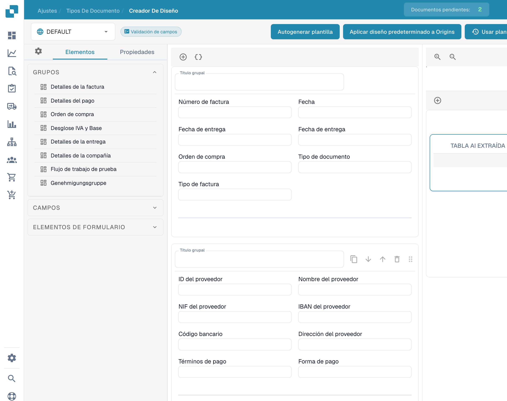

# Usar la vista previa del diseño

La vista previa del **Creador de diseño** permite revisar la disposición de grupos, campos y tablas de un diseño existente.

<figure><figcaption>
Vista previa de la plantilla en el editor de diseños.
</figcaption></figure>

Abra el tipo de documento y el diseño previstos. Use **Elementos** para consultar los grupos y controles disponibles. Seleccione un campo para abrir sus **Propiedades** y revisar etiquetas, anchos y visibilidad.

El selector de origen permite consultar el contexto configurado. Los nombres de origen permanecen sin traducir. El ejemplo muestra un diseño existente; no demuestra la creación de un diseño ni su aplicación a otros orígenes.

Guarde los cambios previstos y compruebe la vista de documento resultante.
