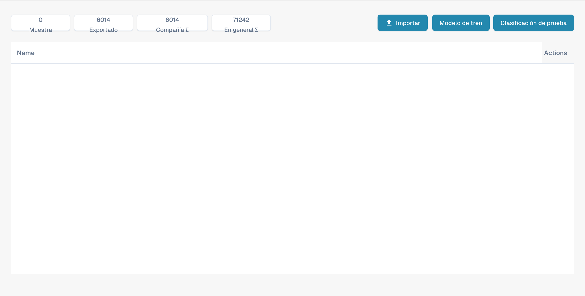

# Entrenamiento del modelo

El entrenamiento del modelo permite administrar muestras y comprobar la clasificación para cada tipo de documento. No es el editor de campos de extracción.

<figure><figcaption>
Resumen del entrenamiento del modelo en español.
</figcaption></figure>

## Contadores

La parte superior muestra las muestras, los documentos exportados y los contadores de la empresa y globales. Considere el ámbito del contador al interpretar los valores.

## Importar, entrenar y probar

* **Importar** permite incorporar muestras de entrenamiento.
* El botón mostrado como **Modelo de tren** inicia el entrenamiento del modelo. Esta traducción del producto es incorrecta; su función es entrenar, no seleccionar un modelo ferroviario.
* **Clasificación de prueba** permite comprobar la clasificación de documentos nuevos.

Las cabeceras **Nombre** y **Acciones** pueden seguir apareciendo en inglés. Esta vista no ofrece una acción para crear campos; use la configuración de campos del tipo de documento. Las capturas no demuestran un entrenamiento ejecutado ni resultados de una prueba de clasificación.
