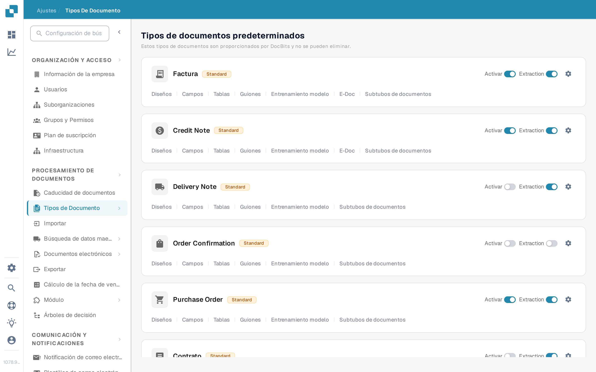
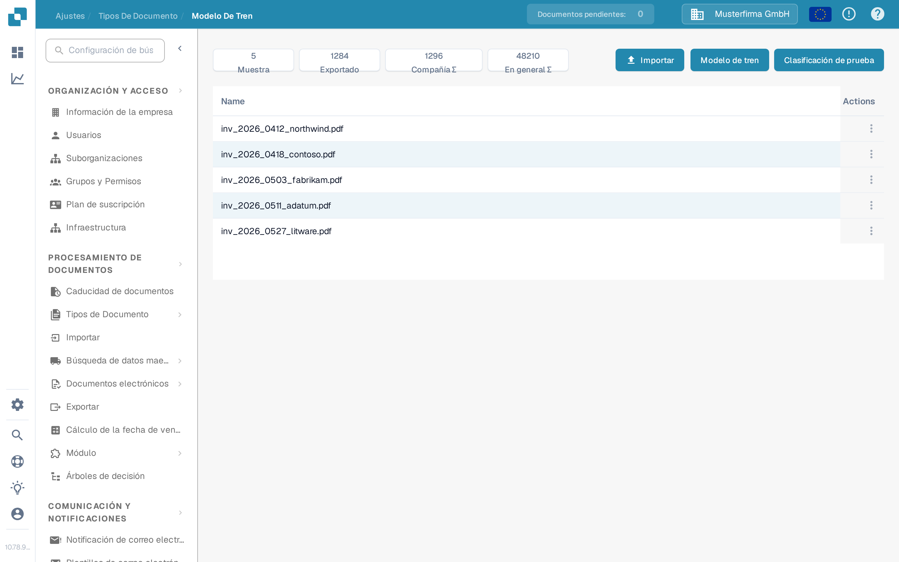
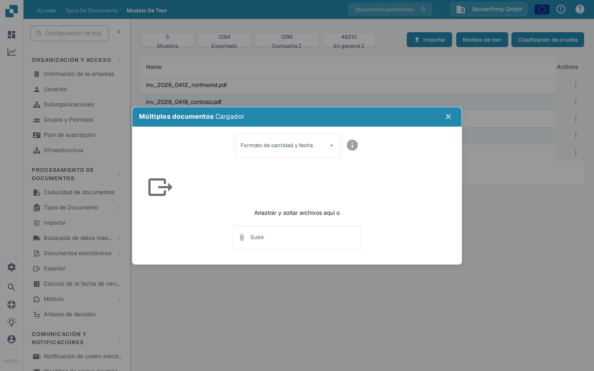
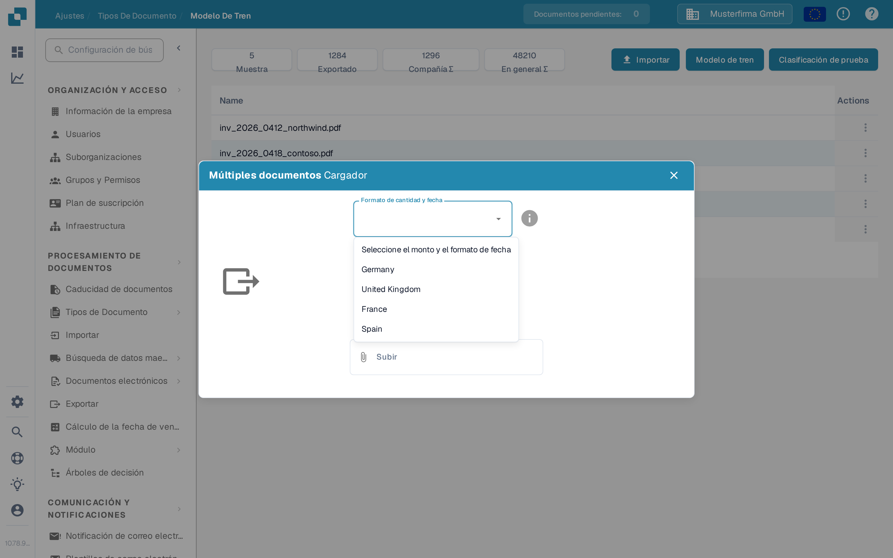
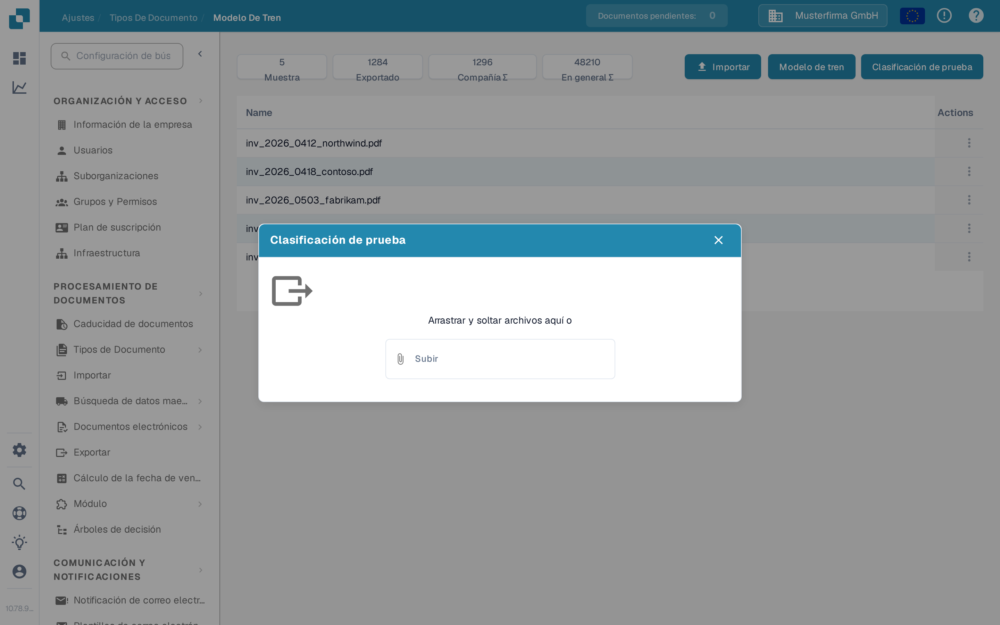

# Importar documentos de muestra para el entrenamiento del modelo

Use esta página para añadir PDFs de muestra a un tipo de documento y luego entrenar o probar su modelo de clasificación. Necesita acceso a **Ajustes** y **Tipos de Documento**. Para el propósito de las funciones de entrenamiento, consulte [Propósito y uso: Entrenamiento del Modelo](purpose-and-use-model-training.md).

## Abrir el tipo de documento

1. Vaya a **Ajustes → Tipos de Documento**.
2. Busque el tipo de documento que desea entrenar. En su fila, seleccione **Entrenamiento modelo**. El ejemplo siguiente usa **Factura**.

<figure><figcaption>
Abra Entrenamiento modelo desde el tipo de documento elegido.
</figcaption></figure>

Los demás controles de esta tarjeta tienen otro propósito: **Activar** habilita el tipo de documento, **Extraction** cambia su modo de extracción, el engranaje abre sus ajustes y los enlaces restantes abren otras áreas de configuración. No necesita cambiarlos solo para abrir el Entrenamiento del Modelo.

La página **Modelo de tren** muestra el número de muestras y una lista de los documentos de entrenamiento subidos. En la organización de ejemplo, la lista contiene cinco documentos; su organización puede mostrar otros documentos y cifras.

<figure><figcaption>
Las tres acciones están en la parte superior derecha de la lista de entrenamiento.
</figcaption></figure>

## Importar PDFs de muestra

1. Seleccione **Importar**.
2. Elija el **Formato de cantidad y fecha** que coincida con el documento de muestra. Por ejemplo, elija **Spain** para las convenciones españolas de número y fecha. Esta selección indica a DocBits cómo interpretar los valores del documento subido; no cambia el idioma de la aplicación.
3. Arrastre los archivos PDF al diálogo o use **Subir** para seleccionarlos. El importador actual de documentos de muestra acepta **archivos PDF**; rechaza otros tipos de archivo. Al seleccionar los archivos se inicia la subida.
4. Cierre el diálogo y compruebe que los documentos aparecen en la lista de entrenamiento. Si DocBits informa de un error de subida o de que un documento ya existe, corrija el archivo o elija otra muestra antes de continuar.

<figure><figcaption>
Elija un formato antes de seleccionar los PDFs de muestra.
</figcaption></figure>

<figure><figcaption>
Elija el formato del documento, no su idioma de interfaz preferido.
</figcaption></figure>

Para las acciones sobre las muestras importadas, consulte [Gestionar datos de entrenamiento](manage-training-data.md).

## Entrenar y comprobar el modelo

Cuando los PDFs de muestra previstos estén en la lista, seleccione **Modelo de tren**. DocBits puede procesar el entrenamiento en segundo plano; espere su mensaje de finalización antes de considerar el nuevo modelo como listo. El número de muestras y cualquier límite de plan que se muestren en esta página pertenecen a su organización.

Para comprobar la clasificación, seleccione **Clasificación de prueba** y suba un archivo de ejemplo aparte en el diálogo. Tras el procesamiento, DocBits indica si el tipo de documento previsto coincide con esta página y muestra los detalles de la clasificación. El diálogo de prueba vacío de abajo se muestra sin enviar ningún archivo.

<figure><figcaption>
Use Clasificación de prueba para comprobar el modelo con otro documento.
</figcaption></figure>

Para interpretar el resultado, consulte [Probar el modelo](testing-the-model.md). Si el resultado es pobre, revise los [datos de entrenamiento](manage-training-data.md) y la [guía de solución de problemas](troubleshooting.md) antes de añadir más muestras.
