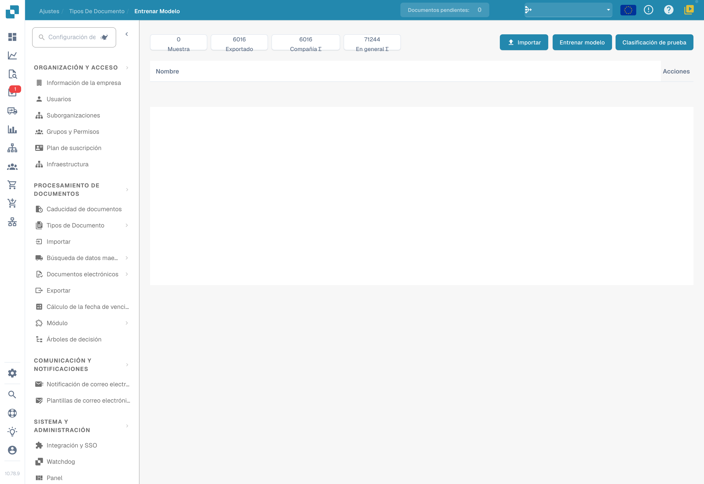
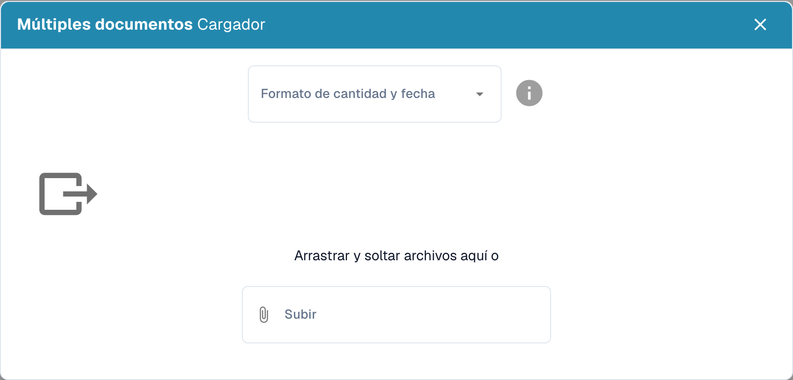

# Importar Datos: Entrenamiento del Modelo

Prepara documentos representativos de los formatos, idiomas y tipos que procesa la organización. Utiliza únicamente los formatos de archivo aceptados por tu instalación. Elimina duplicados y separa los documentos de entrenamiento de los reservados para la evaluación.

## Abrir la importación

En la configuración del tipo de documento correspondiente, abre el entrenamiento del modelo y selecciona la función de importación.

<figure><figcaption>
Vista general del entrenamiento del modelo: datos y acciones disponibles; no se inició ningún entrenamiento ni importación.
</figcaption></figure>

## Elegir formatos y archivos

Selecciona los formatos de números y fechas que correspondan a los archivos y, después, los documentos que vas a importar. Por ejemplo, `1.234,56` y `1,234.56` utilizan separadores diferentes. Una fecha como `05/06/2026` también debe interpretarse según el formato seleccionado.

<figure><figcaption>
Diálogo de importación para el entrenamiento del modelo, sin archivos seleccionados ni cargados. El título real «Múltiples documentos Cargador» tiene un orden de palabras incorrecto; corresponde al cargador de documentos.
</figcaption></figure>

Revisa la selección antes de iniciar la importación. Espera a que termine el procesamiento y comprueba los errores y el tipo de documento asignado. Corrige los errores de clasificación y extracción antes de utilizar los ejemplos para el entrenamiento.

## Entrenar y evaluar

Entrena el modelo con las funciones y los permisos disponibles en tu versión. Evalúa después el resultado con una muestra independiente. Añadir documentos no garantiza por sí solo una mayor exactitud. Consulta [Probar el modelo](testing-the-model.md).
