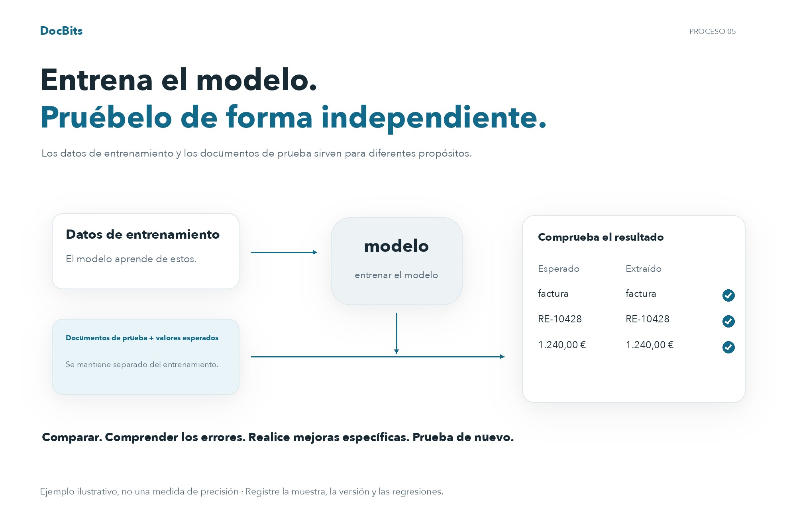

# Probando el modelo

## Evalúe con documentos de prueba independientes

<figure><picture><source srcset="../../../../../.gitbook/assets/intro-process-05-modelltest-es-dark-20261029.png" media="(prefers-color-scheme: dark)"></picture><figcaption>
Evalúe con documentos de prueba independientes
</figcaption></figure>

Los datos de entrenamiento y los documentos de prueba sirven para diferentes propósitos. Para documentos de prueba independientes, defina los tipos de documentos y valores de campo esperados y luego compárelos con las predicciones. Registre la versión del modelo, muestra, discrepancias y fallas técnicas. Realice mejoras específicas y repita la prueba con el mismo protocolo de evaluación. Los valores mostrados son un ejemplo, no una medida de precisión.

Realiza la prueba con documentos representativos que no se hayan utilizado para entrenar el modelo. Prepara las respuestas esperadas para cada documento: su tipo y, para evaluar la extracción, los valores de los campos.

## Ejecutar la prueba

1. Abre el entrenamiento del modelo para el tipo de documento que vas a evaluar.
2. Selecciona la prueba de clasificación, si tu versión ofrece esta función.
3. Selecciona la muestra e inicia la evaluación con las opciones disponibles.
4. Espera a que termine y registra los resultados y los errores. Un fallo técnico o una prueba incompleta no equivale a una clasificación correcta.

<figure><figcaption>
Vista general del entrenamiento del modelo: datos y acciones disponibles; no se inició ningún entrenamiento ni importación.
</figcaption></figure>

## Interpretar los resultados

Compara las predicciones con las respuestas esperadas y analiza los errores por tipo y formato. Si calculas exactitud, precisión, exhaustividad o puntuación F1, indica también el tamaño de la muestra y las categorías evaluadas. No atribuyas al producto métricas que tu versión no muestra; puedes calcularlas por separado a partir de los resultados exportados o registrados.

Las reglas de clasificación y extracción son configuraciones distintas del entrenamiento. Comprueba su efecto cuando intervengan en el procesamiento. No cambies una regla únicamente para ocultar un error de la muestra de prueba.

## Corregir y repetir

Corrige los datos de entrenamiento, las etiquetas o las configuraciones realmente disponibles en tu instalación y vuelve a entrenar el modelo si es necesario. Repite la prueba con el mismo protocolo y conserva una muestra independiente. Documenta la versión, los datos, los resultados y las regresiones. Un buen resultado en la muestra no garantiza el mismo rendimiento con todos los documentos futuros.
