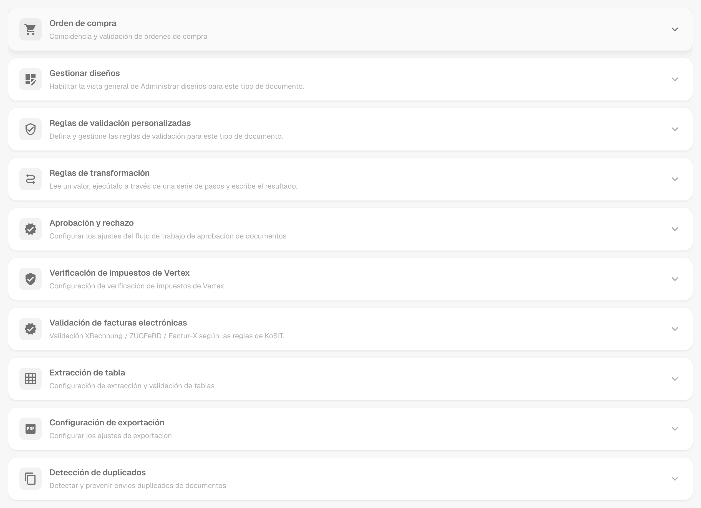
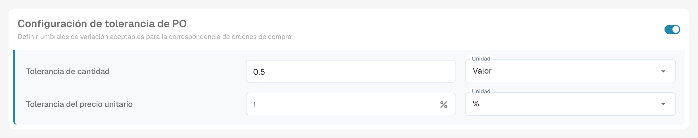
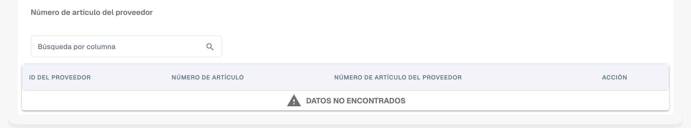
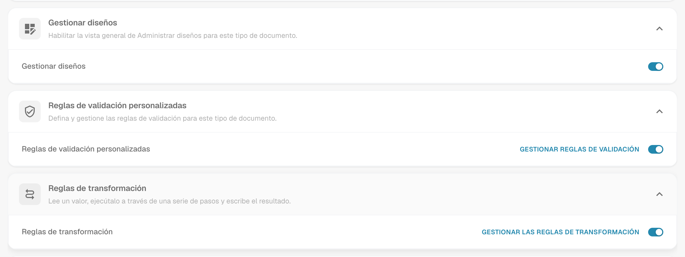
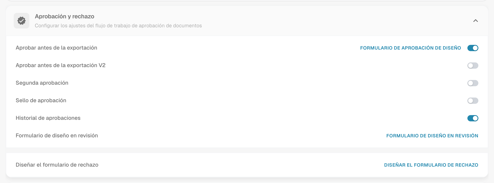
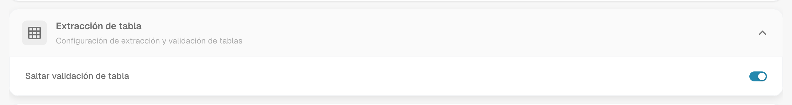
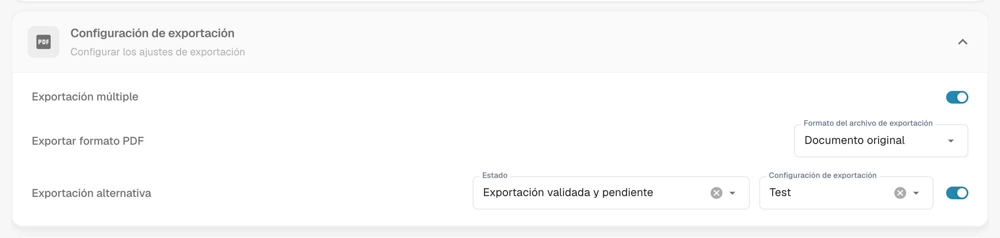
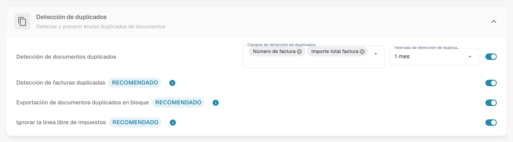

# Más ajustes

## Descripción general

**Más ajustes** contiene las opciones que pertenecen a un tipo de documento, por ejemplo la factura. Un ajuste que activas aquí se aplica solo a ese tipo de documento. La página se compone de tarjetas plegables, una por tema. Abre una tarjeta para ver sus ajustes.

<figure><figcaption>
Las tarjetas de la página Más ajustes, todas plegadas.
</figcaption></figure>

## Cómo acceder

1. Navega a **Ajustes** → **Ajustes globales** → **Tipos de documentos**.
2. Selecciona el tipo de documento y haz clic en **Más ajustes**.

La ruta de navegación en la parte superior de la página muestra **Ajustes / Tipos de documentos / Más ajustes**. El Asistente de configuración, a la derecha de la página, explica los ajustes de la tarjeta abierta.

| Tarjeta | Qué configuras ahí |
| ------- | ------------------ |
| Orden de compra | Coincidencia de OC, tolerancias, exportación de líneas de OC, números de artículo del proveedor |
| Gestionar diseños | Interruptor para la vista general de Gestionar diseños |
| Reglas de validación personalizadas | Tus propias reglas de validación para este tipo de documento |
| Reglas de transformación | Reglas que leen un valor, lo cambian en pasos y lo escriben de nuevo |
| Aprobación y rechazo | Flujo de aprobación y formularios en revisión y de rechazo |
| [Verificación de impuestos de Vertex](vertex-tax-verification.md) | Diseño del formulario para la verificación de impuestos de Vertex |
| Validación de facturas electrónicas | Validación de facturas XRechnung, ZUGFeRD y Factur-X |
| Extracción de tabla | Omitir la validación de las tablas extraídas |
| Configuración de exportación | Exportación múltiple, formato PDF, exportación alternativa |
| Detección de duplicados | Detectar y bloquear documentos duplicados |

## Orden de compra

La tarjeta **Orden de compra** (**Coincidencia y validación de órdenes de compra**) controla cómo se emparejan los documentos de este tipo con las órdenes de compra.

<figure><figcaption>
La tarjeta Orden de compra con sus opciones.
</figcaption></figure>

* [**Orden de compra**](purchase-order/purchase-order.md): Alterna si el documento se procesa en la pantalla de coincidencia de órdenes de compra. También puedes especificar sobre qué cantidad se basa la coincidencia.
* [**lado del servidor de coincidencia de PO**](purchase-order/purchase-order-matching-rules.md): Realiza la coincidencia con el conjunto de reglas configurable. **Configurar reglas de coincidencia de órdenes de compra** abre la [página de reglas](purchase-order/purchase-order-matching-rules.md).
* [**Tabla de órdenes de compra en el generador de diseños**](purchase-order/po-table-in-layout-builder.md): Permite la inclusión de tablas de órdenes de compra en el generador de diseños para diseños de documentos personalizados.
* [**Comprobación automática de actualizaciones de pedidos**](purchase-order/auto-check-for-po-updates.md): Muestra un indicador visual en la pantalla de coincidencia de órdenes de compra cuando se ha actualizado una orden de compra, e invita a los usuarios a actualizar.
* **Actualización automática de los datos del pedido**: Actualiza automáticamente los datos del pedido cuando hay nuevos datos disponibles. Este interruptor pertenece a **Comprobación automática de actualizaciones de pedidos**.
* [**Estado de la línea de pedido consumida**](purchase-order/consumed-po-line-status.md): Aplica codificación de colores a las líneas de la orden de compra en la pantalla de coincidencia.
* [**Calcular el precio unitario del pedido**](purchase-order/calculate-po-unit-price.md): Calcula el precio unitario del pedido utilizando el importe neto y la cantidad, en lugar de extraerlo.
* [**Exportar líneas de PO no coincidentes**](purchase-order/export-not-matched-po-lines.md): Cuando está desactivada, solo se exportan las líneas coincidentes. Cuando está activada, se exportan todas las líneas de la orden de compra, incluso si no coinciden.
* **Ignorar líneas ya coincidentes**: Omite las líneas que ya han coincidido durante un nuevo proceso de coincidencia.
* [**Actualizar el estado de la orden de compra del documento**](purchase-order/update-document-purchase-order-status.md): Actualiza la columna Estado de OC en el panel cada vez que cambia el estado de la orden de compra.
* [**Permitir exportación automática para líneas de orden de compra no coincidentes**, **Coincidencia automática y exportación visibles para** y **Utilice el importe neto de las líneas para el total coincidente visible en**](purchase-order/auto-match-and-export-options.md): Deciden quién ve los accesos directos de Auto Match & Export y qué documentos pueden exportarse automáticamente.

### Configuración de tolerancia de PO

<figure><figcaption>
Tolerancia para cantidad y precio unitario.
</figcaption></figure>

La [**Configuración de tolerancia de PO**](purchase-order/purchase-order-tolerance-settings-additional-purchase-order-tolerance.md) te permite establecer niveles de tolerancia para cantidad y precio unitario, de modo que las discrepancias menores no se marquen como desajustes. Para cada valor eliges el importe y la unidad: un **Valor** absoluto o un porcentaje (**%**). El bloque también contiene la [**Configuración de tolerancia de PO adicional**](purchase-order/purchase-order-tolerance-settings-additional-purchase-order-tolerance.md#ajuste-para-configurar-la-ajuste-adicional-de-tolerancia-de-ordenes-de-compra) para fletes, cargos e impuestos, y [**PO desactivar estados**](purchase-order/purchase-order-disable-statuses.md).


Cuando el atributo del tipo de documento `CUSTOM_RANGE_FOR_PO_TOLERANCE` está activado, las tolerancias de precio unitario y de cantidad proceden de estos ajustes del tipo de documento y no del conjunto de reglas. El diagrama de reglas de la [página de reglas de coincidencia de OC](purchase-order/purchase-order-matching-rules.md) muestra una nota cuando es el caso.


### Número de artículo del proveedor

<figure><figcaption>
El mapa de números de artículo del proveedor.
</figcaption></figure>

El [**Número de artículo del proveedor**](purchase-order/supplier-item-number-map-admin-documentation.md) mapea los números de artículo del proveedor a tus números de artículo internos, de modo que las líneas coincidan incluso cuando el proveedor usa sus propios números. Busca por columna para encontrar una entrada.

## Gestionar diseños, Reglas de validación personalizadas y Reglas de transformación

Tres tarjetas se encuentran directamente debajo de la tarjeta Orden de compra:

* **Gestionar diseños** activa la vista general de Gestionar diseños para este tipo de documento. Consulta el [Gestor de Diseño](../layout-manager/README.md).
* **Reglas de validación personalizadas** activa tus propias reglas de validación. **Gestionar reglas de validación** las abre. Consulta [Reglas de validación personalizadas](../custom-validation-rules.md).
* **Reglas de transformación** activa las reglas de transformación. **Gestionar las reglas de transformación** las abre. Consulta [Reglas de transformación](../transformation-rules.md).

<figure><figcaption>
Las tres tarjetas con sus interruptores.
</figcaption></figure>

## Aprobación y rechazo

La tarjeta **Aprobación y rechazo** contiene el flujo de aprobación y los formularios que ven los usuarios cuando revisan o rechazan un documento.

<figure><figcaption>
La tarjeta Aprobación &#x26; rechazo.
</figcaption></figure>

* **Aprobar antes de la exportación**: Los documentos deben aprobarse antes de poder exportarse. **Formulario de aprobación de diseño** abre el **Creador de diseño** para la pantalla de aprobación.
* **Aprobar antes de la exportación V2**: Activa la Aprobación V2, que admite campos dinámicos en lugar de estáticos.
* **Segunda aprobación**: Agrega una capa adicional de aprobación.
* [**Sello de aprobación**](approval/approval-stamp.md): Agrega un sello al documento cuando se aprueba.
* [**Historial de aprobaciones**](approval/approval-history.md): Muestra el historial de aprobaciones en la pantalla de aprobación y en la validación de campos.
* **Formulario de diseño en revisión**: Configura el diseño del formulario de revisión con el **Creador de diseño**.
* **Diseñar el formulario de rechazo**: Configura el diseño del formulario de rechazo con el **Creador de diseño**.

Para el **Creador de diseño**, consulta el [Gestor de Diseño](../layout-manager/README.md).

## Verificación de impuestos de Vertex

La tarjeta **Verificación de impuestos de Vertex** contiene **Verificación de impuestos de Design Vertex**. Abre el Creador de diseño para el formulario que ven los usuarios cuando DocBits compara el impuesto del proveedor con el impuesto calculado por Vertex. Consulta [Verificación de impuestos de Vertex](vertex-tax-verification.md) para la integración, la tolerancia y el resultado.

## Validación de facturas electrónicas

La tarjeta **Validación de facturas electrónicas** activa la validación de las facturas electrónicas entrantes y te permite decidir si se notifica al proveedor cuando se rechaza una factura. Consulta [Validación de facturas electrónicas](../../../document-processing/e-documents/validation-rules.md).

## Extracción de tabla

<figure><figcaption>
La tarjeta Extracción de tabla.
</figcaption></figure>

* **Saltar validación de tabla**: Permite omitir el proceso de validación estándar de los datos de la tabla. Úsalo cuando se requiera un manejo de datos flexible o cuando ciertos pasos de validación puedan omitirse para mejorar el rendimiento.

## Configuración de exportación

<figure><figcaption>
La tarjeta Configuración de exportación.
</figcaption></figure>

* **Exportación múltiple**: Permite exportar un documento más de una vez.
* **Exportar formato PDF**: **Formato del archivo de exportación** define el formato PDF que se usa al exportar documentos, por ejemplo **Documento original**.
* [**Exportación alternativa**](purchase-order/alternate-export.md): Configura una exportación alternativa para un estado de documento elegido. Elige el **Estado** y la **Configuración de exportación** que se ejecuta para él, y luego activa el ajuste.

## Detección de duplicados

<figure><figcaption>
La tarjeta Detección de duplicados.
</figcaption></figure>

La tarjeta contiene **Detección de documentos duplicados** con los campos que deciden qué se considera un duplicado y el intervalo en el que se comparan los documentos, además de las opciones **Detección de facturas duplicadas**, **Exportación de documentos duplicados en bloque** e **Ignorar la línea libre de impuestos**. Las tres llevan una etiqueta **Recomendado**. Consulta [Detección de duplicados](duplicate-document-handling.md) para saber cómo se trata un documento marcado.
