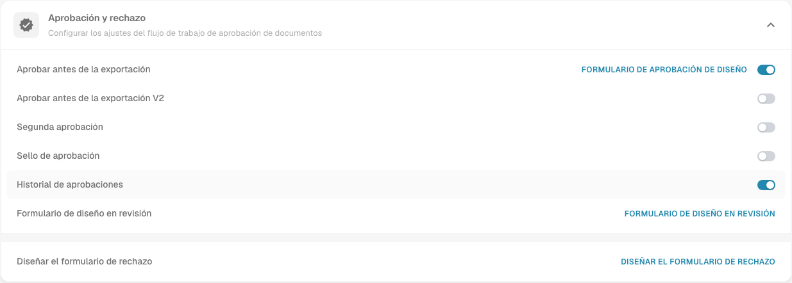

# Aprobación

Use las opciones de aprobación para decidir cómo se verifica un documento antes de salir de DocBits. Las opciones se configuran para cada tipo de documento, así que empiece por el tipo que usa su equipo, por ejemplo **Factura**.

1. Abra **Ajustes** → **Tipos de Documento**.
2. Seleccione el **icono de engranaje** de la tarjeta del tipo de documento para abrir **Más ajustes**.
3. Desplácese hasta **Aprobación y rechazo**. Revise las cuatro opciones principales y, si aparece, la opción adicional V2 antes de cambiar cualquier ajuste.

<figure><figcaption>
Vista nativa de Dev en español para Factura, con ajustes observados sin cambios: Aprobar antes de la exportación e Historial de aprobaciones están activados; V2, Segunda aprobación y Sello de aprobación están desactivados. Este estado observado no indica valores predeterminados ni una configuración recomendada.
</figcaption></figure>

| Opción | Para qué sirve |
| --- | --- |
| **Aprobar antes de la exportación** | Exigir una decisión de aprobación antes de exportar el documento. Cuando esta opción está activada, también se muestra **Aprobar antes de la exportación V2**. |
| **Segunda aprobación** | Añadir otro paso de aprobación cuando una decisión no basta para su proceso. |
| **Sello de aprobación** | Añadir una marca de aprobación a un documento aprobado. Vea [Sello de aprobación](approval-stamp.md) para la configuración y las opciones de descarga. |
| **Historial de aprobaciones** | Guardar un registro de las decisiones de aprobación. Vea [Historial de aprobaciones](approval-history.md) para el ajuste y cómo consultar el historial. |

Elija las opciones que exija su propio proceso. Luego use un documento de prueba que no sea de un cliente y los roles de revisor previstos para comprobar el flujo de aprobación antes de aplicarlo a documentos reales. La captura muestra los ajustes disponibles; no se realizó ningún flujo de aprobación ni exportación durante esta verificación de la documentación.
