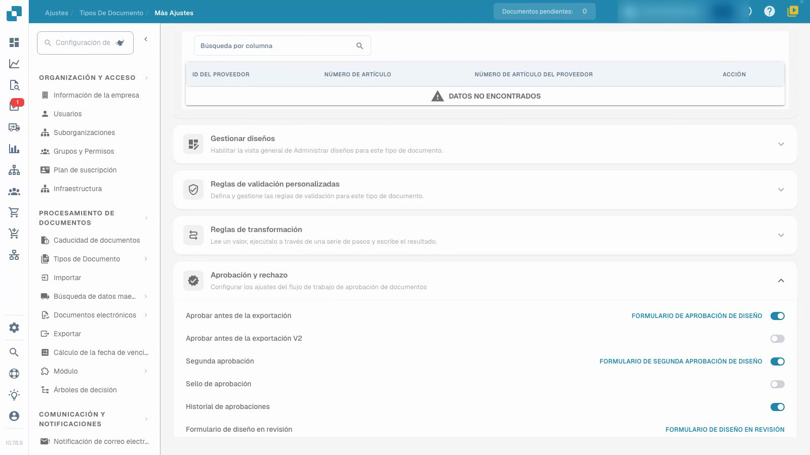
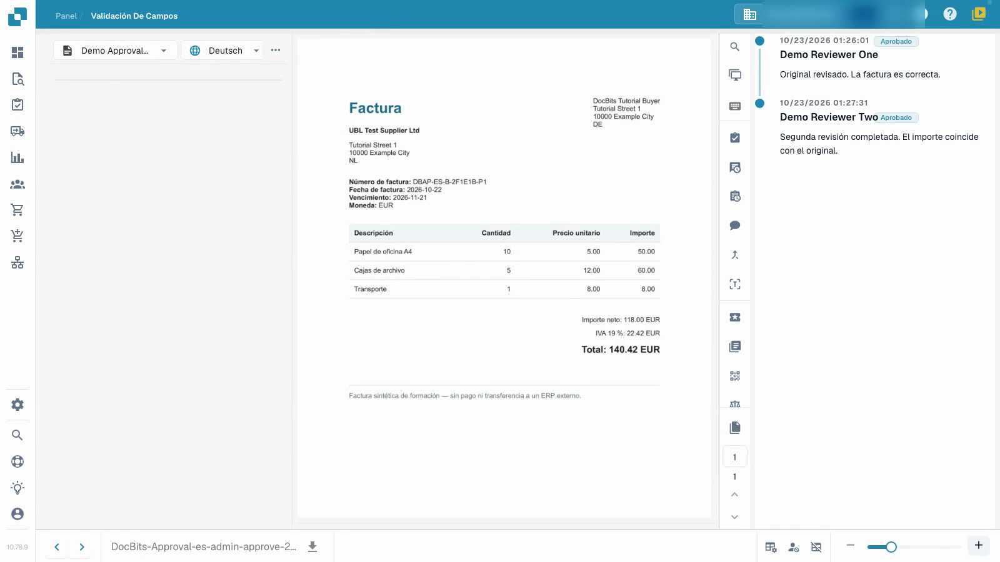

# Configurar y probar aprobaciones de facturas

Este video muestra la configuración y prueba de aprobaciones.


Configurar y probar aprobaciones de facturas


[Ver video con subtítulos](https://docbits-videos.fra1.cdn.digitaloceanspaces.com/settings-assistant/invoice-approval-admin/v1/es.html)

Se muestra la aplicación real. Los nombres de las opciones pueden variar según la versión utilizada.

Configure la aprobación para el tipo de documento utilizado por su proceso. Identifique a los revisores previstos y decida si necesita una segunda revisión independiente. El video utiliza un tipo de prueba separado, facturas sintéticas y cuentas temporales de revisión sin permisos de administración; su presentador es ficticio.

## Configurar el tipo de documento

Abra **Ajustes → Tipos de Documento**, seleccione el tipo previsto y abra **Más ajustes → Aprobación y rechazo**. Elija las configuraciones que necesita su proceso, luego vuelva a cargar la página para verificar qué se guardó.

| Configuración | Propósito |
| --- | --- |
| Aprobar antes de la exportación | Requerir una decisión de aprobación antes de que el documento proceda a la exportación. |
| Segunda aprobación | Agregar una segunda etapa de aprobación al proceso configurado. |
| Historial de aprobaciones | Mantener las decisiones registradas disponibles para su revisión. |
| Sello de aprobación | Configurar una marca en un documento aprobado; consulte la guía de sellos separada. |

La opción V2 adicional y los editores de formularios son configuraciones separadas. Este tutorial utiliza formularios de aprobación estándar preparados.

## Probar con los roles previstos

1. Asigne al primer y segundo revisor grupos separados y el acceso previsto al documento asignado. En este ejemplo, la primera cuenta tiene permiso de aprobación de primera etapa y la segunda cuenta tiene permiso de segunda etapa. Un interruptor por sí solo no asigna a una persona ni otorga ese permiso.
2. Utilice la primera cuenta normal de revisión para verificar la factura asignada y ya validada, agregue una nota y otorgue la primera aprobación. Verifique que el documento guardado aún espera la segunda aprobación. Compruebe que esta cuenta no puede realizar la segunda etapa cuando sus permisos lo prohíben.
3. Asigne la factura en espera al otro revisor autorizado. Utilice esa segunda cuenta normal de revisión para verificarla y otorgar la segunda aprobación con una nota separada.
4. Vuelva a abrir el historial y verifique ambos revisores diferentes, horas y notas. También rechace una factura de prueba separada con un motivo y verifique esa decisión después de volver a cargar.

<figure><figcaption>
Configuraciones de aprobación guardadas en el propio tipo de prueba.
</figcaption></figure>

<figure><figcaption>
Dos revisores diferentes y ambas notas guardadas.
</figcaption></figure>

## Verificar el resultado

Mantenga la primera aprobación, la segunda aprobación pendiente y el rechazo como resultados diferentes. Confirme que los valores de la factura permanecen sin cambios tras cada decisión. En este ejemplo, el canal de prueba espera la recuperación de los datos y no tiene un ERP externo como destino. El estado técnico `pending_data_fetch`, cuando se muestra, significa esperar la recuperación de datos. El historial de aprobación por sí solo no prueba una transferencia ERP.

Pruebe los roles configurados, la asignación y la ruta de decisión completa antes de aplicar el proceso a documentos reales.

## Páginas relacionadas

- [Grupos, usuarios y permisos](../../../groups-users-and-permissions/README.md)
- [Historial de aprobación](approval-history.md)
- [Sello de aprobación](approval-stamp.md)
