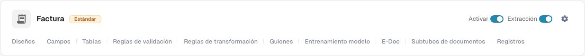
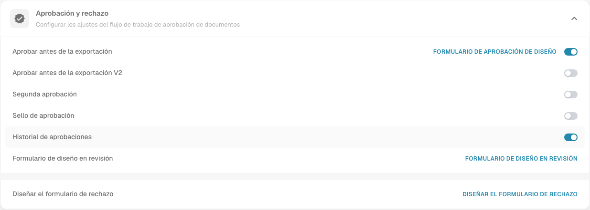

# Historial de aprobaciones

El **Historial de aprobaciones** permite revisar las decisiones del flujo de aprobación de un documento. La versión anterior de esta página enlazaba una ruta antigua de **Ajustes generales** y mostraba tres imágenes de una interfaz más antigua sin explicar los controles. Use la configuración actual de tipos de documento para activar la opción y verifique el resultado con una aprobación de prueba en su propia organización.

## Activar la opción para un tipo de documento

1. Con una cuenta de administrador, abra **Ajustes** → **Tipos de Documento**. Busque el tipo de documento, por ejemplo **Factura**, y seleccione su **icono de engranaje** para abrir **Más ajustes**. Los enlaces **Diseños** y **Campos** de la tarjeta llevan a otros editores.

   <figure><figcaption>
Abra «Más ajustes» en el tipo de documento cuyo flujo de aprobación desea revisar.
</figcaption></figure>

2. Despliegue **Aprobación y rechazo** y busque **Historial de aprobaciones**. Este ajuste se configura por separado de **Aprobar antes de la exportación**, **Segunda aprobación** y **Sello de aprobación**. La captura nativa en español muestra el tipo de documento **Factura**: **Aprobar antes de la exportación** e **Historial de aprobaciones** ya estaban **activados**; **Aprobar antes de la exportación V2**, **Segunda aprobación** y **Sello de aprobación** estaban **desactivados**. Estos estados se observaron sin cambiar los ajustes y no indican valores predeterminados ni una configuración recomendada.

   <figure><figcaption>
Compruebe el interruptor «Historial de aprobaciones» del tipo de documento seleccionado.
</figcaption></figure>

3. Active **Historial de aprobaciones** solo después de confirmar el flujo de aprobación previsto y quién puede ver sus decisiones. Anote el ajuste previo para poder compararlo con la prueba.

## Verificar con un documento de prueba

Use un documento de prueba del tipo configurado que entre realmente en el flujo de aprobación. Pida a un usuario de prueba autorizado que lo apruebe o lo rechace, abra después la vista de aprobación de ese documento y revise el historial disponible. Compare la decisión, el usuario, la hora y cualquier comentario introducido con la acción que realizó. En un flujo con más de un aprobador, compruebe la secuencia tras cada decisión. Si no se ve ningún historial, revise el tipo de documento, el estado del flujo, el interruptor y los permisos de visualización antes de tratarlo como un error de documentación o del producto.

Las dos capturas nativas de Dev muestran la ruta de configuración actual y los ajustes visibles. Para estas capturas no se aprobó ni rechazó ningún documento y no se realizó ninguna exportación. La vista del historial todavía necesita un documento de prueba con actividad de aprobación; un interruptor activado no demuestra por sí solo que ya exista un historial.
