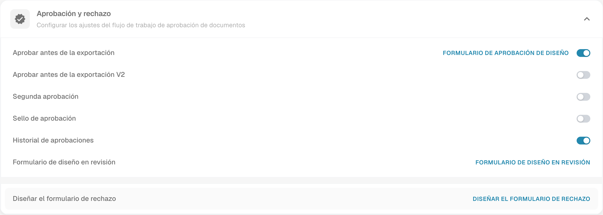

# Historial de aprobaciones

El historial permite revisar decisiones de aprobación y rechazo registradas para un documento. Los datos disponibles dependen del procesamiento previo y de sus permisos.

## Encontrar el ajuste

1. Abra **Ajustes → Tipos de Documento**.
2. Abra el engranaje del tipo correspondiente.
3. Despliegue **Aprobación y rechazo** y revise **Historial de aprobaciones**. Modifique la configuración únicamente si lo requiere su flujo.

<figure><figcaption>
Configuración actual de Aprobación y rechazo con Historial de aprobaciones. Se muestra el estado encontrado; no se cambió ninguna opción ni se ejecutó una decisión de aprobación.
</figcaption></figure>

## Revisar las decisiones

Abra el documento y el historial que ofrezca la interfaz, si está disponible. Revise la decisión, la persona que la registró, el momento y el orden. Los comentarios pueden aportar razones adicionales cuando se hayan registrado.

Evalúe el texto de la decisión y no únicamente su color. Un historial vacío no acredita una aprobación. La imagen muestra la configuración; para esta guía no se aprobó o rechazó ningún documento ni se creó un historial de decisiones.
