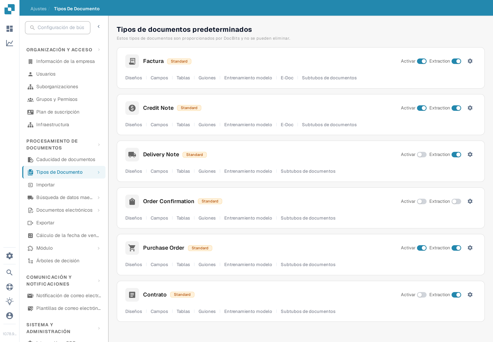
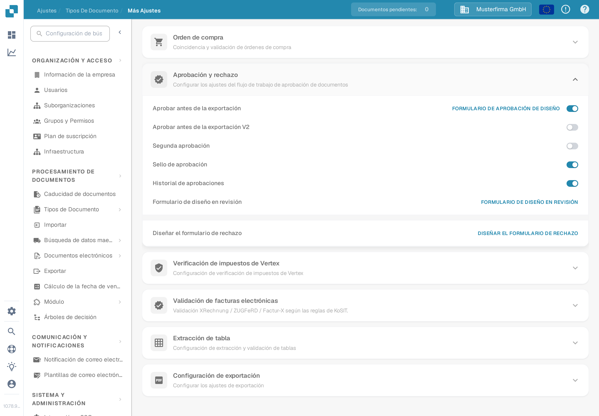

# Sello de aprobación

El sello de aprobación es una anotación que se añade durante la aprobación de un documento cuando la opción está habilitada para ese tipo de documento. Es útil cuando un revisor necesita ver quién aprobó un documento y cuándo. La página anterior mostraba seis capturas de pantalla de una interfaz antigua y daba por verificados conjuntamente el sello, la exportación a IDM y las opciones de descarga de PDF. Comprueba cada resultado en tu propio flujo de trabajo antes de confiar en él.

## Encontrar la opción

1. Con una cuenta de administrador, abre **Ajustes → Tipos de Documento**. Busca el tipo que quieres configurar, por ejemplo **Factura**, y selecciona el **icono de engranaje** de esa tarjeta. El engranaje abre **Más Ajustes** para ese tipo de documento; **Diseños** y **Campos** abren editores diferentes.

   <figure><figcaption>
Abre el engranaje del tipo de documento correspondiente.
</figcaption></figure>

2. En **Más Ajustes**, expande **Aprobación y rechazo**. Localiza el interruptor **Sello de aprobación** junto a **Aprobar antes de la exportación**, **Segunda aprobación** e **Historial de aprobaciones**. La captura muestra la organización sintética **DocBits Documentation Test A** con el sello **desactivado**. No muestra un documento sellado.

   <figure><figcaption>
Comprueba el ajuste de Sello de aprobación del tipo de documento seleccionado.
</figcaption></figure>

3. Activa el interruptor solo después de acordar cómo funcionan las aprobaciones y las exportaciones en tu organización. Guarda un registro del ajuste anterior para poder verificar su efecto en una factura de prueba.

## Verificar una aprobación

Envía una factura sintética de este tipo de documento por el flujo de aprobación configurado. En la pantalla **Lista para aprobación**, apruébala con una cuenta de prueba autorizada. El cliente web actual de DocBits comprueba la opción Sello de aprobación durante la aprobación y añade una anotación de sello con el nombre del aprobador y la fecha. Vuelve a abrir el documento aprobado e inspecciona la anotación y el PDF descargado que usa realmente tu flujo de trabajo. Si el sello no aparece, revisa el tipo de documento, el estado de aprobación, el ajuste y la configuración de exportación.

El sello de aprobación es independiente de **Segunda aprobación** e **Historial de aprobaciones**. Activar uno no demuestra que los demás estén configurados. Las acciones de descarga disponibles en el Panel y el formato de exportación a IDM dependen del entorno y no se verificaron para esta página, por lo que esta guía no promete etiquetas concretas en el menú de descarga ni salida automática a IDM.

Las dos nuevas capturas de pantalla se comprobaron visualmente en la Test A Sandbox en español. No se cambió ningún interruptor y no se aprobó ni exportó ningún documento durante esta comprobación; el estado final sellado necesita una factura sintética aprobada específica.

## Achados de traducción de la aplicación

Estos términos aparecen así en la interfaz en español (Sandbox 10.78.9) y se citan literalmente; los documentos no los corrigen:

- La categoría de menú se muestra como «Tipos De Documento» (con «De» en mayúscula) en la ruta de navegación y como «Tipos de Documento» en el menú lateral.
- La sección de ajustes se muestra como «Aprobación y rechazo»; el interruptor se llama «Sello de aprobación».
- «Historial de aprobaciones» es la traducción literal de Approval History.
