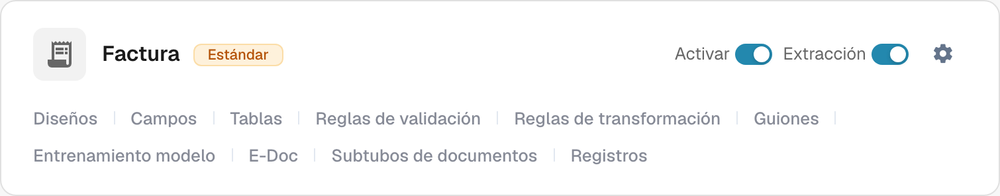
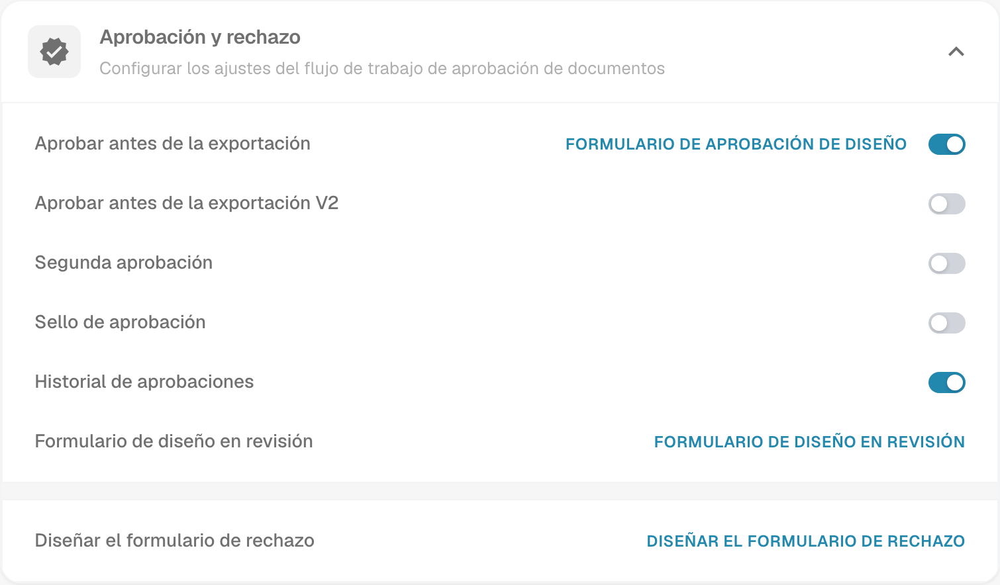

# Sello de aprobación

El sello de aprobación es una anotación del flujo de aprobación cuando la opción está habilitada para ese tipo de documento. Ayuda al revisor a comprobar quién aprobó un documento y cuándo. Verifica la anotación y el resultado del PDF con una factura de prueba en el flujo de trabajo que utiliza tu organización.

## Encontrar la opción

1. Con una cuenta de administrador, abre **Tipos de Documento** en los ajustes de administración. Busca el tipo que quieres configurar, por ejemplo **Factura**, y selecciona el **icono de engranaje** de esa tarjeta. El engranaje abre **Más ajustes** para ese tipo de documento.

   <figure><figcaption>
Tarjeta real de Factura en Dev en español. El engranaje abre Más ajustes; no se modificó ningún control.
</figcaption></figure>

   **Activar** controla la disponibilidad del tipo de documento y **Extracción** ajusta su modo de extracción. Los enlaces al pie de la tarjeta abren áreas independientes: **Diseños**, **Campos**, **Tablas**, **Reglas de validación**, **Reglas de transformación**, **Guiones**, **Entrenamiento modelo**, **E-Doc**, **Subtipos de documentos** y **Registros**. Los enlaces disponibles dependen de los módulos y ajustes del tipo. Para localizar el sello, utiliza el engranaje.

2. En **Más ajustes**, expande **Aprobación y rechazo**. Localiza **Sello de aprobación** junto a **Aprobar antes de la exportación**, **Segunda aprobación** e **Historial de aprobaciones**. La imagen muestra el ajuste existente del sello **desactivado**; en tu organización puede tener otro estado. No muestra un documento aprobado.

   <figure><figcaption>
Vista real de Aprobación y rechazo en Dev en español. Los estados de los controles solo se consultaron.
</figcaption></figure>

   **Aprobar antes de la exportación**, **Aprobar antes de la exportación V2**, **Segunda aprobación** e **Historial de aprobaciones** son ajustes del flujo separados del sello. Los enlaces de diseño abren los editores de los formularios de aprobación, revisión o rechazo correspondientes. No es necesario abrir estos editores para consultar el ajuste del sello.

3. Cambia **Sello de aprobación** solo después de acordar cómo funcionan las aprobaciones y exportaciones en tu organización. **El cambio del interruptor guarda el ajuste inmediatamente.** Guarda un registro del estado anterior para poder verificar su efecto en una factura de prueba.

## Verificar una aprobación

Envía una factura sintética de este tipo de documento por el flujo de aprobación configurado. En el paso de aprobación de ese flujo, apruébala con una cuenta de prueba autorizada. Vuelve a abrir el documento aprobado y comprueba que la anotación contiene el nombre y la fecha esperados. Inspecciona también el PDF descargado que usa realmente tu flujo de trabajo. Si el sello no aparece, revisa el tipo de documento, el estado de aprobación, el ajuste y la configuración de exportación.

El sello de aprobación es independiente de **Segunda aprobación** e **Historial de aprobaciones**. Activar uno no demuestra que los demás estén configurados. Las acciones de descarga disponibles en el panel y el formato de exportación a IDM dependen del entorno y no se verificaron para esta página, por lo que esta guía no promete etiquetas concretas en el menú de descarga ni salida automática a IDM.

Las dos capturas muestran vistas reales de Dev en español. No se cambió ningún interruptor ni se aprobó o exportó ningún documento durante esta comprobación. El resultado final con sello necesita una factura sintética aprobada dedicada a la prueba.

## Observaciones sobre la traducción de la aplicación 

En la interfaz Dev consultada, los términos son **Tipos de Documento**, **Más ajustes**, **Aprobación y rechazo**, **Sello de aprobación** e **Historial de aprobaciones**. Se citan tal como aparecen en la interfaz española actual. Los enlaces **Guiones** y **Entrenamiento modelo** corresponden a las áreas de scripts y entrenamiento de modelos; no es necesario abrirlos para consultar el sello.
