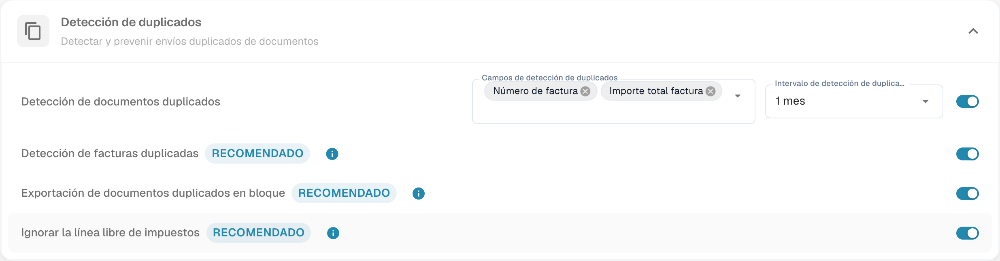
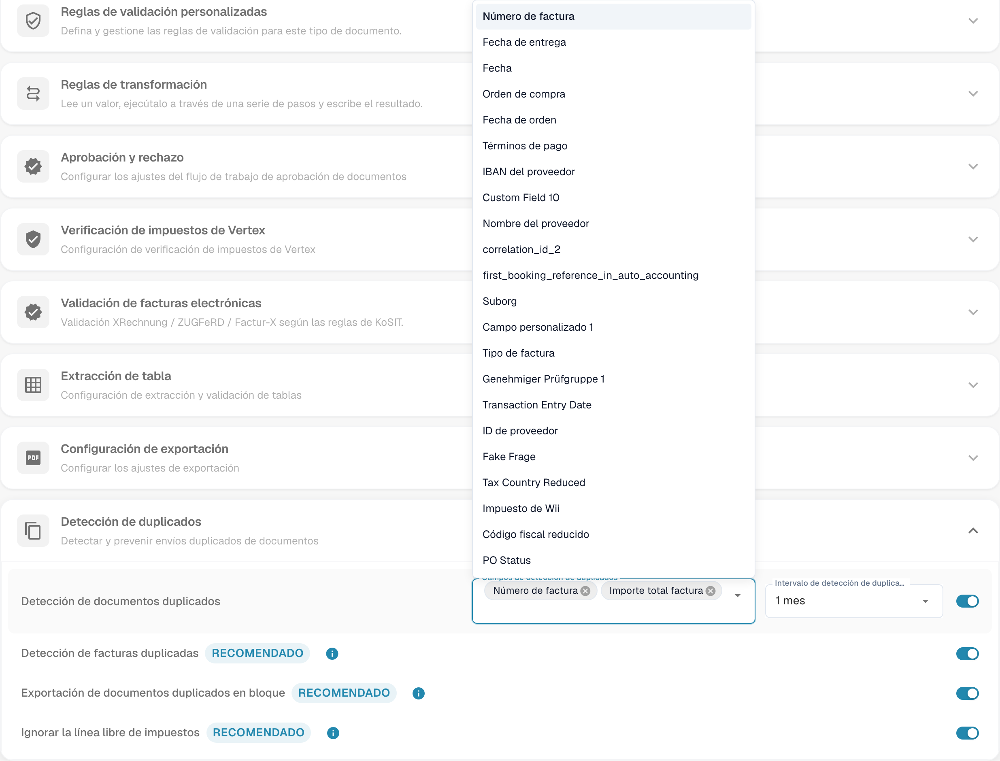

# Detección de duplicados

## Resumen

En **DocBits**, puedes filtrar documentos duplicados especificando qué campos deben coincidir y definiendo un intervalo de tiempo durante el cual se deben detectar duplicados.

Esta página proporciona una guía detallada sobre cómo habilitar y utilizar la función de **Detección de duplicados** de manera efectiva.

## Habilitar la Detección de duplicados

Para habilitar la detección de documentos duplicados en **DocBits**, sigue estos pasos:

1.  Navega a **Ajustes** → **Ajustes globales** → **Tipos de documentos**.

    
2.  Selecciona el **Tipo de documento** deseado y haz clic en **Más ajustes**.

    
3.  Ve a la sección de **Detección de duplicados**.

<figure><figcaption>
Configuración de detección de documentos duplicados.
</figcaption></figure>

DocBits proporciona dos opciones para identificar documentos duplicados:

1. **Detección de documentos duplicados**:\
   Esta función verifica si hay documentos duplicados subidos a **DocBits** según los criterios seleccionados. Si algún documento coincide con los criterios seleccionados en otros documentos, se marcará como duplicado.
2.  **Detección de facturas duplicadas** (Solo disponible para el tipo de documento **Factura**):\
    Esta función requiere sincronizar las facturas de proveedores desde Infor a DocBits. Compara los números de factura en el panel de DocBits con los de Infor. Si el mismo número de factura aparece más de una vez, se marcará como duplicado.

    <mark style="color:red;">**Nota**</mark>: Utilizar la función de **Detección de facturas duplicadas** resultará en un cargo adicional de crédito.

## Filtrar qué documentos deben ser detectados como duplicados

Una vez que la **Detección de duplicados** está habilitada, estarán disponibles dos menús desplegables para la configuración:

*   **Campos de detección de duplicados**\
    Selecciona los campos que deben utilizarse para identificar duplicados (por ejemplo, Identificación del proveedor, Fecha, Número de factura, etc.). Los documentos que coincidan con estos campos se marcarán como duplicados.

<figure><figcaption>
Campos disponibles para detectar documentos duplicados.
</figcaption></figure>

*   **Intervalo de detección de duplicados**

    Utiliza esta configuración para definir el rango de tiempo dentro del cual se detectan duplicados. Los documentos subidos dentro del intervalo seleccionado se compararán entre sí según los campos seleccionados.

    **Opciones disponibles:**

    * 1 mes
    * 3 meses (Recomendado)
    * 6 meses
    * 1 año

    <mark style="color:red;">**Nota**</mark>: Se recomienda un intervalo de 3 meses para asegurar un rendimiento óptimo. Seleccionar un intervalo más largo puede llevar a tiempos de carga más lentos en el panel.

    

## Ver documentos duplicados en el Panel

Una vez que la **Detección de duplicados** está habilitada, cualquier documento identificado como duplicado mostrará un ícono de indicador de duplicado en el panel.

*   Haz clic en este ícono para abrir los registros coincidentes en una vista de pantalla dividida para una fácil comparación.\
    <mark style="color:red;">**Nota**</mark>: El ícono solo aparecerá si se ha detectado al menos un duplicado para el documento.

*   Al ver un documento marcado, aparecerá una barra de advertencia en la parte superior, indicando que el documento es un duplicado.

    

Para revisar posibles duplicados, compare número de factura, proveedor, fecha e importe. Use el aviso de duplicado y los datos del documento para decidir qué necesita corregirse.
