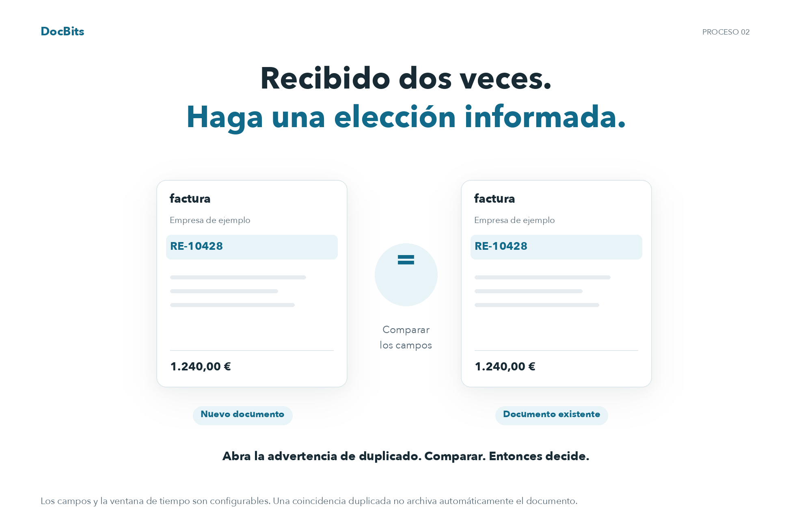
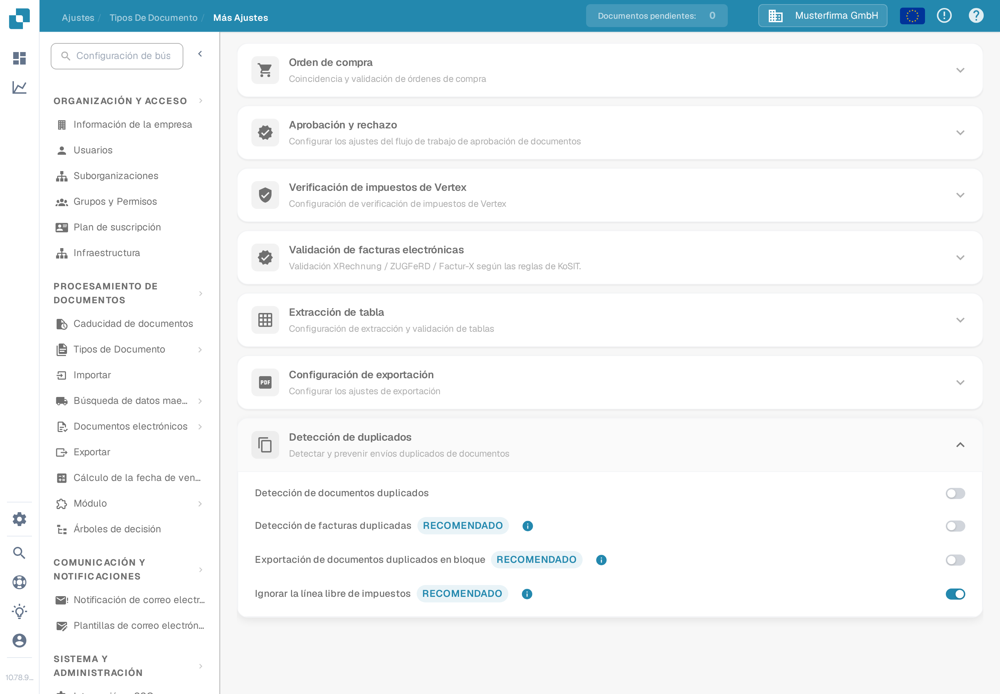
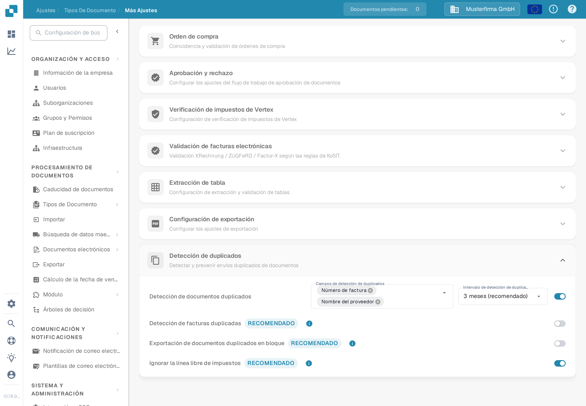
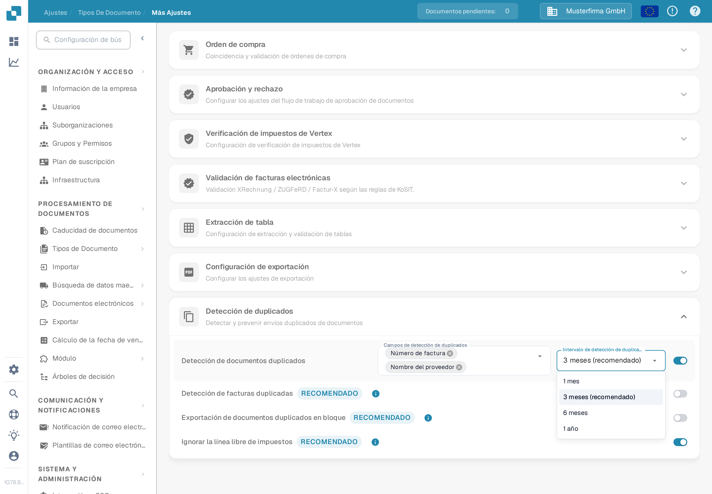

# Detección de duplicados

## Detecta duplicados y toma una decisión informada

<figure><picture><source srcset="../../../../../.gitbook/assets/intro-process-02-dubletten-es-dark-20261029.png" media="(prefers-color-scheme: dark)"></picture><figcaption>
Detecta duplicados y toma una decisión informada
</figcaption></figure>

DocBits compara los campos configurados dentro de la ventana de tiempo seleccionada. Cuando encuentre una coincidencia, abra la advertencia de duplicado y compare los documentos antes de continuar o archivar. El bloqueo de exportaciones duplicadas es una configuración separada; una coincidencia no archiva automáticamente un documento.

Use la **Detección de duplicados** para marcar documentos que coincidan con otro documento en los campos seleccionados dentro de un intervalo de tiempo elegido. Las opciones pertenecen a cada tipo de documento.

## Abrir los ajustes

1. Abra **Ajustes → Tipos de Documento**.
2. En el tipo de documento que desee configurar, seleccione **Ajustes**.
3. En **Más Ajustes**, abra **Detección de duplicados**.

<figure><figcaption>
Los ajustes de Factura muestran cuatro interruptores independientes. Los selectores de campos e intervalo aparecen al activar la detección.
</figcaption></figure>

## Definir qué cuenta como duplicado

1. Active **Detección de documentos duplicados**. Aparecen los selectores **Campos de detección de duplicados** e **Intervalo de detección de duplicados**.
2. Seleccione los campos que deben coincidir. Para una factura, puede elegir **Nombre del proveedor** y **Número de factura**. Elija campos que distingan los documentos en su propio proceso.
3. Elija un intervalo: **1 mes**, **3 meses (recomendado)**, **6 meses** o **1 año**. Un intervalo más largo comprueba un rango de fechas más amplio y puede tardar más en cargar.

Cada cambio se guarda al realizarlo; no hay ningún botón Guardar independiente en esta sección. Si desactiva la detección, los selectores de campos e intervalo se ocultan.

<figure><figcaption>
Active la detección antes de seleccionar los campos de comparación y el intervalo de tiempo.
</figcaption></figure>

<figure><figcaption>
Tres meses aparece marcado como el intervalo recomendado en el menú.
</figcaption></figure>

Para **Factura**, esta sección también ofrece **Detección de facturas duplicadas**, **Exportación de documentos duplicados en bloque** e **Ignorar la línea libre de impuestos**. Son interruptores independientes; active solo el comportamiento que necesite su proceso de facturas. Los interruptores adicionales no se muestran para otros tipos de documento.

## Revisar un documento marcado

Cuando DocBits encuentra una coincidencia, la fila del documento en el **Panel** muestra un icono de duplicado. Seleccione el icono para comparar los registros coincidentes en el panel lateral. El icono aparece solo cuando existe una coincidencia.

Al abrir un documento marcado, la advertencia de duplicado ofrece **Ver duplicados**, **Proceder de todos modos** y, si el documento aún no se ha archivado, **Archivo**. Revise los registros coincidentes antes de elegir una acción. Consulte [la guía del Panel](../../dashboard/README.md) para ver la lista de documentos.
