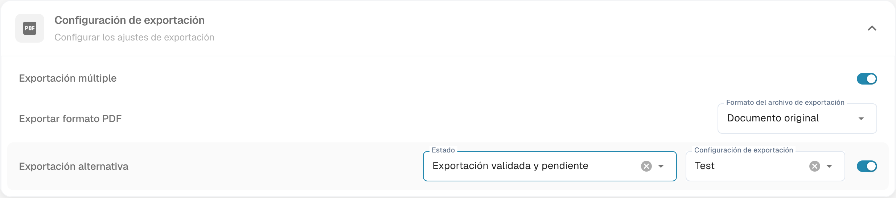

# Exportación alternativa

La exportación alternativa ofrece un destino de exportación para los documentos que cumplen el estado configurado. **Estado** determina la disponibilidad de esta opción; no indica el estado que se escribirá después de exportar.

## Encontrar la configuración

1. Abra **Ajustes → Tipos de Documento**.
2. Abra el engranaje del tipo de documento correspondiente.

<figure><figcaption>
Tipos de documentos predeterminados con enlaces a Campos y engranajes de configuración. No se modificó ningún interruptor Activar o Extracción.
</figcaption></figure>

3. Despliegue **Configuración de exportación** y localice **Exportación alternativa**.

<figure><figcaption>
Configuración actual de Exportación alternativa. Estado determina su disponibilidad; no es el estado que se escribe después de exportar. La etiqueta real «Exportación validada y pendiente» tiene una redacción defectuosa. Test es una configuración de ejemplo; no se ejecutó ninguna exportación.
</figcaption></figure>

## Configurar la disponibilidad

Seleccione el estado requerido entre las opciones que ofrece su versión y asigne la **Configuración de exportación** correspondiente. Compruebe el destino antes de habilitar la opción. La etiqueta actual «Exportación validada y pendiente» se refiere al documento validado y pendiente de exportación, aunque su redacción sea defectuosa.

Consulte la [configuración de exportaciones](../../../../document-processing/export.md) para preparar el destino. Si el documento cumple el estado configurado y la opción está disponible en su flujo, podrá elegir ese destino en la pantalla de conciliación de pedidos. La imagen muestra únicamente la configuración; no acredita una exportación ejecutada.
