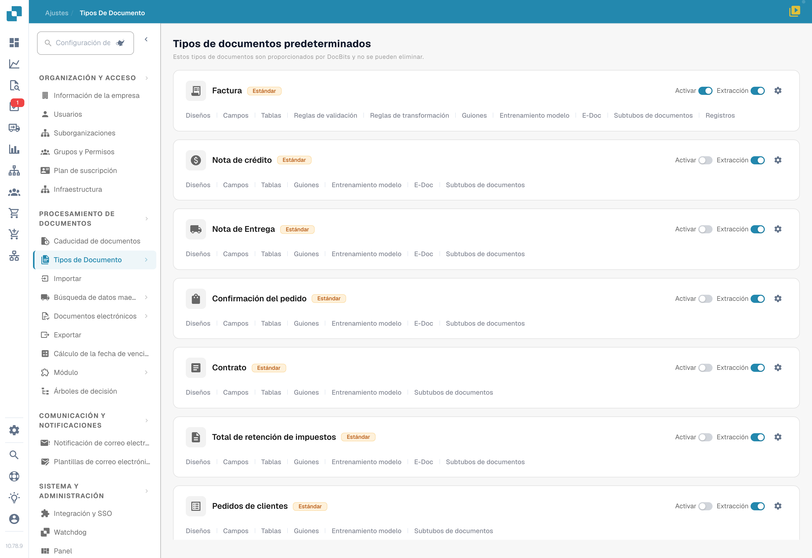
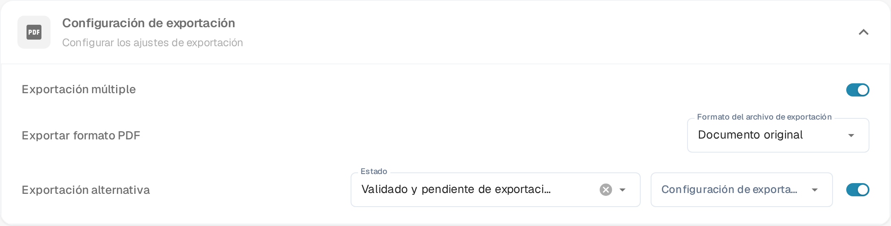

# Exportación alternativa

La exportación alternativa ofrece un destino de exportación para los documentos que cumplen el estado configurado. **Estado** determina la disponibilidad de esta opción; no indica el estado que se escribirá después de exportar.

## Encontrar la configuración

1. Abra **Ajustes → Tipos de Documento**.
2.  Busca la tarjeta del tipo de documento y abre sus ajustes con el engranaje (**Más ajustes**).

<figure><figcaption>
Tipos de documentos predeterminados con enlaces a Campos y engranajes de configuración. No se modificó ningún interruptor Activar o Extracción.
</figcaption></figure>

3.  Despliega **Configuración de exportación** y activa **Exportación alternativa**.

    <figure><figcaption>
El interruptor <strong>Exportación alternativa</strong> en <strong>Configuración de exportación</strong>. Al activarlo aparecen <strong>Estado</strong> y <strong>Configuración de exportación</strong>. No se ejecutó ninguna exportación.
</figcaption></figure>

## Configurar la disponibilidad

Seleccione el estado requerido entre las opciones que ofrece su versión y asigne la **Configuración de exportación** correspondiente. Compruebe el destino antes de habilitar la opción. La etiqueta actual «Exportación validada y pendiente» se refiere al documento validado y pendiente de exportación, aunque su redacción sea defectuosa.

* **Estado** — el estado del documento en el que se ofrece la opción de exportación adicional.
* **Configuración de exportación** — la configuración de exportación que utiliza esta opción.

Consulte la [configuración de exportaciones](../../../../document-processing/export.md) para preparar el destino. Si el documento cumple el estado configurado y la opción está disponible en su flujo, podrá elegir ese destino en la pantalla de conciliación de pedidos. La imagen muestra únicamente la configuración; no acredita una exportación ejecutada.
