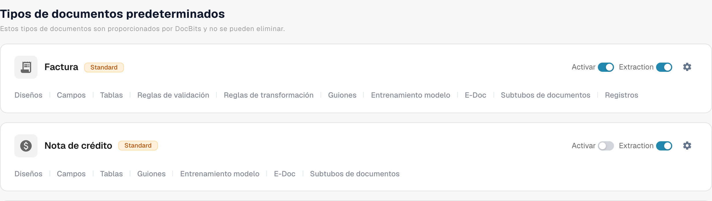
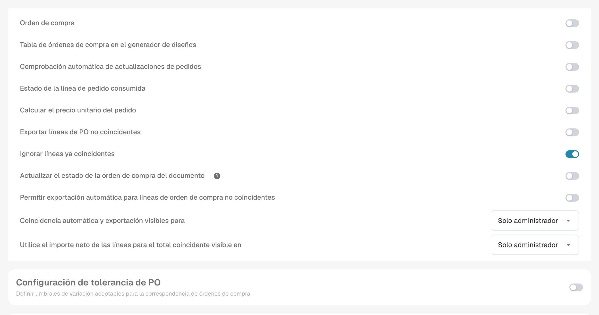

# Estado de la línea de pedido consumida

**Estado de la línea de pedido consumida** colorea las líneas de la orden de compra en la vista de coincidencia según la cantidad de cada línea que ya se ha casado. Actívelo para el tipo de documento de factura si su equipo necesita detectar rápidamente las líneas de OC sin usar, parcialmente usadas y totalmente usadas. El color es una ayuda visual; compruebe la **Cantidad igualada** y la columna de cantidad de OC seleccionada antes de decidir si una línea puede volver a casarse.

## Activar la configuración

1. Abra **Configuración → Tipos de documento**. Localice el tipo de documento utilizado para sus facturas y seleccione el engranaje de su tarjeta para abrir **Más ajustes**. La captura muestra la tarjeta **Factura**. Deje los interruptores **Activar** y **Extracción** como están.

   <figure><figcaption>
Acceso a los ajustes adicionales del tipo de documento Factura.
</figcaption></figure>

2. Expanda **Número de pedido** si está contraído. Localice **Estado de la línea de pedido consumida** y active su interruptor. Es una configuración independiente de **Actualizar el estado de la orden de compra del documento**, que se encuentra más abajo en la misma sección.

   <figure><figcaption>
Configuración del estado de las líneas de pedido consumidas.
</figcaption></figure>

3. Abra una factura con coincidencia de orden de compra e inspeccione sus líneas de OC. Los ejemplos siguientes muestran cómo se relacionan los colores de las líneas con el estado de coincidencia. Para conocer los pasos de la coincidencia, consulte [Coincidencia de órdenes de compra](../../../../../../end-user-and-partner-section/end-user-section/purchase-order-matching/README.md).

## Interpretar los colores de las líneas de OC

| Aspecto | Significado | Qué comprobar |
| --- | --- | --- |
| Liso o blanco | Todavía no se ha casado ninguna cantidad de esta línea de OC. | Compruebe la cantidad de la OC y la línea de la factura antes de casar. |
| Tinte azul | Ha seleccionado la línea en la vista de coincidencia actual. | La selección es temporal; no significa que la línea esté totalmente casada. |
| Naranja pálido | Se ha casado parte de la cantidad, pero la cantidad casada es inferior a la cantidad de OC seleccionada. | Compruebe cuánta cantidad queda. |
| Violeta pálido | La cantidad casada es igual o superior a la cantidad de OC seleccionada. | No dé por hecho que hay más cantidad disponible. |

Una línea tachada tiene un significado distinto: su estado de OC puede estar excluido por los [estados de desactivación de OC](purchase-order-disable-statuses.md). Compruebe esa configuración si no se puede seleccionar una línea.

La siguiente leyenda describe los estados de coincidencia sin depender de las capturas de versiones anteriores. Compruebe siempre la cantidad ya asignada antes de reutilizar una posición.
