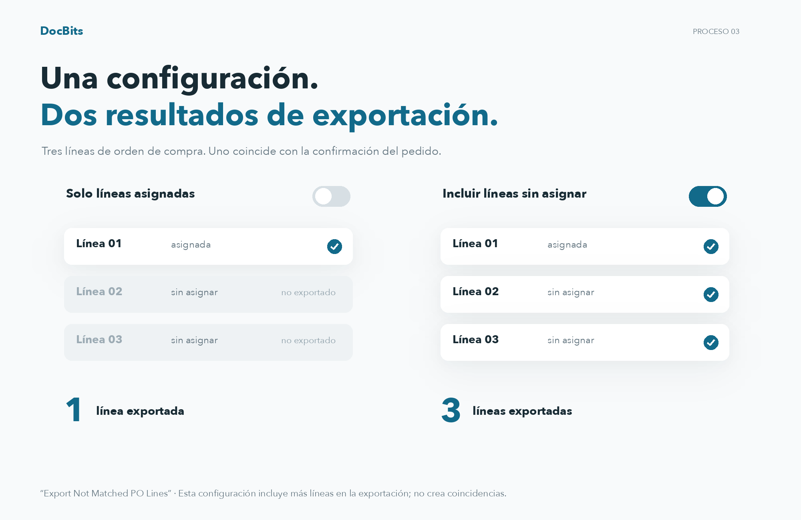

# Exportar líneas de PO no coincidentes

## Comprender el alcance de las exportaciones con tres líneas de orden de compra

<figure><figcaption>
Comprender el alcance de las exportaciones con tres líneas de orden de compra
</figcaption></figure>

En este ejemplo, la orden de compra tiene tres líneas y solo una coincide con una línea de confirmación de orden. Con “Export Not Matched PO Lines” desactivado, solo se exporta la línea de orden de compra coincidente. Con la opción activada, también se incluyen las dos líneas de orden de compra no coincidentes. Esto no crea coincidencias adicionales.

## **Dónde Encontrarlo**

Ve a **Configuración → Configuración General → Tipos de Documentos → Más Configuraciones → Sección de Orden de Compra → Exportar Líneas de PO No Coincidentes**. Activa el botón para habilitar esta configuración.

## **Cómo Funciona**

* **Cuando está deshabilitado**, el sistema solo exporta las líneas de orden de compra que están emparejadas con una línea de confirmación de pedido. Las líneas de orden de compra no coincidentes no se incluirán en la exportación.
* **Cuando está habilitado**, el sistema exporta todas las líneas de orden de compra, incluso si no están emparejadas con una línea de confirmación de pedido.

Por ejemplo, si una orden de compra tiene **tres líneas**, pero el proveedor envía una **confirmación de pedido con solo una línea**, emparejas esa línea con una línea de orden de compra. Las dos líneas de orden de compra no coincidentes restantes serán:

* **Excluidas de la exportación** si la configuración está deshabilitada.
* **Incluidas en la exportación** si la configuración está habilitada.
