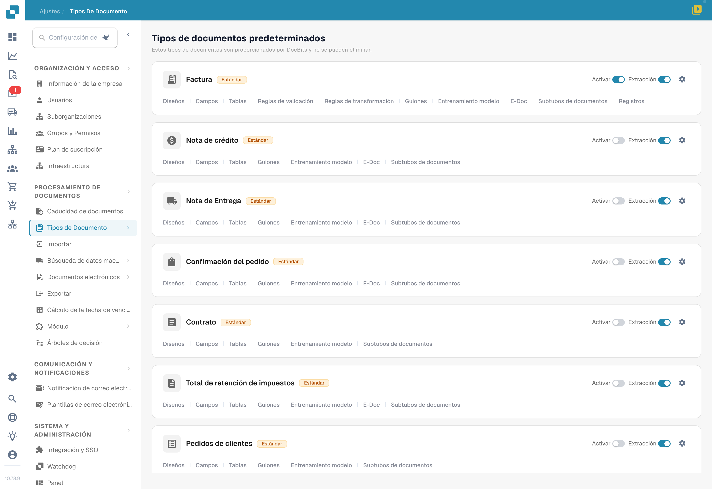
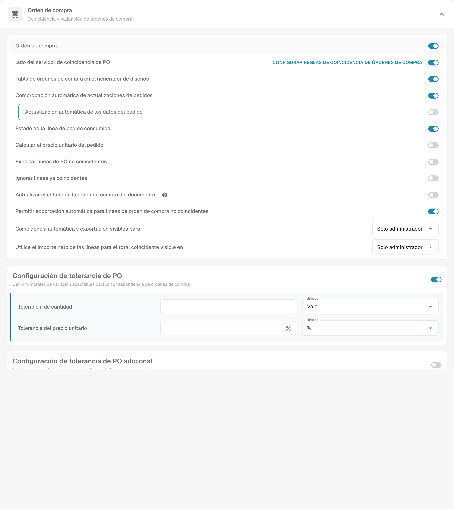
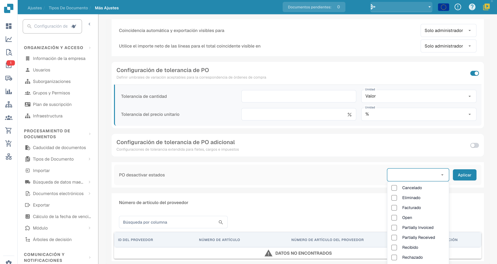

# Estados de pedidos excluidos de la conciliación

El ajuste **PO desactivar estados** permite excluir de la conciliación las órdenes de compra que tienen determinados estados. Esta configuración controla la elegibilidad del pedido para la conciliación; no constituye por sí sola un bloqueo general de pagos o de todas las exportaciones.

## Encontrar la configuración

1. Abra **Ajustes → Tipos de Documento** y el engranaje del tipo correspondiente.

<figure><figcaption>
Tipos de documentos predeterminados con enlaces a Campos y engranajes de configuración. No se modificó ningún interruptor Activar o Extracción.
</figcaption></figure>

2. Despliegue **Orden de compra**.

<figure><figcaption>
Configuración actual de Orden de compra, incluido Calcular el precio unitario del pedido. Los valores privados están ocultos; no se cambió la configuración ni se ejecutó una conciliación.
</figcaption></figure>

3. Localice **PO desactivar estados** y abra el selector.

<figure><figcaption>
Selector actual PO desactivar estados. Open, Partially Invoiced y Partially Received siguen en inglés y corresponden a abierto, parcialmente facturado y parcialmente recibido. No se seleccionó ningún estado ni se pulsó Aplicar.
</figcaption></figure>

## Seleccionar los estados

Seleccione los estados que su proceso debe excluir y utilice **Aplicar** para guardar un cambio deliberado. En la versión mostrada, Open, Partially Invoiced y Partially Received siguen en inglés; significan abierto, parcialmente facturado y parcialmente recibido. Utilice las opciones que ofrezca su versión.

Compruebe el pedido y su estado cuando no esté disponible para la conciliación. Una restricción de conciliación no demuestra por sí misma que el documento esté pagado, aprobado o exportado. Durante la captura no se seleccionó ningún estado ni se pulsó Aplicar.
