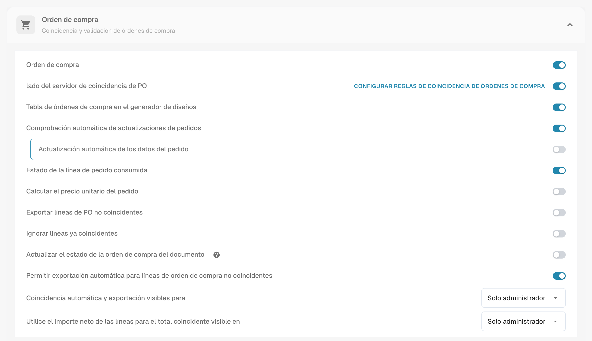
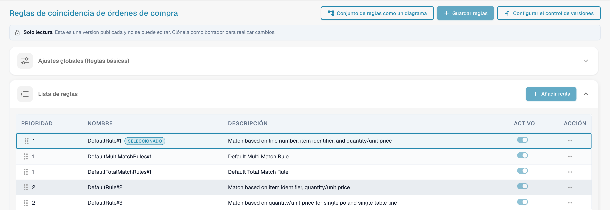
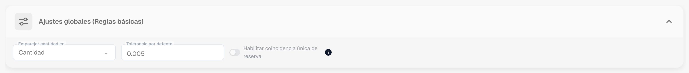
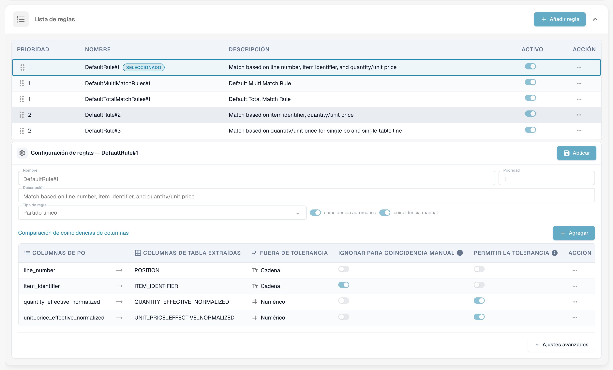
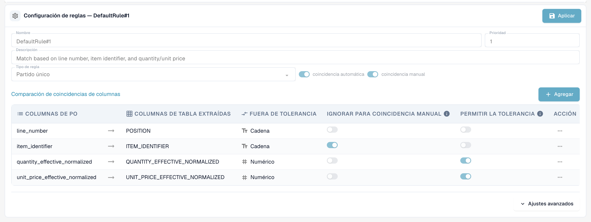
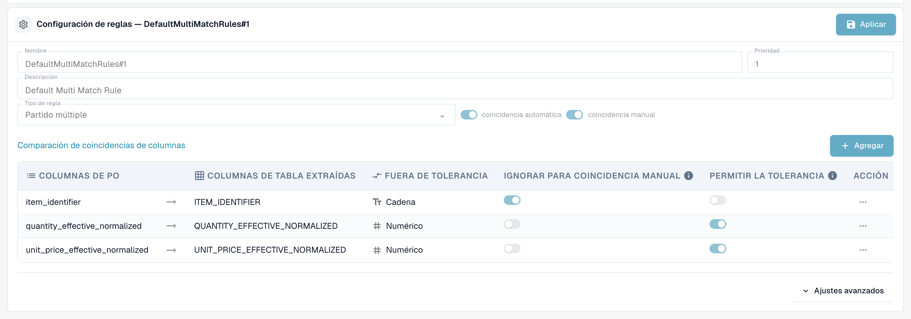
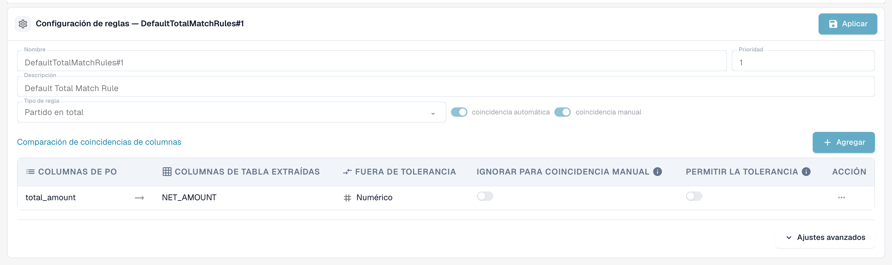
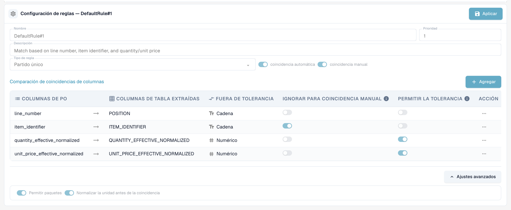
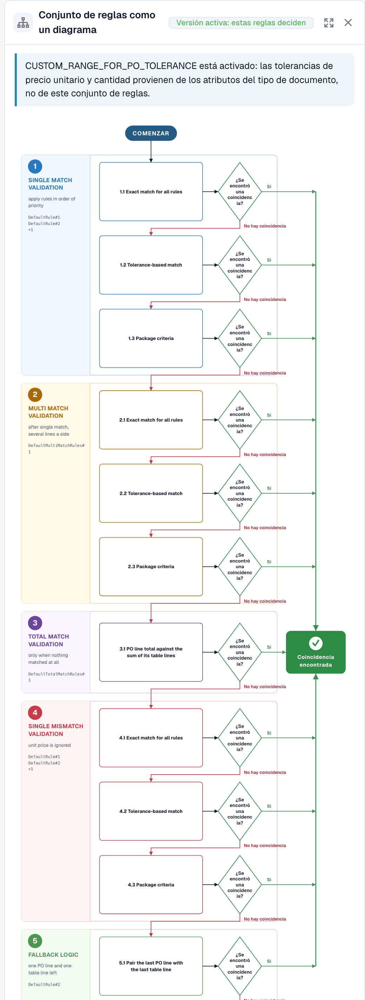
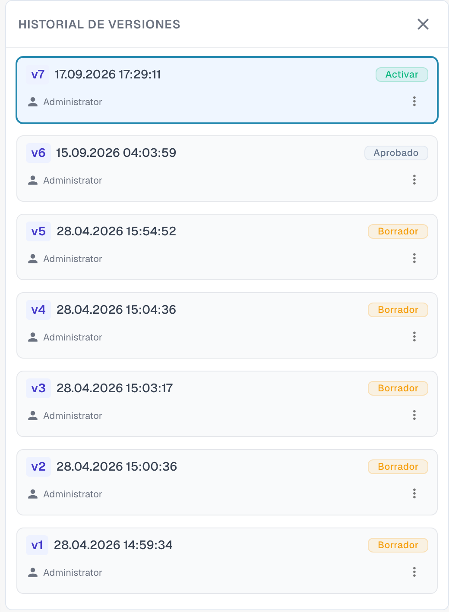

# Reglas de Coincidencia de Órdenes de Compra

## Introducción: Órdenes de Compra y Gestión de Reglas de OC

La Coincidencia de Órdenes de Compra (OC) es un proceso crítico para asegurar la consistencia entre las Órdenes de Compra (OC) y las facturas entrantes o recibos de mercancías correspondientes. Un conjunto robusto de reglas es esencial para lograr una alta tasa de coincidencia automática, prevenir fraudes y garantizar pagos correctos.

Esta página de configuración se utiliza para definir y gestionar las reglas que determinan _cómo_ se emparejan las líneas de la OC con el documento entrante correspondiente (factura, confirmación de pedido).


**Requisito previo:** las reglas de coincidencia solo se usan cuando **lado del servidor de coincidencia de PO** está activado para el tipo de documento (Ajustes → Tipos de documentos → Más ajustes → Orden de compra). Con el interruptor desactivado, DocBits realiza la coincidencia con su comparador incorporado (cantidad, precio unitario, número de artículo, número de orden de compra) e ignora el conjunto de reglas.


***

## Cómo acceder

1. Navega a **Ajustes** → **Ajustes globales** → **Tipos de documentos**, selecciona el tipo de documento y haz clic en **Más ajustes**.
2. En la tarjeta **Orden de compra**, activa **lado del servidor de coincidencia de PO**.
3. Haz clic en **Configurar reglas de coincidencia de órdenes de compra** junto al interruptor.

<figure><figcaption>
La tarjeta Orden de compra. <strong>Configurar reglas de coincidencia de órdenes de compra</strong> está junto a <strong>lado del servidor de coincidencia de PO</strong>.
</figcaption></figure>

## La página de un vistazo

<figure><figcaption>
La página Reglas de coincidencia de órdenes de compra.
</figcaption></figure>

La página tiene tres botones en la parte superior:

* **Conjunto de reglas como un diagrama** abre un diagrama de flujo del conjunto de reglas activo. Consulta Conjunto de reglas como diagrama más abajo.
* **Guardar reglas** guarda tus cambios en el borrador que estás editando.
* **Configurar el control de versiones** abre el historial de versiones. Consulta Versiones y borradores más abajo.

Debajo de los botones aparece un aviso **Solo lectura** cuando miras una versión publicada: *Esta es una versión publicada y no se puede editar. Clónela como borrador para realizar cambios.* Debajo vienen la tarjeta **Configuración global (reglas básicas)** y la **Lista de reglas**. Selecciona una regla de la lista para configurarla en el área **Configuración de reglas** situada debajo de la lista.

***

## Configuración global (reglas básicas)

Estos ajustes establecen el marco que se aplica a todas las reglas de coincidencia:

<figure><figcaption>
La tarjeta Configuración global (reglas básicas), abierta.
</figcaption></figure>

* **Ajuste:** Coincidencia de cantidad en
  * **Propósito:** Define qué cantidad de la línea de la orden de compra se compara con la línea del documento, por ejemplo la cantidad pedida o la **cantidad abierta de factura** (pedida menos ya facturada), que es la elección habitual para facturas.
  * **Valores válidos:** Cantidad u otros campos de cantidad disponibles en el sistema, según la estructura de datos (por ejemplo, un campo alternativo de cantidad normalizada).
  * **Dependencia:** Determina la base de todas las reglas de coincidencia que incluyen la cantidad en sus criterios de comparación.
* **Ajuste:** Tolerancia estándar (Tolerancia predeterminada)
  * **Propósito:** Define cuánto puede desviarse un valor numérico del documento respecto al valor de la orden de compra y seguir contando como coincidencia. Compensa las diferencias de redondeo. Se aplica a **cada columna numérica** con "Permitir la tolerancia" activada, tanto la cantidad como el precio unitario.
  * **Valor válido:** Un número decimal. Si se interpreta como **valor absoluto** (0.005 = una desviación de hasta 0.005 en la cantidad o el precio comparados) o como **porcentaje** (0.5 = 0.5 % del valor comparado) lo determina el **tipo de tolerancia** del conjunto de reglas (`value` o `percent`; los conjuntos de reglas nuevos usan `value`). Las tolerancias por artículo (consulta [Configuración de tolerancia](purchase-order-tolerance-settings-additional-purchase-order-tolerance.md)) sustituyen a la tolerancia estándar para ese artículo.
  * **Dependencia:** Se aplica a las reglas que usan campos numéricos para la coincidencia y tienen activada la opción "Permitir la tolerancia".
* **Ajuste:** Habilitar coincidencia única de reserva
  * **Propósito:** Cuando está activado, la última línea de orden de compra sin emparejar se empareja automáticamente aunque el número del albarán sea distinto. La coincidencia se marca como desajuste para que la revises.
  * **Valores válidos:** Activado o desactivado. El valor por defecto es desactivado.

***

## Lista de reglas

La Lista de reglas muestra todas las reglas de coincidencia disponibles y gestiona su orden de ejecución.

<figure><figcaption>
La Lista de reglas. La regla seleccionada está marcada como <strong>Seleccionado</strong>. Una regla se puede desactivar con su interruptor <strong>Activo</strong>.
</figcaption></figure>

#### Estructura y ejecución

* **Prioridad:** Este campo numérico (por ejemplo, 1, 2, 3) determina la secuencia de ejecución de las reglas. Las reglas con un número de prioridad menor se intentan primero. Esto permite a los administradores estructurar una jerarquía, que normalmente comienza con las reglas más específicas y estrictas (por ejemplo, coincidencia por número de línea y número de pieza) y recurre a reglas más amplias o menos restrictivas.
* **Nombre y descripción:** Proporciona una identificación clara y el contexto de la regla, y explica los criterios principales que usa (por ejemplo, "Regla estándar n.º 1: coincidencia basada en número de línea, ID de pieza y cantidad").
* **Activo:** Un interruptor simple que permite activar o desactivar la regla al instante sin tener que eliminar su configuración.

**Flujo de ejecución:** El sistema realiza la coincidencia en una secuencia en cascada. Si una regla (por ejemplo, prioridad 1) empareja correctamente una línea, el proceso para esa línea se detiene. Si no se encuentra ninguna coincidencia, el sistema pasa a la siguiente regla de la secuencia de prioridad (por ejemplo, prioridad 2). Cada ejecución queda registrada en el documento; el **historial de coincidencias** de la pantalla de coincidencia de órdenes de compra muestra qué regla se intentó, cuál coincidió y cuáles se omitieron y por qué.

***

## Configuración de reglas (ajustes detallados)

Esta área de configuración detallada define la lógica y los criterios específicos de una regla individual.

<figure><figcaption>
El área Configuración de reglas para una regla de coincidencia simple. <strong>Aplicar</strong> mantiene tus cambios en el borrador.
</figcaption></figure>

#### Parámetros básicos

* **Tipo de regla:** Especifica la cardinalidad de la coincidencia.

| Tipo de regla | Qué hace | Uso típico |
| ------------- | -------- | ---------- |
| **Partido único** | Una línea de orden de compra con una línea de documento. Todas las columnas configuradas deben coincidir (dentro de la tolerancia donde esté permitida). | El caso estándar. |
| **Partido múltiple** | Varias líneas de orden de compra con una línea de documento, o varias líneas de documento con una línea de orden de compra. Las cantidades se **suman**, el precio unitario se compara como **promedio**, las demás columnas deben coincidir. | Entregas parciales, una línea de factura que cubre varias líneas de pedido. |
| **Partido en total** | Compara un **importe** (normalmente el importe neto de la línea del documento con el **total** de la orden de compra) y empareja toda la orden de compra de una vez. | Proveedores que facturan una suma global, facturas de servicios, facturas de una sola línea. |

<figure><figcaption>
Una regla de coincidencia múltiple compara el identificador de artículo, la cantidad sumada y el precio unitario promedio.
</figcaption></figure>

<figure><figcaption>
Una regla de coincidencia por total compara un importe, aquí el importe neto con el total de la orden de compra.
</figcaption></figure>

* **coincidencia automática:** Si está activada, el sistema intentará aplicar esta regla de forma totalmente automática. El procesamiento automático requiere una alta confianza en los criterios.
* **coincidencia manual:** Si está activada, un usuario puede ver o aplicar esta regla durante el paso de conciliación manual, lo que le ofrece un conjunto predefinido de criterios de comparación para resolver excepciones.
* **Retroceder:** Una regla marcada como reserva se ejecuta en una fase posterior, solo para los pares de líneas que siguen sin emparejar después de que se hayan ejecutado todas las reglas normales. Úsala para la regla "más flexible" que debe capturar lo que las reglas estrictas no han encontrado.

#### Condiciones de activación

Una regla puede tener **condiciones de activación**: expresiones que deben ser verdaderas antes de que la regla se ejecute. Si una condición es falsa, la regla se **omite para este documento** (el historial de coincidencias la muestra como "no ejecutada" con el motivo). Las expresiones usan los recuentos de las líneas que se están emparejando:

| Expresión | Significado |
| --------- | ----------- |
| `[[count(po_lines)]]` | número de líneas de orden de compra disponibles para la coincidencia |
| `[[count(table_lines)]]` | número de líneas del documento que están mapeadas para la coincidencia |

Compáralas con `==`, `!=`, `>`, `>=`, `<`, `<=` y combina varias condiciones con `&` (y). Ejemplos:

* `([[count(po_lines)]] > 1) & ([[count(table_lines)]] > 1)`: solo para documentos con varias líneas en ambos lados (típico de una regla de coincidencia múltiple).
* `([[count(po_lines)]] == 1) & ([[count(table_lines)]] == 1)`: solo para documentos de una línea frente a un pedido de una línea.
* `([[count(po_lines)]] >= 1) & ([[count(table_lines)]] >= 1)`: siempre que haya algo que emparejar.


Las condiciones de activación son el motivo más habitual por el que una regla "no hace nada". Una regla de coincidencia por total con la condición `[[count(table_lines)]] > 1` nunca se ejecuta para una factura de una sola línea, y una [regla de transformación](../../transformation-rules.md) que reduce la factura a una única línea de total produce exactamente un documento así. Comprueba los recuentos en el historial de coincidencias antes de cambiar la regla en sí.


#### Comparación de columnas (criterios de coincidencia)

Esta es la definición central de la lógica de la regla: especifica qué campos deben coincidir entre los documentos.

1. Definir las columnas que se comparan:
   * **Columnas de PO:** El campo tomado de los datos de la orden de compra (por ejemplo, el número de línea).
   * **Columnas de tabla extraídas:** El campo correspondiente extraído o analizado del documento entrante (factura/confirmación de pedido) (por ejemplo, `POSITION`).
2. **Tipo de comparación** (columna «Fuera de tolerancia» en la interfaz)**:** Define la naturaleza de la coincidencia requerida (por ejemplo, Tt para la comparación de texto/cadena, que exige una coincidencia exacta carácter por carácter; # para la comparación numérica).
3. **Permitir la tolerancia:** En los campos numéricos (cantidad, precio), activar esta opción indica al sistema que aplique la tolerancia estándar global definida antes. Si _no_ está activada para un campo numérico, los valores deben coincidir exactamente.
4. **Ignorar para coincidencia manual:** Si está marcada, este criterio se relaja durante la intervención manual. Es útil para campos como descripciones o referencias internas que pueden variar ligeramente, y permite al usuario pasar por alto pequeñas diferencias no críticas.

**Qué columnas se pueden comparar**

| Columna | Lado del documento | Lado de la orden de compra | Nota |
| ------- | ------------------ | -------------------------- | ---- |
| Número de línea | `POSITION` | `line_number` | Texto, exacto. Solo es útil cuando el proveedor imprime en el documento los números de línea del pedido. |
| Identificador de artículo | `ITEM_IDENTIFIER` | `item_identifier` | Texto, exacto. Número de artículo o número de artículo del proveedor, también mediante el [Número de artículo del proveedor](supplier-item-number-map-admin-documentation.md). |
| Cantidad normalizada efectiva | `QUANTITY_EFFECTIVE_NORMALIZED` | `quantity_effective_normalized` | Numérico. La cantidad seleccionada en **Coincidencia de cantidad en**, convertida a la misma unidad en ambos lados (conversión del código de unidad, cantidades "por"). |
| Precio unitario normalizado efectivo | `UNIT_PRICE_EFFECTIVE_NORMALIZED` | `unit_price_effective_normalized` | Numérico. El precio por unidad individual tras los descuentos y tras **Precio unitario por** y, si [Calcular el precio unitario del pedido](calculate-po-unit-price.md) está activado, el precio calculado a partir del importe y la cantidad de la línea del pedido. |
| Importe neto | `NET_AMOUNT` | `total_amount` | Numérico. Lo usan las reglas de coincidencia por total. |

**Ejemplo: regla estricta de coincidencia de OC (`DefaultRule#1`)**

Una regla estricta típica combina comprobaciones obligatorias de identidad con comprobaciones de valores:

* **Identidad obligatoria:** El número de línea y el identificador de artículo deben coincidir exactamente (comparación de texto, sin tolerancia).
* **Comprobaciones de valores:** La cantidad normalizada efectiva y el precio unitario normalizado efectivo deben coincidir (comparación numérica, con tolerancia permitida). Solo si se cumplen los cuatro criterios (con tolerancia para los valores) se ejecuta una coincidencia automática.

***

#### Ajustes avanzados

Haz clic en **Ajustes avanzados** debajo de la tabla de columnas para abrir dos opciones más de la regla.

<figure><figcaption>
Ajustes avanzados de una regla.
</figcaption></figure>

* **Permitir paquetes:** Permite que la regla empareje líneas en las que la cantidad y el precio unitario difieren en un tamaño de paquete. Los tamaños de paquete predeterminados son 10, 20, 100 y 1000. DocBits ajusta entonces la cantidad y el precio unitario del documento según el tamaño del paquete antes de compararlos. Este es el paso **Criterios de paquete** de cada etapa del diagrama de reglas (consulta Conjunto de reglas como diagrama más abajo).
* **Normalizar la unidad antes de la coincidencia:** Convierte la unidad de medida de ambos lados a la misma unidad antes de comparar la cantidad. Está activada por defecto.

***

## Conjunto de reglas como diagrama

**Conjunto de reglas como un diagrama** abre un panel junto a las reglas. Muestra las reglas de la versión activa como un diagrama de flujo, de modo que puedes ver en qué orden las intenta DocBits y dónde se detiene la coincidencia.

<figure><figcaption>
El conjunto de reglas como diagrama.
</figcaption></figure>

DocBits recorre cinco etapas de arriba abajo. Cada etapa tiene hasta tres pasadas: **Coincidencia exacta para todas las reglas**, **Coincidencia basada en tolerancia** y **Criterios de paquete**. La primera pasada que encuentra una coincidencia finaliza el proceso (flecha verde). Si una pasada no encuentra ninguna coincidencia, DocBits continúa con la siguiente (flecha roja).

| Etapa | Qué hace |
| ----- | -------- |
| 1. Validación de coincidencia simple | Aplica las reglas de coincidencia simple por orden de prioridad. |
| 2. Validación de coincidencia múltiple | Se ejecuta después de la coincidencia simple, para varias líneas en un lado. |
| 3. Validación de coincidencia por total | Se ejecuta solo cuando no ha coincidido nada. Compara el total de la orden de compra con la suma de las líneas de la tabla. |
| 4. Validación de desajuste simple | Aplica de nuevo las reglas de coincidencia simple, ignorando el precio unitario. |
| 5. Lógica de reserva | Empareja la última línea de la orden de compra con la última línea de la tabla cuando queda exactamente una línea en cada lado. |

Debajo del diagrama, el panel enumera las reglas de cada etapa por prioridad, con las columnas que compara cada regla. Una nota en la parte superior indica de dónde proceden las tolerancias: del conjunto de reglas o, cuando `CUSTOM_RANGE_FOR_PO_TOLERANCE` está activado, de los [ajustes del tipo de documento](purchase-order-tolerance-settings-additional-purchase-order-tolerance.md).

***

## El conjunto de reglas predeterminado

Cada organización empieza con el mismo conjunto de reglas predeterminado. Es una buena referencia cuando creas el tuyo:

| Regla | Tipo / prioridad | Columnas comparadas | Condición de activación |
| ----- | ---------------- | ------------------- | ----------------------- |
| `DefaultRule#1` | coincidencia simple, prioridad 1 | número de línea, identificador de artículo, cantidad (tol.), precio unitario (tol.) | siempre |
| `DefaultMultiMatchRules#1` | coincidencia múltiple, prioridad 1, reserva | identificador de artículo, cantidad (tol.), precio unitario (tol.) | `count(po_lines) > 1` y `count(table_lines) > 1` |
| `DefaultTotalMatchRules#1` | coincidencia por total, prioridad 1 | importe neto ↔ total de la orden de compra (sin tolerancia) | `count(po_lines) >= 1` y `count(table_lines) > 1` |
| `DefaultRule#2` | coincidencia simple, prioridad 2, reserva | identificador de artículo, cantidad (tol.), precio unitario (tol.) | siempre |
| `DefaultRule#3` | coincidencia simple, prioridad 2, reserva | cantidad (tol.), precio unitario (tol.) | `count(po_lines) == 1` y `count(table_lines) == 1` |

De arriba abajo: primero la regla estricta (el número de línea y el artículo deben estar impresos en el documento), después las reglas de reserva sin el número de línea y, por último, un último recurso para documentos de una línea que compara solo la cantidad y el precio.

***

## Impacto en el proceso de coincidencia de OC

El conjunto de reglas definido rige directamente la eficiencia e integridad del flujo de trabajo de coincidencia de OC:

* **Priorización y reservas:** La prioridad definida asegura que el sistema intente primero el método de coincidencia más fiable. Si fallan las reglas estrictas de alta prioridad, el sistema recurre a reglas más amplias, con el objetivo de reducir al mínimo el número de excepciones que se envían a los usuarios.
* **Control de la calidad de la coincidencia:** Las reglas más estrictas (que exigen coincidencias más exactas y menos tolerancia) generan menos coincidencias automáticas, pero muy fiables. Las reglas más flexibles aumentan la tasa de coincidencia automática, pero elevan el riesgo de falsos positivos.
* **Gestión de excepciones (coincidencia manual):** Al habilitar reglas para la coincidencia manual, el sistema ofrece opciones estructuradas a los usuarios. Si una transacción no cumple los criterios de coincidencia automática, se convierte en una excepción. El usuario puede intentar resolverla aplicando una regla manual predefinida, que puede tener criterios más relajados (por ejemplo, ignorar una pequeña diferencia de texto según el ajuste "Ignorar en la coincidencia manual").

## Qué más influye en el resultado

* **Cuándo se ejecuta la coincidencia:** durante el procesamiento del documento, cuando un usuario hace clic en **Auto PO Match**, y **en cada guardado** en el que el número de orden de compra haya cambiado o no se haya consultado nunca (por ejemplo, cuando los datos maestros lo completaron después del procesamiento). Un guardado nunca sobrescribe una coincidencia que ya existe.
* Las [**reglas de transformación**](../../transformation-rules.md) se ejecutan antes de la coincidencia y pueden cambiar las líneas del documento y, con ellas, los recuentos de líneas que consultan las condiciones de activación. Una regla de tabla que reconstruye las líneas conserva una coincidencia existente mientras las líneas sigan siendo las mismas; si sustituye líneas ya emparejadas, la coincidencia se descarta y se muestra el nombre de la regla como motivo.
* [**Calcular el precio unitario del pedido**](calculate-po-unit-price.md) cambia qué precio unitario comparan las reglas en el lado de la orden de compra.
* La [**configuración de tolerancia**](purchase-order-tolerance-settings-additional-purchase-order-tolerance.md) y los [**estados desactivados**](purchase-order-disable-statuses.md) deciden lo estricta que es la comparación y qué líneas de orden de compra se ofrecen.

## Solución de problemas

| Síntoma | Qué comprobar |
| ------- | ------------- |
| "Sin coincidencia" aunque todos los valores coinciden | Abre el historial de coincidencias: qué regla se ejecutó, en qué columna falló (la desviación se muestra por columna), si la regla se omitió por una condición de activación. |
| Precio unitario no coincide exactamente en la tasa de impuesto | El total de la orden de compra incluye impuestos; activa [Calcular el precio unitario del pedido](calculate-po-unit-price.md) (importe neto primero) o compara el importe neto de la línea. |
| Una regla de coincidencia por total nunca se ejecuta | Su condición de activación exige más de una línea de documento. Establece `[[count(table_lines)]] >= 1` o no reduzcas las líneas con una regla de transformación. |
| El conjunto de reglas no tiene ningún efecto | **lado del servidor de coincidencia de PO** está desactivado para el tipo de documento, o el conjunto de reglas modificado sigue siendo un borrador: activa la versión. |

***

## Versiones y borradores

Las reglas de coincidencia tienen versiones. Solo puedes editar un **borrador**; una versión publicada solo se puede consultar. Haz clic en **Configurar el control de versiones** para abrir el **Historial de versiones**.

<figure><figcaption>
El Historial de versiones con todas las versiones del conjunto de reglas.
</figcaption></figure>

Cada versión muestra su número, la fecha y la hora y su estado, por ejemplo **Borrador** o **Aprobado**. El menú de una versión ofrece las acciones disponibles. Para cambiar el conjunto de reglas predeterminado, clónalo primero: abre **Configurar el control de versiones** y elige **Clonar como borrador** en las opciones de la tarjeta de la versión. Edita el borrador, haz clic en **Aplicar** en cada regla que hayas cambiado y en **Guardar reglas**. Las reglas modificadas surten efecto cuando se activa la versión.
