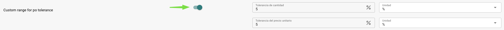
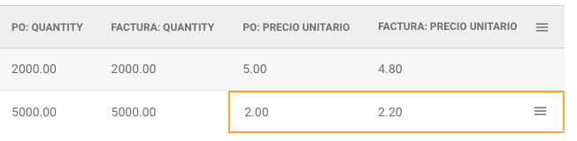
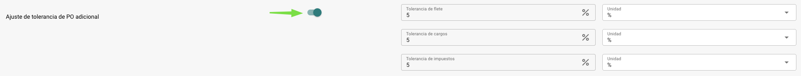

# Ajuste de tolerancias de órdenes de compra / Tolerancia adicional de órdenes de compra

**Ajuste para configurar las tolerancias de órdenes de compra**

Ir a **Ajuste → Ajuste General → Tipos de Documentos → Más Configuraciones → Sección de Órdenes de Compra → Ajuste de Tolerancia de Órdenes de Compra**

#### **Cómo Funciona**

Cuando está habilitada, esta Ajuste permite definir tolerancias para **Cantidad** y/o **Precio Unitario**. Estas tolerancias pueden establecerse como un porcentaje o como un valor fijo. Esto significa que una factura puede desviarse de la orden de compra (OC) dentro del rango de tolerancia especificado sin ser marcada como un desajuste, proporcionando flexibilidad mientras se asegura un procesamiento fluido.

<mark style="color:red;">**NOTA**</mark>**:** Las tolerancias funcionan en ambas direcciones; es decir, el valor de la factura puede ser mayor o menor que el valor de la OC dentro del rango permitido.

#### **Configurándolo**

* **Habilitar la Ajuste:**
  * Activa la Ajuste de Tolerancia de OC usando el botón de alternancia.
* **Configurar Tolerancias:**
  * Aparecerán cuatro campos:
    * Un campo para el **Monto de Tolerancia de Cantidad**.
    * Un campo para el **Monto de Tolerancia de Precio Unitario**.
  * Detrás de cada campo, hay un menú desplegable donde puedes seleccionar el tipo de tolerancia:
    * **Porcentaje:** Indica una tolerancia porcentual.
    * **Valor:** Indica un monto fijo por el cual el valor puede diferir.

<figure><figcaption></figcaption></figure>

**Escenario de Ejemplo:**

* Supongamos que la **Tolerancia de Precio Unitario** está configurada en **5%**.
* La orden de compra incluye dos líneas:
  * **Línea 1:** Precio Unitario = **$5.00**
  * **Línea 2:** Precio Unitario = **$2.00**
* En la factura:
  * **Línea 1:** El precio unitario se ajusta a **$4.80** (**dentro** de la tolerancia del 5%).
  * **Línea 2:** El precio unitario se ajusta a **$2.20** (**fuera** de la tolerancia del 5%).
* **Resultado:**
  * La Línea 1 **no se marca** como un desajuste porque $4.80 está dentro del 5% de $5.00.
  * La Línea 2 **se marca** como un desajuste porque $2.20 excede la desviación permitida del 5% de $2.00. El usuario ahora debe tomar medidas para resolver el desajuste antes de que la factura pueda ser procesada.

<figure><figcaption></figcaption></figure>

### **Ajuste** para configurar la **Ajuste** Adicional de Tolerancia de Órdenes de Compra

Ir a **Ajuste → Ajuste General → Tipos de Documentos → Más Configuraciones → Sección de Órdenes de Compra → Ajuste de tolerancia de PO adicional**

#### **Cómo Funciona**

Cuando está habilitada, esta Ajuste permite definir tolerancias para **Flete**, **Cargos** y/o **Impuesto**. Estas tolerancias pueden establecerse como un porcentaje o como un valor fijo, permitiendo que las facturas varíen ligeramente de los valores de la OC sin ser marcadas como desajustes. Esto proporciona flexibilidad adicional y asegura que las diferencias menores no interrumpan el flujo de trabajo.

<mark style="color:red;">**NOTA**</mark>: Al igual que las Ajuste de tolerancia estándar, estas tolerancias se aplican en ambas direcciones, permitiendo aumentos o disminuciones dentro de los límites establecidos.

#### **Configurándolo**

* **Habilitar la Ajuste:**
  * Activa la Ajuste Adicional de Tolerancia de OC usando el botón de alternancia.
* **Configurar Tolerancias:**
  * Seis campos se volverán visibles:
    * Un campo para cada uno de los montos de tolerancia para **Flete**, **Cargos** e **Impuesto**.
  * Cada campo tiene un menú desplegable correspondiente donde puedes elegir el tipo de tolerancia:
    * **Porcentaje:** La tolerancia se define como un porcentaje.
    * **Valor:** La tolerancia se define como un monto fijo.

<figure><figcaption></figcaption></figure>
