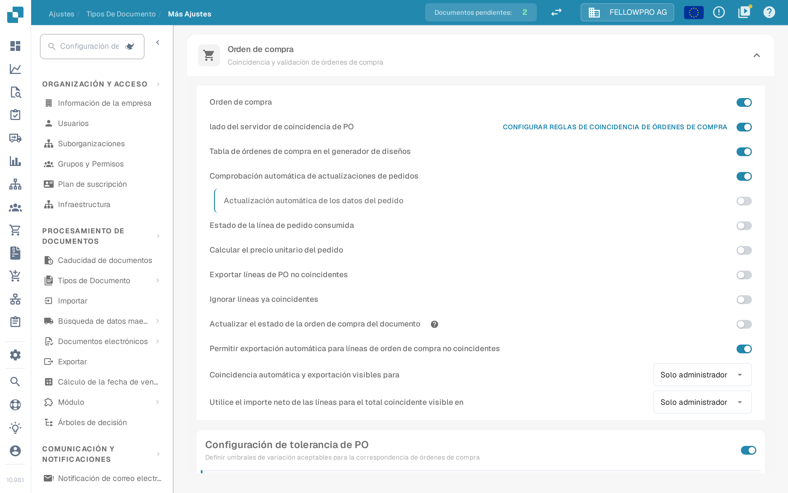

# Orden de compra

## Resumen

Este ajuste habilita la sección de [**Coincidencia de Orden de Compra**](../../../../../../end-user-and-partner-section/end-user-section/purchase-order-matching/), que se vuelve accesible después de la validación del documento.

<mark style="color:red;">**Nota**</mark>: Para el tipo de documento **Factura**, se deben cumplir los siguientes requisitos adicionales:

* El ajuste de **Orden de compra** debe estar habilitado (como se describe en esta página)
* La factura debe ser del tipo **Factura de Compra**
* Debe estar presente una **Tabla Extraída**

## Pasos de Activación 

1. Ve a **Ajustes** -> **Ajustes globales** -> **Tipos de documentos**
2.  Busca la tarjeta del tipo de documento y abre sus ajustes con el engranaje (**Más ajustes**).
3.  Expande la sección **Orden de compra** y activa **Orden de compra**.

<figure><figcaption>
La sección <strong>Orden de compra</strong> en los ajustes avanzados. El primer interruptor activa la coincidencia de órdenes de compra para el tipo de documento; los siguientes la afinan.
</figcaption></figure>

## **Funcionalidad**

Una vez activada, la sección de [**Coincidencia de Orden de Compra**](../../../../../../end-user-and-partner-section/end-user-section/purchase-order-matching/) estará disponible después de la validación del documento.

### Qué cantidad se compara

La cantidad del pedido que compara la coincidencia depende de **lado del servidor de coincidencia de PO**:

* **lado del servidor de coincidencia de PO desactivado** – junto al interruptor **Orden de compra** aparece una lista con **Cantidad**, **Cantidad recibida** y **Entrega recibida Cantidad pendiente**. DocBits compara la cantidad elegida con su propio motor de coincidencia.
* **lado del servidor de coincidencia de PO activado** – la coincidencia sigue las reglas del tipo de documento y la cantidad es parte de esas reglas. El enlace **Configurar reglas de coincidencia de órdenes de compra**, a la derecha de la fila, abre las reglas.


La captura se tomó con **lado del servidor de coincidencia de PO** activado, por lo que la lista de cantidad no aparece en esa pantalla: se define en las reglas de coincidencia.

