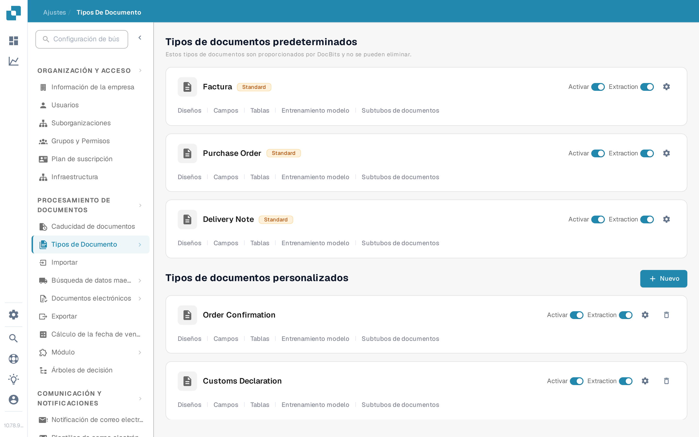
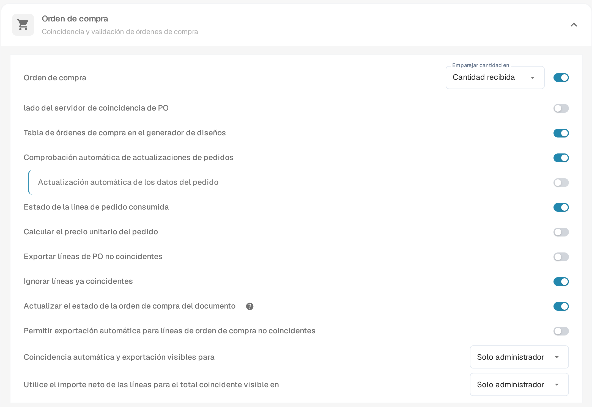
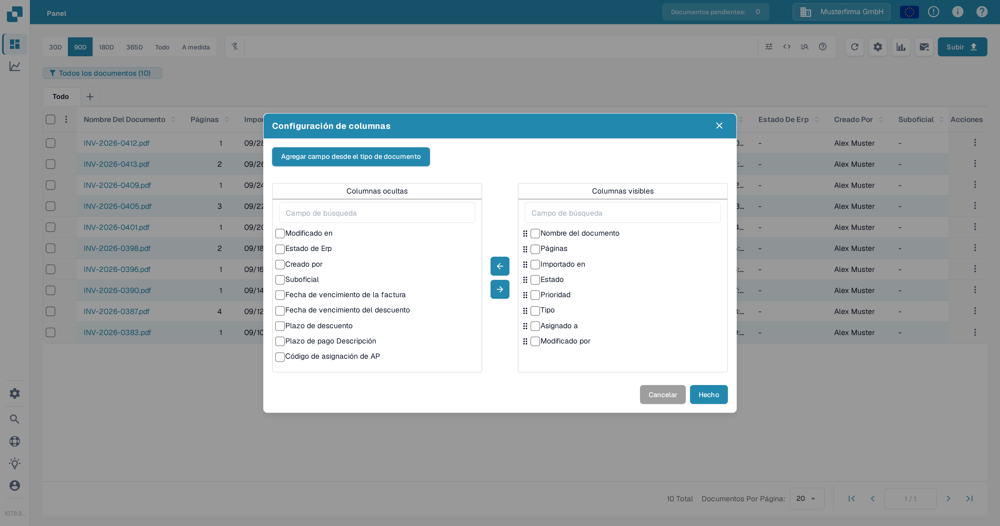
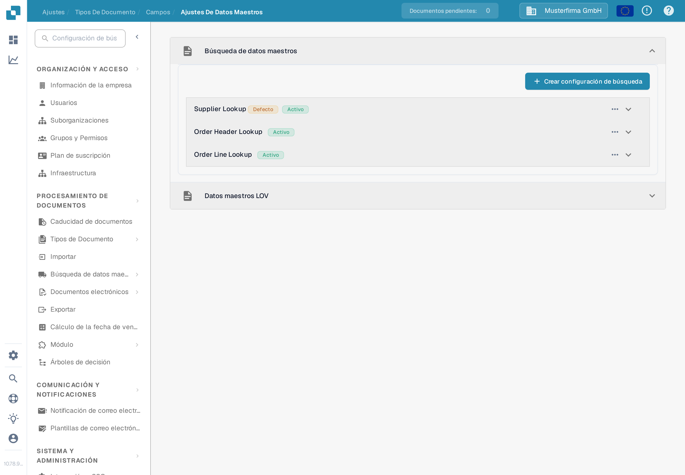

# Actualizar Estado de Orden de Compra de Documentos

Esta configuración es para los tipos de documentos que utilizan órdenes de compra. Controla si un documento puede recibir actualizaciones de estado de su orden de compra vinculada. El interruptor se configura por tipo de documento. Para ver un estado de OC en el panel, el campo correspondiente también debe estar disponible y visible como columna.

Antes de cambiar la configuración, elija la organización y el tipo de documento correctos. Necesita acceso de administrador para editar la configuración de los tipos de documentos. Una orden de compra debe estar vinculada a un documento antes de poder comprobar un cambio de estado.

## Activar la configuración

1. Abra **Ajustes → Tipos De Documento**.
2. Busque el tipo de documento utilizado para los documentos vinculados a la OC, como **Factura**, y seleccione el engranaje de su tarjeta para abrir **Más Ajustes**.
3. Expanda **Orden de compra**. Busque **Actualizar el estado de la orden de compra del documento** y actívelo. El icono de ayuda cercano explica la opción dentro de la aplicación. Cambiar este interruptor no modifica las demás configuraciones de PO de la misma sección.

<figure><figcaption>Abra la configuración del tipo de documento que utiliza.</figcaption></figure>

<figure><figcaption>El interruptor de actualización de estado en la configuración de Orden de compra.</figcaption></figure>

## Mostrar un estado de OC en el panel

1. Vuelva al panel y seleccione el engranaje situado encima de la tabla de documentos.
2. Abra **Configuración de columnas** desde el menú de ajustes avanzados.
3. Seleccione **Agregar campo desde el tipo de documento**, elija el tipo de documento y busque **Estado de OC**. Si ese campo está disponible, selecciónelo, elija **Agregar a Columnas visibles** y luego seleccione **Hecho**.

El cuadro de diálogo de columnas contiene **Columnas ocultas** y **Columnas visibles**. Utilice las flechas para mover una columna seleccionada entre ambas. Consulte [Cambiar columnas del documento](../../../../../../end-user-and-partner-section/end-user-section/dashboard/change-document-columns.md) para ver la guía completa de columnas. Si **Estado de OC** no aparece para el tipo seleccionado, pida a un administrador que compruebe su campo y la configuración de búsqueda; el interruptor de visualización por sí solo no crea un campo inexistente.

<figure><figcaption>Elija qué columnas aparecen en el panel.</figcaption></figure>

## Comprobar la búsqueda de la orden de compra

En **Ajustes → Tipos De Documento → Campos → Ajustes De Datos Maestros**, expanda **Búsqueda de datos maestros** y luego **Order Header Lookup**. Compruebe que existe la asignación del campo de OC requerido y que la búsqueda correspondiente tiene **Disparador Automático** cuando se necesita una búsqueda automática. La captura siguiente muestra la lista de configuraciones; no demuestra un estado de OC actualizado.

<figure><figcaption>Compruebe las filas de búsqueda reales del tipo de documento.</figcaption></figure>

Para obtener ayuda con la configuración de una búsqueda, consulte [Configuración de Datos Difusos con Datos Maestros](../../../../../setup/document-types/fuzzy-data-configuration-with-master-data.md).

## Verificar con un documento conocido

Utilice un documento que ya esté vinculado a una orden de compra de prueba. Cambie el estado de esa orden de compra mediante su proceso habitual, actualice el panel y compruebe el documento y el campo de estado de OC visible. Si el estado no se actualiza, revise el vínculo de OC del documento, la configuración de búsqueda y si el campo correspondiente se agregó al panel. No deduzca una actualización correcta solo del interruptor.

## Hallazgos de traducción de la aplicación

Estos términos aparecen sin traducir o de forma inconsistente en la interfaz en español (versión 10.78.9.5); se citan tal cual y se han notificado, no corregido en la documentación:

1. En la página Tipos de Documento, los nombres de tipo **Purchase Order**, **Delivery Note**, **Order Confirmation**, **Customs Declaration** y **Freight Letter**, así como el encabezado de columna **Extraction**, permanecen en inglés.
2. En el panel, el encabezado de columna **Suboficial** es una traducción incorrecta de "Sub-Org".
3. En la configuración de PO, el interruptor se llama **Actualizar el estado de la orden de compra del documento**, mientras que el título de la página dice "Actualizar Estado de Orden de Compra de Documentos".
4. En Búsqueda de datos maestros, los nombres de las configuraciones **Supplier Lookup**, **Order Header Lookup** y **Order Line Lookup** permanecen en inglés, y la etiqueta predeterminada se muestra como **Defecto**.
