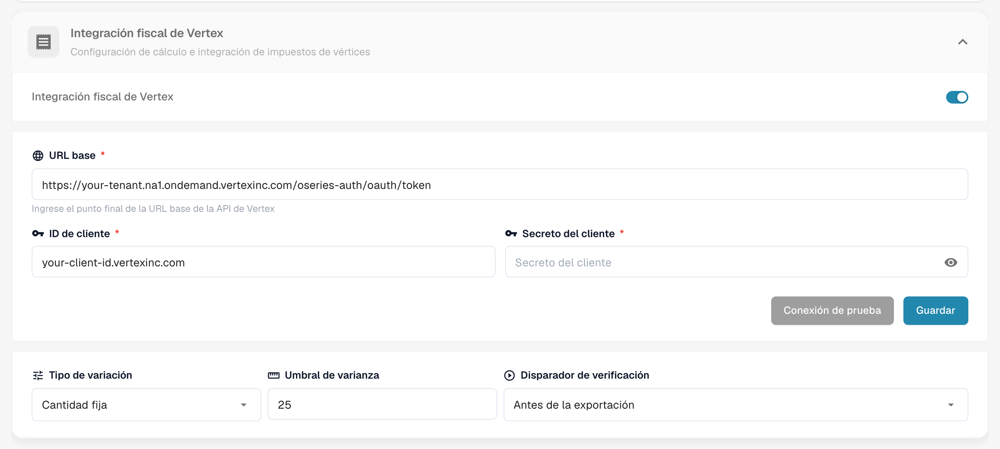
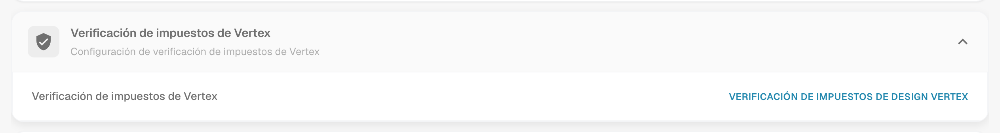
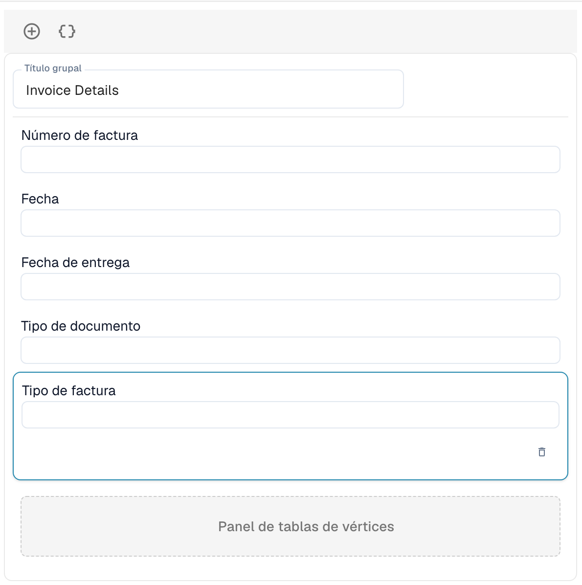

# Verificación de impuestos de Vertex

La verificación de impuestos de Vertex compara el impuesto que un proveedor cobró en una factura con el impuesto que Vertex calcula para las mismas líneas. DocBits solicita el cálculo a Vertex, muestra ambos importes al usuario y detiene el documento cuando el impuesto del proveedor es demasiado alto.

## Cómo funciona

1. El documento llega al punto de activación. Lo eliges en los ajustes del módulo: **Antes de la exportación** (por defecto) o **Antes de la aprobación**.
2. DocBits envía las líneas de la factura a Vertex y recibe el impuesto calculado.
3. DocBits escribe el resultado en el documento: el **Monto del impuesto de vértice** y la **Tasa impositiva de Vertex** por línea, y los totales de cabecera **Impuesto del vendedor** (el impuesto cobrado en la factura), **Impuesto sobre el vértice**, el subtotal y la **Diferencia**.
4. DocBits compara el impuesto del proveedor con el impuesto de Vertex:

| Situación | Resultado |
| --------- | --------- |
| El impuesto del proveedor es superior al impuesto de Vertex en **más del umbral de varianza** | El documento se rechaza. Su estado pasa a **Impuesto de vértice rechazado**. |
| El impuesto del proveedor es superior, pero **dentro del umbral** | El documento se acepta. |
| El impuesto del proveedor es igual al impuesto de Vertex | El documento se acepta. |
| El impuesto del proveedor es **inferior** al impuesto de Vertex | El documento se acepta y el importe que falta se devenga. |

El mensaje de resultado indica los importes, por ejemplo: *Rejected: vendor tax $380.00 exceeds Vertex calculated tax $140.00 by $240.00 (171.4%), above configured threshold of $25.00.*

Los usuarios abren el resultado desde el icono de Vertex en la fila del documento en el panel. La pantalla **Verificación de impuestos de Vertex** muestra un banner (**La verificación falló.** con el mensaje, o **Verificación exitosa**), los campos del diseño que creaste y las tablas de Vertex con el impuesto por línea.


La verificación solo se ejecuta para los tipos de documento que tienen una configuración de exportación de tipo **Vertex**. Sin ella, el documento continúa sin verificación.


## Configurar la integración

Abre **Ajustes** → **Módulo** → **Pedido y Finanzas** y ve a la tarjeta **Integración fiscal de Vertex**. La página también contiene los ajustes de coincidencia de OC y de contabilización automática.

<figure><figcaption>
La tarjeta Integración fiscal de Vertex. Los valores de tenant y de cliente se sustituyen por marcadores de posición en esta captura de pantalla.
</figcaption></figure>

1. Activa **Integración fiscal de Vertex**. La función requiere la suscripción de impuestos de Vertex.
2. Introduce la **URL base** de tu punto final de token de Vertex, tu **ID de cliente** y tu **Secreto del cliente**.
3. Haz clic en **Conexión de prueba** y luego en **Guardar**.
4. Define la tolerancia y el disparador:
   * **Tipo de variación:** **Cantidad fija** o **Porcentaje**.
   * **Umbral de varianza:** La desviación que todavía se acepta. El valor por defecto es un importe fijo de 25. En modo porcentaje, introduce el valor como decimal, por ejemplo 0.05 para el 5 %.
   * **Disparador de verificación:** **Antes de la exportación** o **Antes de la aprobación**. Con **Antes de la aprobación**, la comprobación se ejecuta mientras se procesa el documento, antes de que pase a la aprobación. Si la propia comprobación falla, el documento obtiene el estado **Error de exportación**.

Después, agrega una configuración de exportación de tipo **Vertex** para el tipo de documento (**Ajustes** → **Exportar**). Utiliza un archivo de mapeo TOML.

## Diseñar el formulario de verificación

Los campos que ven los usuarios en la pantalla de verificación se diseñan por tipo de documento.

1. Abre **Ajustes** → **Ajustes globales** → **Tipos de documentos**, selecciona el tipo de documento y haz clic en **Más ajustes**.
2. Abre la tarjeta **Verificación de impuestos de Vertex** y haz clic en **Verificación de impuestos de Design Vertex**.

<figure><figcaption>
La tarjeta Verificación de impuestos de Vertex.
</figcaption></figure>

El Creador de diseño se abre con el tipo de diseño **Verificación de impuestos de Vertex**. Arrastra grupos y campos al formulario, por ejemplo **Detalles de la factura** con número de factura, fecha y fecha de entrega. El **Panel de tablas de vértices** muestra la comparación de impuestos y las partidas con el impuesto de Vertex por línea. Forma parte del diseño.

<figure><figcaption>
Un diseño de Verificación de impuestos de Vertex con el grupo Detalles de la factura y el Panel de tablas de vértices.
</figcaption></figure>

Para saber cómo funciona el Creador de diseño, consulta el [Gestor de Diseño](../layout-manager/README.md).
