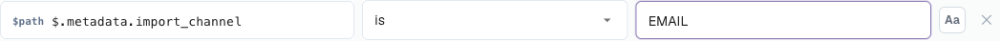

# Rule Conditions (Applies when)

## Descripción general

Cada regla de las funciones de reglas de DocBits tiene una sección **Applies when**. Decide **para qué documentos (y, en las reglas de tabla, para qué filas) hace algo la regla**. El trabajo real de la regla (generar un error de validación, cambiar un valor, elegir un diseño) solo ocurre cuando la condición es verdadera.

El mismo constructor de condiciones se utiliza en las tres funciones de reglas:

| Función | Etiqueta en el constructor | Cuando la condición es verdadera… | Cuando es falsa… | Cuando se deja vacía… |
| --- | --- | --- | --- | --- |
| [Custom Validation Rules](custom-validation-rules.md) | Paso 2 **Applies when** | se ejecuta la comprobación del paso 3 | la regla se omite: sin error ni advertencia | la comprobación se ejecuta en todos los documentos |
| [Transformation Rules](transformation-rules.md) | Paso 2 **When it runs** → **Only when…** | el pipeline cambia el valor | el valor se deja como está | elija **Always**: la regla se ejecuta en todos los documentos |
| [Layout Selection Rules](layout-manager/layout-selection-rules.md) | Paso 2 **Applies when** | el documento recibe el diseño de esta regla (gana la primera coincidencia) | DocBits prueba con la siguiente regla | la regla coincide con todos los documentos en su prioridad |

Apréndala una vez aquí y podrá usarla en todas partes.


Una condición solo decide **si** se aplica una regla. Nunca cambia datos ni muestra un mensaje por sí sola. “El número de identificación fiscal del proveedor debe estar rellenado” es la **comprobación** de una regla de validación; “solo para facturas alemanas” es su **condición**.


## Leer una condición

Una condición se lee como una frase. El constructor siguiente dice:

> **Si TODAS** las siguientes son verdaderas: el Document Origin **es** Deutsch, el Total Amount es **mayor que** 250 y (**ANY** de: la Currency **es** EUR, la Currency **está vacía**).

<figure><figcaption>
Dos condiciones combinadas con ALL, más un grupo anidado combinado con ANY
</figcaption></figure>

Con esa condición, la regla se aplica a:

| Documento | Origen | Importe total | Moneda | ¿Se aplica? | Por qué |
| --- | --- | --- | --- | --- | --- |
| A | DE | 469.18 | EUR | **sí** | las tres partes son verdaderas |
| B | DE | 469.18 | *(vacía)* | **sí** | el grupo ANY es verdadero porque la moneda está vacía |
| C | DE | 120.00 | EUR | no | 120 no es mayor que 250 |
| D | DE | 469.18 | USD | no | ninguna línea del grupo ANY es verdadera |
| E | AT | 469.18 | EUR | no | el origen no es DE |

## Los bloques de construcción

### Líneas de condición

Cada línea tiene cuatro partes:

| Parte | Qué es |
| --- | --- |
| **Field** | El valor que se comprueba: un atributo del documento, un campo de cabecera, una columna de tabla o una ruta JSON. Consulte [Campos que puede utilizar](#campos-que-puede-utilizar). |
| **Operator** | Cómo se compara el valor: *is*, *contains*, *greater than*, *is empty* … Consulte [Operadores](#operadores). |
| **Value** | Con qué se compara el campo. Oculto para *is empty* / *is not empty*. En los campos con una lista fija de valores (origen, estado, moneda…) el valor se elige en una lista desplegable. |
| **Aa** | Ignorar mayúsculas y minúsculas. Disponible solo para comparaciones de texto. Cuando está activado, `gmbh` coincide con `GmbH`. |

Haga clic en **✕** para eliminar una línea.

### ALL y ANY

El selector al inicio de un grupo decide cómo se combinan sus líneas:

* **All** of the following are true: todas las líneas deben ser verdaderas (AND).
* **ANY** of the following are true: al menos una línea debe ser verdadera (OR).

### Grupos anidados

Haga clic en **+ Add nested group** para colocar un grupo dentro de otro. Un grupo anidado cuenta como una línea de su grupo padre, de modo que puede mezclar AND y OR:

* *ALL of*: el origen es DE, **ANY of** (la moneda es EUR, la moneda está vacía)
* *ANY of*: el proveedor es 10040, **ALL of** (el proveedor es 20723, el importe total es mayor que 1000)

Los grupos se pueden anidar tan profundamente como necesite. Manténgalo legible: dos niveles bastan para casi cualquier regla de negocio.

### Una condición vacía

Si no añade ninguna línea, la regla no tiene condición y **se aplica siempre** (en las reglas de diseño: coincide con todos los documentos en su prioridad). Es la opción correcta para reglas que deben ejecutarse en todas partes, como “recortar el número de factura” o “la cantidad debe ser positiva”.

## Campos que puede utilizar

Abra la lista desplegable de campos para ver todos los campos, agrupados según su procedencia. Escriba para filtrar la lista.

<figure><figcaption>
El selector de campos: primero los atributos del documento y después los campos de cabecera del tipo de documento
</figcaption></figure>

### Atributos del documento (`doc.`)

Información que DocBits conoce sobre el propio documento, independiente de los campos extraídos:

| Campo en el selector | Clave | Valores de ejemplo | Uso típico |
| --- | --- | --- | --- |
| **Document Origin** | `doc.doc_origin` | `DE`, `AT`, `US` (mostrados como Deutsch, Austria, United States) | reglas y diseños específicos de cada país |
| **Extraction Method** | `doc.extraction_method` | `ELECTRONIC_DOCUMENT`, `FELLOW_KV2`, `MANUAL` | tratar las facturas electrónicas (XRechnung, ZUGFeRD) de forma distinta de los PDF escaneados |
| **Document Status** | `doc.status` | Ready for validation, Pending Approval, Pending second approval … | diseños por fase del flujo de trabajo, reglas que solo se aplican antes de la aprobación |
| **Sub Document Type** | `doc.sub_doc_type` | sus subtipos, p. ej., abono | reglas para un solo subtipo |

### Campos de cabecera (`header.`)

Cada campo del tipo de documento, por ejemplo **Invoice Number** (`header.invoice_id`), **Supplier ID** (`header.supplier_id`), **Total Amount** (`header.total_amount`), **Currency** (`header.currency`), **Supplier Tax ID** (`header.supplier_tax_id`), **Purchase Order** (`header.purchase_order`). El selector muestra la etiqueta y, entre paréntesis, la clave técnica. El valor utilizado es el valor actual del campo, incluidas las correcciones realizadas por un usuario.

### Columnas de tabla (`row.`)

Columnas de la fila de tabla actual, por ejemplo `row.QUANTITY` o `row.ITEM_NUMBER`. Aparecen en el selector como **Table columns** solo en las reglas que se ejecutan **una vez por fila**:

* reglas de validación con el nivel **Table line**
* reglas de transformación con el ámbito **Table column**

En estas reglas, la condición se comprueba **para cada fila por separado**. Una fila que no coincide se omite; las demás filas se siguen procesando.

<figure><figcaption>
Una condición por fila: solo se comprueban las filas que tienen número de artículo
</figcaption></figure>

Las reglas que se ejecutan una vez por documento (reglas de cabecera, reglas de tabla completa, reglas de diseño) no pueden usar campos `row.`: no hay una fila concreta que puedan examinar.

### Ruta JSON personalizada (Advanced)

En la parte inferior del selector, **Advanced → Custom JSON path…** convierte el campo en un cuadro de texto libre marcado con `$path`. Lee un valor en cualquier punto de los datos extraídos del documento, aunque no sea un campo del tipo de documento.

<figure><figcaption>
Una condición de ruta JSON sobre el canal de importación del documento
</figcaption></figure>

* La ruta empieza por `$` y usa `.name` para las claves y `[0]` para las posiciones de lista, por ejemplo `$.metadata.import_channel` o `$.shipping.addresses[0].country`.
* Debe terminar en un único valor. Una ruta que termina en una lista o un objeto cuenta como vacía.
* Las líneas de ruta JSON ofrecen los operadores *is*, *is not*, *matches*, *is empty* e *is not empty*.

Utilice las rutas JSON con moderación. Dependen de la estructura interna de los datos extraídos; un campo del tipo de documento es más fácil de entender y de mantener.

### Dónde se puede usar cada tipo de campo

| | Validation: Header field | Validation: Table line | Validation: Whole table | Transformation: Header / Routing / Table rows | Transformation: Table column | Layout selection |
| --- | --- | --- | --- | --- | --- | --- |
| Atributos del documento `doc.` | ✓ | ✓ | ✓ | ✓ | ✓ | ✓ |
| Campos de cabecera `header.` | ✓ | ✓ | ✓ | ✓ | ✓ | ✓ |
| Columnas de tabla `row.` | – | ✓ | – | – | ✓ | – |
| Ruta JSON `$` | ✓ | ✓ | ✓ | ✓ | ✓ | ✓ |

## Operadores

<figure><figcaption>
Los operadores que se ofrecen para un campo de texto
</figcaption></figure>

| Operador | Es verdadero cuando… | Valor | Ejemplo |
| --- | --- | --- | --- |
| **is** | el campo es igual al valor | un valor | Supplier ID **is** `20723` |
| **is not** | el campo no es igual al valor | un valor | Currency **is not** `EUR` |
| **is one of** | el campo es igual a algún valor de una lista | valores separados por comas | Supplier ID **is one of** `10040, 10041, 20723` |
| **contains** | el valor aparece en cualquier parte del campo | texto | Supplier Name **contains** `GmbH` |
| **starts with** | el campo empieza por el valor | texto | Invoice Number **starts with** `GS-` |
| **ends with** | el campo termina con el valor | texto | Purchase Order **ends with** `-IT` |
| **matches** | una expresión regular encuentra una coincidencia en el campo | expresión regular | Invoice Number **matches** `^INV-\d{6}$` |
| **is empty** | el campo no tiene valor (ausente o solo espacios) | – | Purchase Order **is empty** |
| **is not empty** | el campo tiene un valor | – | Purchase Order **is not empty** |
| **greater than** / **less than** | el campo es un número superior / inferior al valor | número | Total Amount **greater than** `10000` |
| **greater or equal** / **less or equal** | lo mismo, incluido el propio valor | número | Total Amount **less or equal** `250` |

### Qué operadores ofrece un campo

La lista se adapta al tipo del campo:

| Tipo de campo | Operadores |
| --- | --- |
| Texto | todos los operadores |
| Número e importe (Total Amount, Quantity …) | is, is not, greater than, less than, greater or equal, less or equal, is empty, is not empty |
| Campos con una lista fija (Document Origin, Status, Currency …) | is, is not, is one of, is empty, is not empty |
| Fecha (Invoice Date, Due Date …) | is, is not, is empty, is not empty |
| Sí/No | is, is not, is empty, is not empty |
| Ruta JSON personalizada | is, is not, matches, is empty, is not empty |


**Las fechas no se pueden comparar con *before* o *after* en una condición.** “Fecha de vencimiento posterior a la fecha de la factura” o “fecha de factura de más de 90 días” pertenece a la **comprobación** de una regla de validación (**Compare fields**), no a *Applies when*.


## Cómo se comparan los valores

Conocer estas reglas evita la mayoría de las sorpresas:

1. **Los números se comparan como números.** Si ambos lados parecen números, `250`, `250.00` y `250,00` son iguales. Se entienden los importes con formato regional como `1.234,56`.
2. **Todo lo demás se compara como texto, tras eliminar los espacios iniciales y finales.** `" EUR "` es `EUR`.
3. **Las mayúsculas y minúsculas importan** salvo que **Aa** (ignorar mayúsculas) esté activado.
4. **Vacío es especial.** Un campo ausente o en blanco:
   * es verdadero para **is empty** e **is not**,
   * es falso para **is**, **is one of**, **contains**, **starts with**, **ends with**, **matches** y todas las comparaciones numéricas.


Debido a la regla 4, *Currency **is not** EUR* también es verdadero para los documentos **sin** moneda. Si no es lo que desea, añada una segunda línea *Currency **is not empty***.



Debido a la regla 1, los valores que parecen números se comparan numéricamente incluso cuando son códigos: `007` **is** `7` es verdadero. Para códigos en los que los ceros iniciales importan, utilice **matches** con un patrón como `^007$`.


## Ejemplos

**Solo documentos alemanes** — `Document Origin` **is** `Deutsch`.

**Solo facturas electrónicas** — `Extraction Method` **is** `ELECTRONIC_DOCUMENT`. Utilice **is not** para excluirlas, por ejemplo en una regla que repara errores de OCR.

**Un grupo de proveedores** — `Supplier ID` **is one of** `10040, 10041, 20723`.


En los campos cuyo valor se elige en una lista desplegable (origen, estado, moneda), **is one of** solo permite elegir una entrada. Para aceptar varias, cree un grupo **ANY** con una línea **is** por valor.


**Facturas de gran importe de un proveedor** — **All of**: `Supplier ID` **is** `20723`, `Total Amount` **greater than** `10000`.

**Facturas sin pedido de compra** — `Purchase Order` **is empty**. Una condición típica para una regla de “centro de coste obligatorio”.

**Todo excepto los abonos** — `Invoice Type` **is not** `credit_note` (utilice los valores que su organización almacena en el campo).

**Facturas que llegaron por correo electrónico** — Ruta JSON personalizada `$.metadata.import_channel` **is** `EMAIL`.

**Solo líneas de artículo** (reglas de línea de tabla / columna de tabla) — `row.ITEM_NUMBER` **is not empty**. Las líneas de transporte o descuento sin número de artículo se omiten.

**Segunda fase de aprobación** (reglas de diseño en la pantalla Approval) — `Document Status` **is** `Pending second approval`.

**EU o moneda ausente** — **All of**: `Document Origin` **is** `Deutsch`, **ANY of** (`Currency` **is** `EUR`, `Currency` **is empty**). Es la condición que se muestra al inicio de esta página.

## Probar y depurar una condición

Cada función le permite probar una condición antes de confiar en ella:

* **Reglas de validación** — **Test rule** ejecuta la regla contra un documento real. “*Rule skipped — scope not matched*” significa que la condición era falsa para ese documento. Consulte [Test rule](custom-validation-rules.md#test-rule).
* **Reglas de transformación** — la **Live preview** tiene **Condition values**: escriba un valor para cada campo de la condición y vea “*Conditions match — rule runs*” o “*Conditions do not match — rule is skipped*”.
* **Reglas de selección de diseño** — el panel **Live preview · /resolve** muestra qué regla coincidió para un documento de muestra.

### Leer el rastro de condiciones en los registros

Active **Log execution** en una regla. Cada evaluación se escribe entonces en **Document Types → (tipo de documento) → Logs**. Abra una entrada: bajo **Log details** se enumera cada línea de condición con el valor que esperaba la regla, el valor que realmente tenía el documento y si la línea se cumplió.

<figure><figcaption>
La entrada de registro explica por qué se omitió la regla: la regla esperaba <code>abcd</code> y el documento tenía <code>911892112</code>
</figcaption></figure>

Los registros se pueden buscar por **Rule key**, **Rule ID** o **Document**, y filtrar por tipo de regla, resultado y fecha. Vuelva a desactivar **Log execution** cuando termine: escribe una entrada por evaluación y las reglas se ejecutan en cada guardado.

## Errores comunes

| Síntoma | Causa | Solución |
| --- | --- | --- |
| La regla nunca se aplica | El valor difiere en mayúsculas o en ortografía (`Gmbh` frente a `GmbH`) | Active **Aa** o copie el valor exactamente del documento |
| La regla se aplica a documentos sin el campo | **is not** es verdadero para campos vacíos | Añada *campo* **is not empty** |
| *greater than* nunca coincide | El campo no es un número, o es una fecha | Utilice un campo numérico; compare fechas en una comprobación de validación |
| La regla se aplica a demasiados documentos | Las líneas se combinaron con **ANY** en lugar de **All** | Revise el selector de cada grupo |
| Faltan columnas de tabla en el selector | La regla se ejecuta una vez por documento | Utilice el nivel **Table line** (validación) o el ámbito **Table column** (transformación) |
| La condición funcionó en la vista previa pero no en el documento | La vista previa usó valores que usted escribió | Pruebe con **Test rule** en un documento real o revise el rastro del registro |
