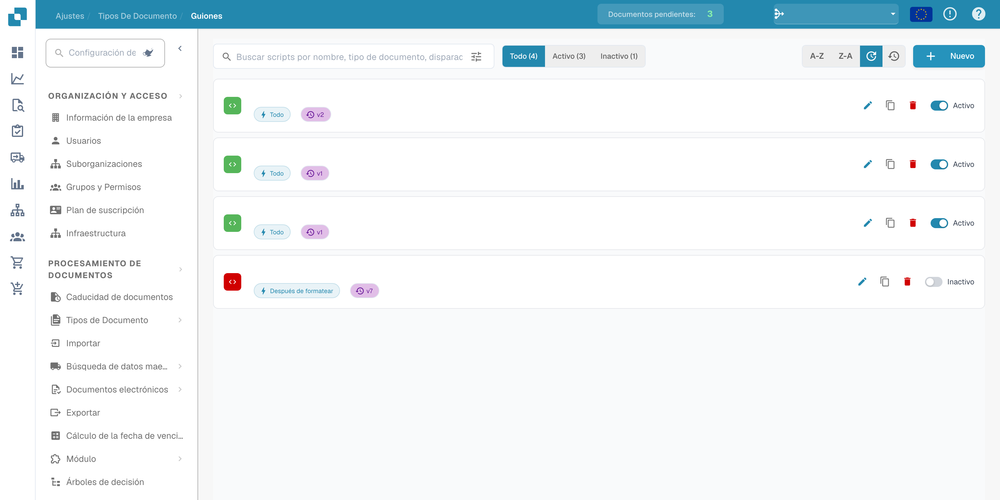
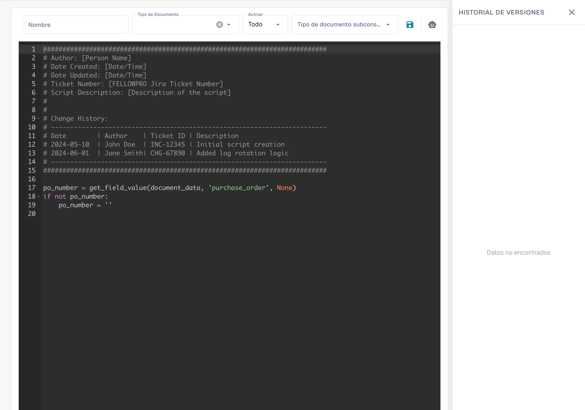

# Creación y edición de scripts


Scripts de documentos de DocBits explicados: automatice la lógica personalizada en su flujo de trabajo de documentos


## Para crear un nuevo script en DocBits, siga estas instrucciones detalladas:

**Elija el lenguaje de scripting:**

Seleccione un tipo de script y un lenguaje que ofrezcan el editor y el entorno de ejecución de su instalación de DocBits. Los tipos disponibles y los contextos de ejecución dependen de la versión instalada.

**Abra el entorno de desarrollo de scripts:**

Inicie sesión en DocBits y navegue al entorno de desarrollo de scripts. Se encuentra en el área de administración.

<figure><figcaption><p>Lista de scripts con nombres, fechas y datos de la organización ocultos.</p></figcaption></figure>

**Cree un nuevo script:**

Haga clic en el botón "+ New" para abrir un nuevo editor de scripts.

<figure><figcaption><p>Editor de un nuevo script con la plantilla inicial suministrada; es distinto del ejemplo independiente de Python que aparece a continuación.</p></figcaption></figure>

**Escriba el código:**

Utilice el editor para escribir el código de su script. Comience con la sintaxis básica del lenguaje de scripting elegido.

Por ejemplo, si utiliza Python, su script podría tener este aspecto:

## 1. Script de ejemplo en Python


## Función para limpiar nombres de pacientes

Este ejemplo independiente de Python muestra la sintaxis. No es un punto de ejecución del ciclo de vida de DocBits verificado; adáptelo al contexto de script documentado antes de utilizarlo.

```python
def clean_patient_name(name):
    cleaned_name = name.strip().title()
    return cleaned_name

if __name__ == "__main__":
    patient_name = " john doe "
    cleaned_name = clean_patient_name(patient_name)
    print("Cleaned patient name:", cleaned_name)
```

## 2. Script de ejemplo


**Pruebe el script:**

Compruebe el código en busca de errores y pruébelo en un entorno de pruebas. Asegúrese de que el script produzca los resultados esperados y funcione correctamente.


**Guarde el script:**

Guarde el script en DocBits y asígnele un nombre significativo que describa su finalidad.


**Asigne el script a tipos de documento:**

Un paso importante es asignar el script a los tipos de documento adecuados. Esto determina cuándo y cómo se aplica el script. Normalmente puede hacerse a través de una interfaz de configuración de DocBits, donde puede asignar el script a un tipo de documento específico y especificar en qué condiciones debe aplicarse.


**Revise y publique:**

Después de haber creado, probado y asignado el script, vuelva a comprobar que no haya errores ni incoherencias. Si todo está correcto, puede publicar el script en el entorno de producción de DocBits.


Mediante estos pasos, puede crear, probar e implementar con éxito un nuevo script en DocBits para automatizar procesos y mejorar la eficiencia de la documentación médica.
