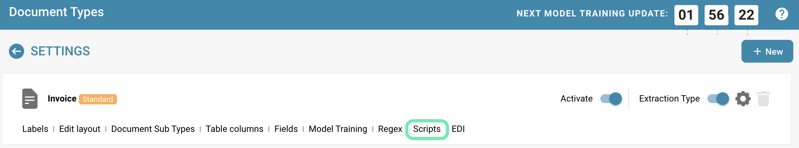
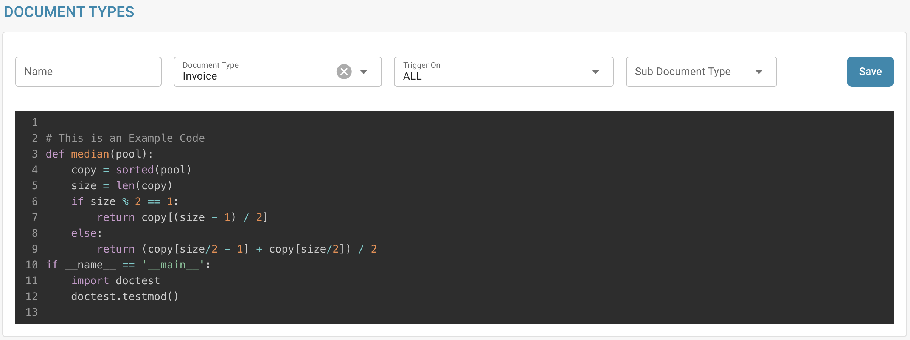
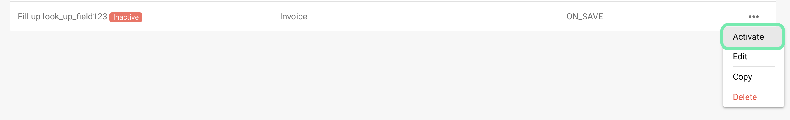

# Creación y edición de scripts


Scripts de documentos de DocBits explicados: automatice la lógica personalizada en su flujo de trabajo de documentos


## Para crear un nuevo script en DocBits, siga estas instrucciones detalladas:

**Elija el lenguaje de scripting:**

Primero, debe elegir el lenguaje de scripting que desea utilizar. DocBits suele admitir lenguajes de scripting comunes como Python, JavaScript o SQL. La elección del lenguaje depende de las necesidades de su proyecto y de su propia competencia.

**Abra el entorno de desarrollo de scripts:**

Inicie sesión en DocBits y navegue al entorno de desarrollo de scripts. Se encuentra en el área de administración.

<figure><figcaption></figcaption></figure>

**Cree un nuevo script:**

Haga clic en el botón "+ New" para abrir un nuevo editor de scripts.

<figure><figcaption></figcaption></figure>

**Escriba el código:**

Utilice el editor para escribir el código de su script. Comience con la sintaxis básica del lenguaje de scripting elegido.

Por ejemplo, si utiliza Python, su script podría tener este aspecto:

## 1. Script de ejemplo en Python

<figure><figcaption></figcaption></figure>

## Función para limpiar nombres de pacientes

def clean\_patient\_name(name): cleaned\_name = name.strip().title() # Remove spaces and apply capitalization

return cleaned\_name

## Programa principal

if **name** == "**main**": patient\_name = " john doe " cleaned\_name = clean\_patient\_name(patient\_name) print("Cleaned patient name:", cleaned\_name)

## 2. Script de ejemplo

<figure><figcaption></figcaption></figure>

**Pruebe el script:**

Compruebe el código en busca de errores y pruébelo en un entorno de pruebas. Asegúrese de que el script produzca los resultados esperados y funcione correctamente.

<figure><figcaption></figcaption></figure>

**Guarde el script:**

Guarde el script en DocBits y asígnele un nombre significativo que describa su finalidad.

<figure><figcaption></figcaption></figure>

**Asigne el script a tipos de documento:**

Un paso importante es asignar el script a los tipos de documento adecuados. Esto determina cuándo y cómo se aplica el script. Normalmente puede hacerse a través de una interfaz de configuración de DocBits, donde puede asignar el script a un tipo de documento específico y especificar en qué condiciones debe aplicarse.

<figure><figcaption></figcaption></figure>

**Revise y publique:**

Después de haber creado, probado y asignado el script, vuelva a comprobar que no haya errores ni incoherencias. Si todo está correcto, puede publicar el script en el entorno de producción de DocBits.

<figure><figcaption></figcaption></figure>

<figure><figcaption></figcaption></figure>

Mediante estos pasos, puede crear, probar e implementar con éxito un nuevo script en DocBits para automatizar procesos y mejorar la eficiencia de la documentación médica.
