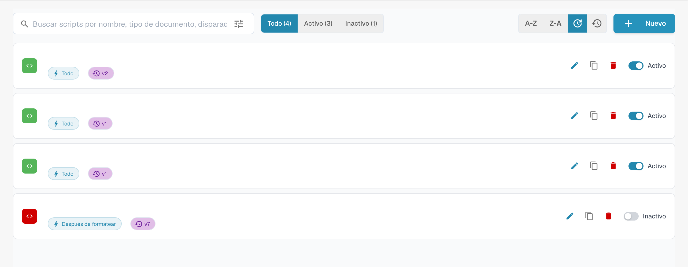

# Activación y administración de scripts

## Videotutorial: administrar scripts


Administrar los scripts de un tipo de documento


El vídeo muestra la lista de scripts con filtro y orden, cómo activar y desactivar, copiar, el historial de versiones y la eliminación con confirmación.

Abra el tipo de documento y su administración de scripts. La lista muestra los scripts disponibles y los controles de edición, duplicación y estado. Los nombres están ocultos en este ejemplo.

<figure><figcaption>
Administración de scripts con controles de edición y nombres ocultos.
</figcaption></figure>

Filtre por estado o busque el script previsto antes de abrirlo. Revise el tipo de documento, el evento de ejecución y el código antes de guardar cambios. No active, duplique ni elimine un script solo para comprobar el aspecto de la interfaz.

Los controles y la disponibilidad dependen de sus permisos. Pruebe cualquier cambio previsto con documentos representativos antes de usarlo en un flujo real.
