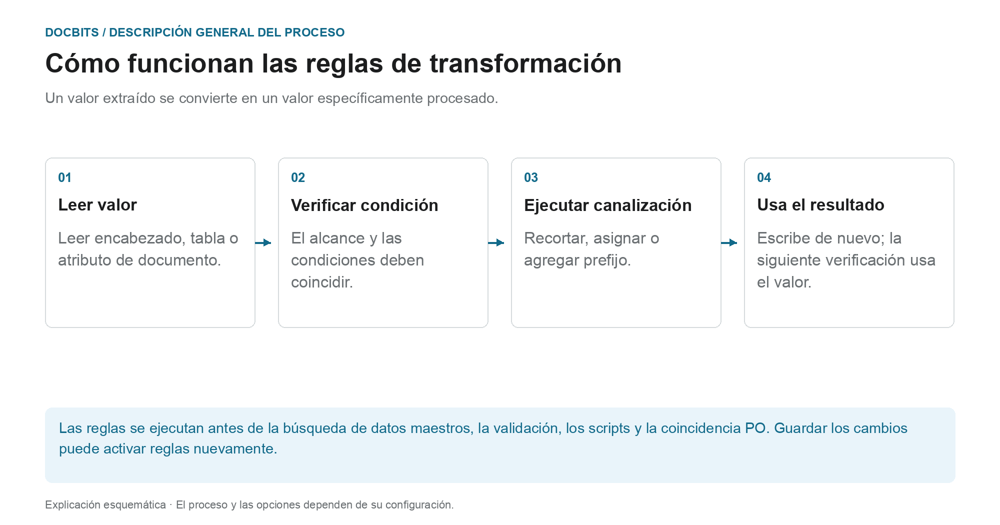
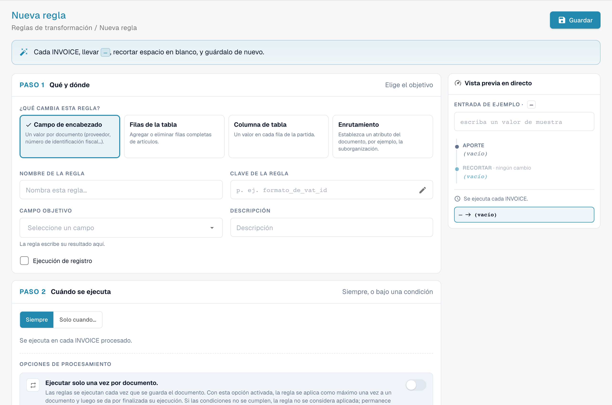
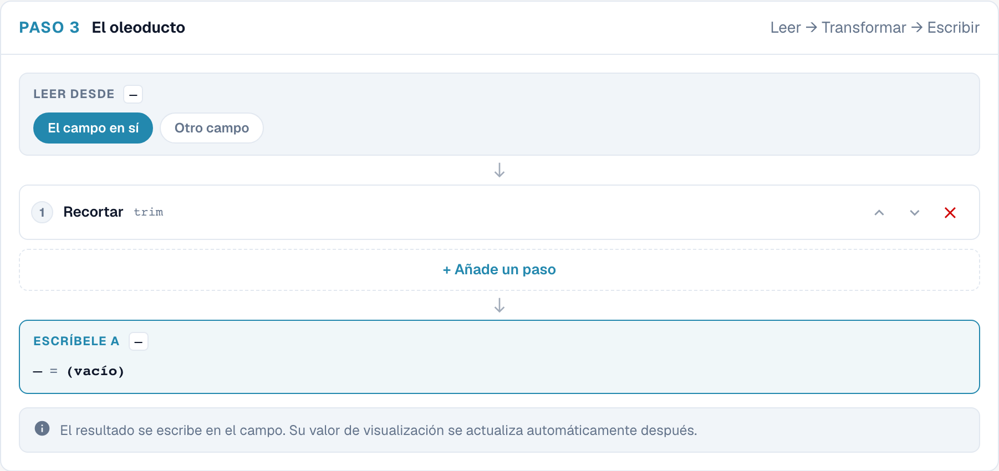
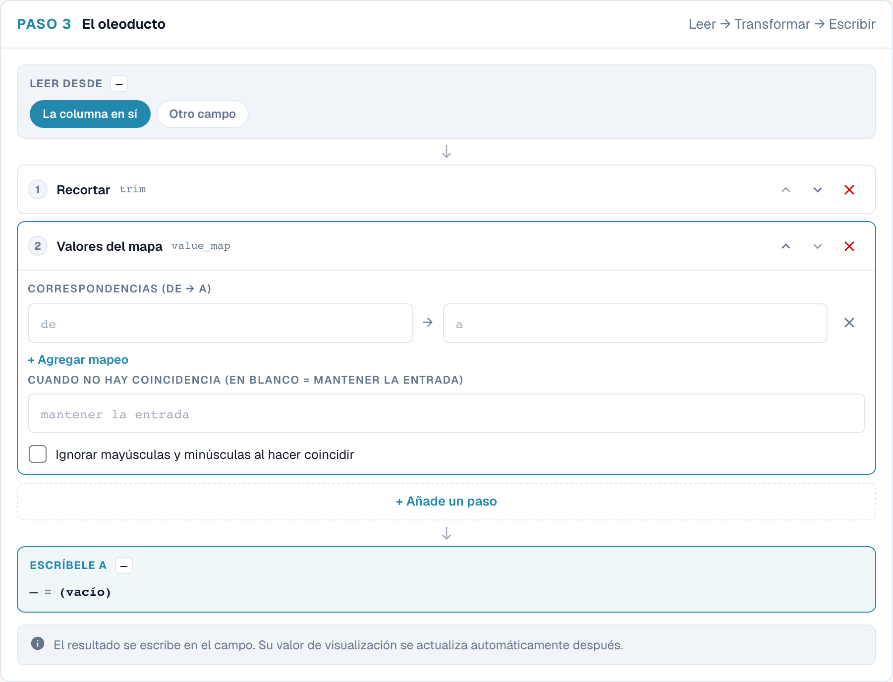
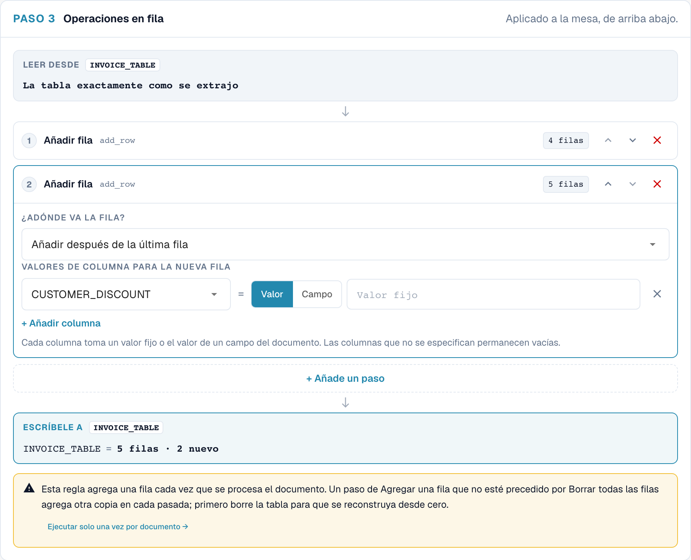
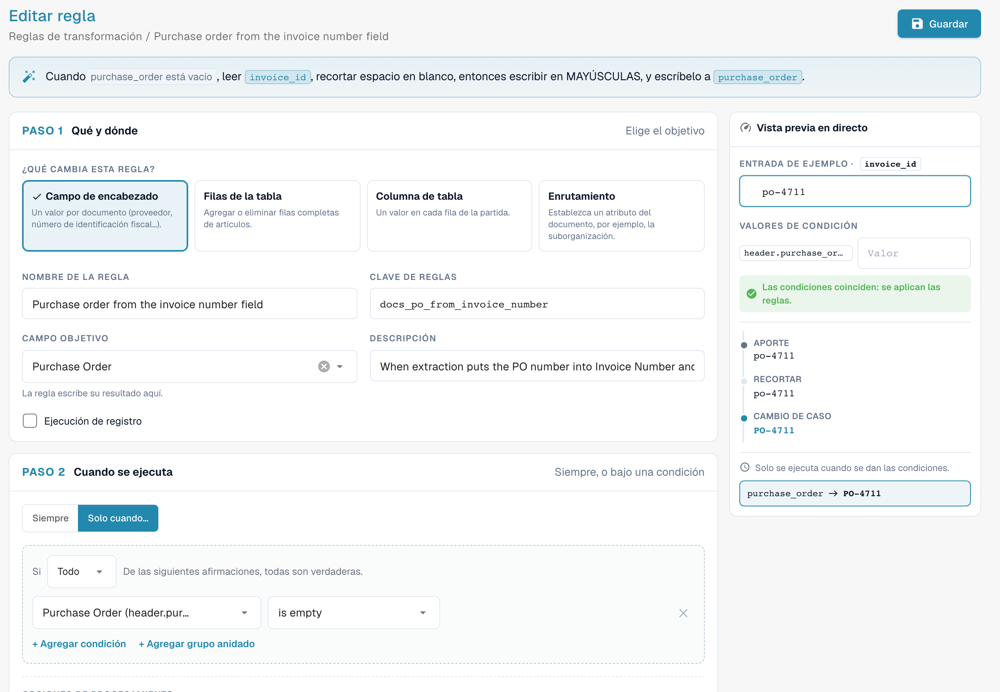
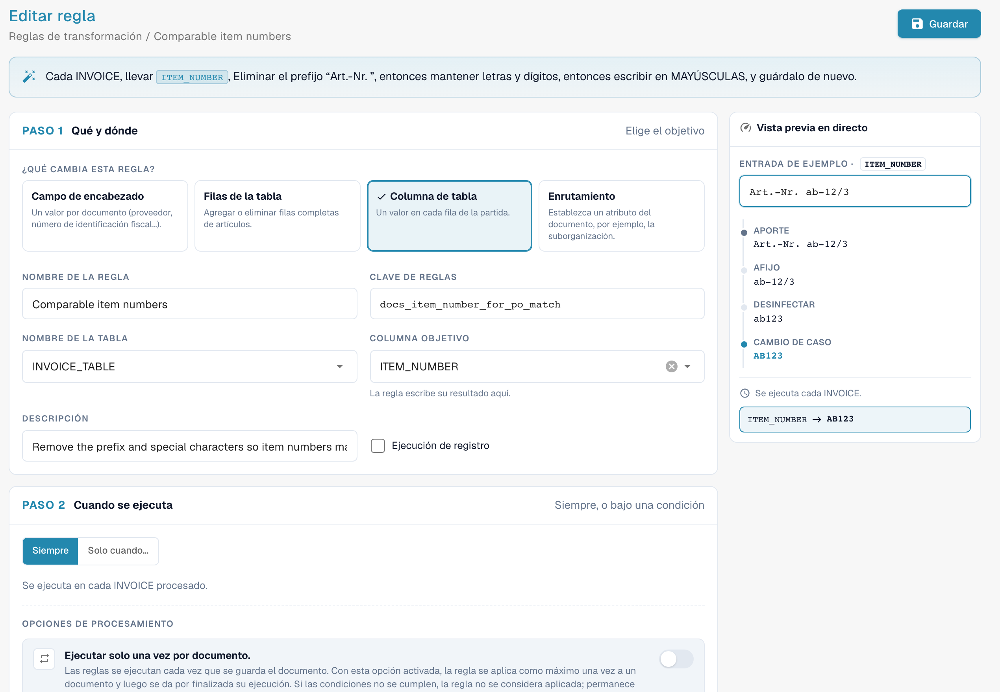

# Reglas de transformación

## Del valor extraído a la verificación posterior

<figure><figcaption>
Un valor extraído se convierte en un valor específicamente procesado. El diagrama es esquemático; La configuración activa de su organización determina el comportamiento real.
</figcaption></figure>

Una transformación cambia los datos existentes; no vuelve a realizar OCR. Lee una entrada, verifica su condición, ejecuta los pasos configurados y escribe el resultado. Si no se cumple la condición, se omite la regla.

**Ejemplo:** Una celda de la tabla contiene `STK`. Una asignación de valores que se aplica al proveedor escribe `PCE`. La coincidencia descendente PO utiliza el código de unidad normalizado. Pruebe también un valor que ya esté normalizado y un valor al que no se debería aplicar la regla.

1. **Activador:** Durante el procesamiento de documentos, las reglas se ejecutan después de la extracción. También pueden volver a ejecutarse cuando se guardan los datos de extracción modificados.
2. **Orden:** Dentro de una ejecución, los ámbitos se procesan en este orden: **Campo de encabezado → Enrutamiento → Filas de la tabla → Columna de la tabla**. Dentro de cada ámbito, la prioridad y la clave determinan el orden.
3. **Efecto:** Una regla de tabla puede cambiar o eliminar elementos de línea. Esto puede cambiar el recuento de filas y los requisitos previos para la conciliación de órdenes de compra. Reemplazar filas que ya han coincidido puede eliminar una asignación existente.
4. **Control:** Compare la entrada, obtenga una vista previa y el resultado guardado. Cuando el registro de ejecución está habilitado, el seguimiento de condición muestra por qué se aplicó u omitió una regla.

**Verificar repeticiones:** Una regla no debe cambiar su valor ya preparado cada vez que se guarda. Utilice pasos idempotentes apropiados, una fuente sin cambios o la ejecución única prevista. Los detalles y ejemplos siguen a continuación; [Reglas de coincidencia PO](more-settings/purchase-order/purchase-order-matching-rules.md) explica el mapeo descendente.



## Descripción general

**Activador:** Durante el procesamiento de documentos, las reglas se ejecutan después de la extracción. También pueden volver a ejecutarse cuando se guardan los datos de extracción modificados.

* un **campo de encabezado** (número de factura, moneda, NIF/ID fiscal del proveedor …),
* una **columna** en cada fila de una tabla (unidad, número de artículo, base de precio …),
* las **filas** de una tabla (borrarlas, añadir una fila),
* un **atributo del documento**: hoy, la suborganización a la que pertenece (**Enrutamiento**).

Cada regla **lee** un valor, lo hace pasar por una breve **pipeline** de pasos y **escribe** el resultado de vuelta. Las reglas se ejecutan **antes** de la validación, los scripts y el PO matching (conciliación de órdenes de compra), por lo que todo lo que viene después ya ve los valores corregidos.

Las reglas de transformación sustituyen a la mayoría de los pequeños scripts que las organizaciones solían escribir para "recortar siempre este campo", "mapear los códigos de unidad de este proveedor", "añadir el prefijo que espera nuestro ERP" o "colapsar las líneas de este proveedor en una única línea total", con un formulario, una vista previa en directo y sin código.

### Problemas que resuelven

| Requisito | Regla |
| --- | --- |
| Un proveedor imprime el número de factura sin el prefijo `INV-` que espera nuestro ERP | Campo de encabezado *Invoice Number*, solo para ese proveedor: Recortar → UPPERCASE → Afijo: añadir prefijo `INV-` |
| Los proveedores envían códigos de unidad alemanes (`STK`, `Std`) y el ERP espera códigos UN/ECE (`PCE`, `HUR`) | Columna de tabla *UNIT*: Map values `STK → PCE`, `KG → KGM`, `Std → HUR` |
| Los números de artículo llegan con un prefijo como `Art.-Nr. 4711` | Columna de tabla *ITEM_NUMBER*: Afijo: quitar prefijo `Art.-Nr. ` |
| Los NIF/ID fiscales contienen espacios y puntos | Campo de encabezado *Supplier Tax ID*: Desinfectar, conservar alfanuméricos |
| Un proveedor se concilia por el total, no por líneas | Filas de la tabla: Clear all rows → Add a row con el importe neto |
| Todos los documentos de determinados proveedores pertenecen a una suborganización | Enrutamiento: asignar la suborganización cuando *Supplier ID is one of …* |
| Las fechas deben escribirse en un formato fijo en un campo de texto libre | Campo de encabezado: Reformat date `%d.%m.%Y` |
| El número de orden de compra está en el campo equivocado (por ejemplo, en *Invoice Number*) | Campo de encabezado *Purchase Order*: leer de *Invoice Number*, solo cuando *Purchase Order is empty* |
| El número de orden de compra lleva ceros a la izquierda o un prefijo que la orden de compra no tiene | Campo de encabezado *Purchase Order*: Recortar `0` a la izquierda, o Afijo: quitar prefijo |
| Los números de artículo se diferencian de las líneas de la orden de compra en mayúsculas/minúsculas, espacios o prefijos | Columna de tabla *ITEM_NUMBER*: Afijo: quitar prefijo → Desinfectar → UPPERCASE |

## Activar las reglas de transformación

Las reglas de transformación las activa **por tipo de documento** un **administrador de la organización**.

1. Vaya a **Ajustes → Ajustes generales → Tipos de documento**.
2. Haga clic en el icono de **ajustes** (engranaje) de la tarjeta del tipo de documento.
3. Abra **Reglas de transformación** y active el interruptor. Haga clic en **Gestionar las reglas de transformación** para abrir la lista.

<figure><figcaption>
El interruptor Transformation Rules en los ajustes adicionales de un tipo de documento
</figcaption></figure>

La tarjeta del tipo de documento muestra ahora un enlace **Reglas de transformación** y un enlace **Registros** para los registros de ejecución.

## La lista de reglas

La lista muestra todas las reglas del tipo de documento en el orden en que se ejecutan, cada una con un resumen de una frase ("When invoice_id is abcd, take invoice_id, make it UPPERCASE, and save it back."), su alcance (**Encabezamiento**, **Tabla**, **Columna**, **Enrutamiento**), el número de pasos, su origen y si **Ejecución de registro** está activado. Filtre por alcance y por **Active / Inactive**, busque, y use el menú **⋮** para duplicar o eliminar una regla.

Las reglas proceden de tres orígenes, igual que las reglas de validación: reglas **Configuración predeterminada del sistema** que se suministran con DocBits (haga clic en **Personalizar** para obtener una copia editable), reglas de sistema **Personalizado** (**Restablecer a valores predeterminados** restaura el original) y reglas **A medida** que usted ha creado.

## Crear una regla

Haga clic en **Nueva regla**. El constructor tiene tres pasos a la izquierda y una **Vista previa en directo** a la derecha. En la parte superior resume la regla en una frase mientras la construye.

<figure><figcaption>
Ámbitos de transformación: cabecera, filas, columna y enrutamiento.
</figcaption></figure>

### Paso 1 — Qué y dónde

**¿Qué cambia esta regla?** — el alcance:

| Alcance | Cambia | Destino | Se ejecuta |
| --- | --- | --- | --- |
| **Campo de encabezado** | un valor por documento | un campo de encabezado, p. ej. *Invoice Number* | una vez por documento |
| **Filas de la tabla** | filas completas de líneas: borrarlas o añadir filas | una tabla, p. ej. `INVOICE_TABLE` | una vez por documento |
| **Columna de tabla** | un valor en cada fila de líneas | una tabla y una columna, p. ej. `INVOICE_TABLE` / `UNIT` | una vez por fila |
| **Enrutamiento** | un atributo del documento: hoy, la suborganización | *suborganización* | una vez por documento |

A continuación, introduzca el **Nombre de la regla** (la **Clave de reglas** se genera a partir de él), elija el **Campo objetivo** / **Nombre de la tabla** / **Columna objetivo** y, opcionalmente, una **Descripción**. **Ejecución de registro** escribe una entrada de registro por cada aplicación, lo que resulta útil mientras ajusta una regla.

### Paso 2 — Cuándo se ejecuta

* **Siempre** — la regla se ejecuta en cada documento del tipo.
* **Solo cuando…** — la regla se ejecuta solo si se cumple una condición, por ejemplo *Supplier ID is HP0000278*. En las reglas de **Columna de tabla**, la condición puede usar las columnas de la fila actual y se comprueba fila por fila. Consulte [Rule Conditions (Applies when)](rule-conditions-applies-when.md) para ver todos los campos, operadores y ejemplos.

Dos opciones controlan con qué frecuencia se aplica la regla:

| Opción | Efecto |
| --- | --- |
| **Ejecutar solo una vez por documento** | Normalmente las reglas se vuelven a ejecutar en cada guardado. Con esta opción activada, la regla se aplica **como máximo una vez** a un documento y después termina con él. Una pasada en la que las condiciones no coinciden no cuenta, por lo que la regla aún puede aplicarse en un guardado posterior. Es necesaria para pasos que volverían a cambiar el valor en cada guardado (consulte [Idempotencia](#ejecutar-una-vez-e-idempotencia)) y para reglas de tabla que no deben reconstruir las líneas de nuevo. |
| **Ejecutar después de la población de búsqueda (antes de la coincidencia PO)** | *(versiones recientes)* Ejecuta la regla en una pasada adicional después de que se hayan rellenado los datos de búsqueda (por ejemplo, los datos maestros de proveedores) y antes del PO matching. Úsela cuando la regla necesite un valor que proporciona una búsqueda. La regla se sigue ejecutando también en las etapas habituales; una regla de ejecución única con esta opción espera a esta pasada en lugar de ejecutarse justo después de la extracción. |

### Paso 3 — The pipeline

<figure><figcaption>
Pasos de procesamiento de una regla de transformación.
</figcaption></figure>

* **Leer desde** — **el propio campo (o columna)**, u **otro campo**. Leer de otro campo permite rellenar un campo a partir de otro, por ejemplo copiar el número de orden de compra de un campo de texto libre.
* **Pasos** — el valor pasa por los pasos **de arriba abajo**; la salida de un paso es la entrada del siguiente. Añada pasos con **+ Add a step**, reordénelos con las flechas y elimínelos con **✕**. Cada paso muestra a su derecha el valor intermedio del ejemplo.
* **Escríbele a** — el destino del paso 1. DocBits escribe el valor almacenado y después actualiza automáticamente el valor mostrado.

### Los pasos

<figure><figcaption>
Todos los pasos, agrupados por finalidad
</figcaption></figure>

| Paso | Ajustes | Ejemplo de entrada → salida |
| --- | --- | --- |
| **Cambio de caso** | UPPERCASE, minúscula, título, mayúscula primero | `inv-4711` → `INV-4711` |
| **Recortar** | lado (ambos, izquierda, derecha); caracteres (vacío = espacios en blanco) | `  4711 ` → `4711`; con el carácter `0` y lado izquierdo: `004711` → `4711` |
| **Almohadilla** | longitud, carácter de relleno, lado | longitud 10, `0`, izquierda: `4711` → `0000004711` |
| **Truncar** | longitud máxima | 10: `ABCDEFGHIJKL` → `ABCDEFGHIJ` |
| **Afijo** | añadir prefijo, añadir sufijo, quitar prefijo, quitar sufijo; texto | añadir prefijo `INV-`: `4711` → `INV-4711`; quitar prefijo `Art.-Nr. `: `Art.-Nr. 4711` → `4711` |
| **Desinfectar** | conservar solo (alfanuméricos, letras, dígitos, alfanuméricos + espacio) o eliminar los caracteres indicados | conservar alfanuméricos: `DE 123.456.789` → `DE123456789` |
| **Toma una rebanada** | inicio, longitud o fin | inicio 0, longitud 4: `2026-09-29` → `2026` |
| **Extracto** | patrón, grupo de captura | patrón `PO[- ]?(\d+)`, grupo 1: `Order PO-45001234` → `45001234` |
| **Buscar y reemplazar** | patrón, reemplazar por, cantidad (0 = todos) | patrón `\s+`, reemplazar por ` `: `ACME    GmbH` → `ACME GmbH` |
| **Valores del mapa** | asignaciones (de → a), valor cuando no hay coincidencia (vacío = conservar la entrada), ignorar mayúsculas y minúsculas | `STK → PCE`: `stk` → `PCE` |
| **Fecha de reformateo** | patrón de salida (`%d.%m.%Y`, `%m/%d/%Y`, `%Y-%m-%d`, `%d %b %Y`) | `%d.%m.%Y`: `2026-09-29` → `29.09.2026` |
| **Número de formato** | configuración regional (de_DE, en_US, en_GB, fr_FR), decimales mín. y máx. | de_DE, 2 decimales: `1234.5` → `1.234,50` |
| **Valor fijo** | el valor | escribe siempre el valor, sea cual sea el contenido del campo |
| **Borrar** | – | vacía el campo |

Las reglas de **Filas de la tabla** usan dos pasos distintos, que trabajan sobre filas en lugar de sobre valores:

| Paso | Efecto |
| --- | --- |
| **Borrar todas las filas** | elimina todas las filas extraídas. Las filas añadidas por un paso posterior se conservan. |
| **Añadir una fila** | añade una fila **después de la última fila** o **antes de la primera fila**. Para cada columna, elija **Valor** (un valor fijo) o **Campo** (el valor de un campo de encabezado). Las columnas que omita permanecen vacías. |


**Fecha de reformateo** espera la fecha tal como DocBits la almacena internamente (`YYYY-MM-DD`). Aplíquelo al propio campo, no a un texto que ya contenga una fecha con formato.


### Vista previa en directo

La vista previa en directo ejecuta la regla sobre un ejemplo mientras la construye:

* **Entrada de ejemplo** — escriba un valor tal como vendría del documento. Para las reglas de tabla, introduzca el número de filas extraídas (**Tabla de ejemplo**) y los valores de los campos que leen las nuevas filas (**Valores de origen de fila**).
* **Valores de condición** — para las reglas con condición, escriba los valores de los campos de la condición. La vista previa muestra **Las condiciones coinciden: se aplican las reglas.** o **Las condiciones no coinciden: se omite la regla.**.
* Más abajo se ve el valor después de **cada paso** y el resultado final que se escribiría ("invoice_id → INV-230620-03A", o "unchanged").

No se guarda nada mientras usa la vista previa. Haga clic en **Guardar** para guardar la regla.

## Ejemplos

### Limpiar el número de factura de un proveedor

Campo de encabezado **Número de factura** · solo cuando *Supplier ID is HP0000278* · Recortar → Cambio de caso UPPERCASE → Afijo añadir prefijo `INV-`.
Ejemplo `  230620-03a ` → `INV-230620-03A`. Consulte la captura de pantalla de la pipeline más arriba.

### Mapear códigos de unidad

Columna de tabla **INVOICE_TABLE / UNIT** · siempre · Recortar → Map values `STK → PCE`, `KG → KGM`, `Std → HUR`, **Ignorar mayúsculas y minúsculas al hacer coincidir** activado, valor sin coincidencia vacío (conservar la entrada).

<figure><figcaption>
Asignación de valores de una columna en el editor de transformaciones.
</figcaption></figure>

### Una línea total para un proveedor conciliado por el total

Filas de la tabla **INVOICE_TABLE** · solo cuando *Supplier ID is HP0000278* · Clear all rows → Add a row con `POSITION` = valor `001`, `QUANTITY` = valor `1`, `NET_AMOUNT` = campo *Total Net Amount*.

<figure><figcaption>
Paso de transformación sin guardar para añadir una fila.
</figcaption></figure>

El orden importa: **Borrar todas las filas** debe ir **antes** de **Añadir una fila**. El constructor le avisa si no es así ("Clear all rows runs after Add a row …") y también le avisa si un paso **Añadir una fila** no va precedido de **Borrar todas las filas**, porque entonces la regla añadiría otra copia de la fila en cada guardado. Combine esta regla con una regla de PO matching por total que esté activa para documentos de una sola línea.

### Rellenar la orden de compra a partir del campo del número de factura

Campo de encabezado **Número de pedido** · solo cuando *Purchase Order is empty* · **Leer desde** *Invoice Number* → Recortar → Cambio de caso UPPERCASE.

<figure><figcaption>
La regla y su vista previa en directo: <code>po-4711</code> se convierte en <code>PO-4711</code> en <code>purchase_order</code>. Regla de ejemplo en un tipo de documento de prueba.
</figcaption></figure>

Algunos proveedores imprimen el número de pedido donde la extracción espera el número de factura. Entonces **Número de factura** contiene el número de orden de compra y **Número de pedido** está vacío, y el conciliador de órdenes de compra no encuentra nada que conciliar. Esta regla copia el valor antes de que empiece la conciliación. En una prueba en un sistema de desarrollo, un documento con exactamente este problema pasó de *sin conciliar* a *totalmente conciliado* (2 de 2 líneas) al guardarlo con la regla. La regla solo se ejecuta mientras **Número de pedido** está vacío, por lo que nunca sobrescribe un número que se extrajo correctamente.

### Hacer comparables los números de artículo para la conciliación de órdenes de compra

Columna de tabla **INVOICE_TABLE / ITEM_NUMBER** · siempre · Afijo: quitar prefijo `Art.-Nr. ` → Desinfectar: conservar alfanuméricos → Cambio de caso UPPERCASE.

<figure><figcaption>
La vista previa en directo muestra cada paso: <code>Art.-Nr. ab-12/3</code> se convierte en <code>AB123</code>
</figcaption></figure>

Si la factura indica `Art.-Nr. ab-12/3` y la orden de compra tiene `AB123`, las líneas no coinciden. La regla lleva el valor de la factura a la forma que tiene en la orden de compra. Compruebe la forma que usan sus órdenes de compra y adapte los pasos.

### Más ejemplos

| Objetivo | Alcance | Condición | Pasos |
| --- | --- | --- | --- |
| Quitar espacios y puntos del NIF/ID fiscal | Encabezado *Supplier Tax ID* | siempre | Desinfectar: conservar alfanuméricos |
| Quitar el prefijo del artículo | Columna *ITEM_NUMBER* | siempre | Afijo: quitar prefijo `Art.-Nr. ` |
| Números de proveedor de 10 dígitos | Encabezado *Supplier ID* | siempre | Recortar → Pad longitud 10 con `0`, izquierda |
| Extraer el número de orden de compra de un texto de referencia | Encabezado *Purchase Order*, leído de otro campo | solo cuando *La orden de compra está vacía* | Extract `PO[- ]?(\d+)`, grupo 1 |
| Usar siempre una única moneda para un proveedor | Encabezado *Currency* | solo cuando *Supplier ID is 10040* | Fix value `CHF` |
| Eliminar un valor extraído erróneamente | Encabezado *Discount Term* | solo cuando *Supplier ID is 20723* | Clear |
| Base de precio por unidad | Columna *UNIT_PRICE_PER* | solo cuando *row.UNIT_PRICE_PER is empty* | Fix value `1` |
| Enrutar proveedores a una suborganización | Enrutamiento | *Supplier ID is one of* `10040, 10041` | asignar una suborganización fija |
| Quitar los ceros a la izquierda del número de orden de compra | Encabezado *Purchase Order* | siempre | Recortar caracteres `0`, lado izquierdo |
| Conservar solo los dígitos del número de orden de compra | Encabezado *Purchase Order* | siempre | Desinfectar: conservar solo dígitos (`PO-45001234` → `45001234`) |
| Acortar una referencia de orden de compra demasiado larga | Encabezado *Purchase Order* | solo cuando *Supplier ID is 20723* | Truncate a 10 caracteres |
| Añadir al número de orden de compra el prefijo que espera su ERP | Encabezado *Purchase Order* | solo cuando *Supplier ID is 10040* | Afijo: añadir prefijo `4500` |
| Escribir los importes como los lee su ERP | Encabezado *Total Amount* | siempre | Format number, configuración regional `de_DE`, 2 decimales |
| Quitar los espacios dentro de los números de artículo | Columna *ITEM_NUMBER* | siempre | Desinfectar: eliminar los caracteres ` ` (espacio) |
| Usar mayúsculas en los números de artículo | Columna *ITEM_NUMBER* | siempre | Cambio de caso UPPERCASE |
| Enviar las órdenes de compra de una planta a una suborganización | Enrutamiento | *Purchase Order starts with* `4500` | asignar una suborganización fija |

## Reglas de enrutamiento (suborganización)

Una regla de **Enrutamiento** no cambia un campo. Marca un atributo en el documento cuando se cumplen sus condiciones: hoy, la **suborganización**. Elija **Asignar una suborganización fija** y selecciónela de la lista, o **Mapa desde un campo** para asignar valores de un campo extraído a suborganizaciones. El documento pasa entonces a pertenecer a esa suborganización, con sus usuarios, permisos y ajustes. Un valor que no sea una suborganización válida nunca se escribe.

## Cuándo se ejecutan las reglas

* **Durante el procesamiento**, después de la extracción y antes de la consulta de datos maestros, la validación, los scripts y el PO matching.
* En **cada guardado** del documento en el que hayan cambiado los datos extraídos. Las reglas sin **Ejecutar solo una vez por documento** se aplican de nuevo cada vez.
* Dentro de una misma pasada, las reglas se ejecutan alcance por alcance en este orden: **Campo de encabezado → Enrutamiento → Filas de la tabla → Columna de tabla**. Por tanto, una regla de columna también se aplica a las filas que una regla de tabla acaba de añadir. Dentro de un alcance, las reglas se ejecutan por prioridad y luego por clave.

### Ejecutar una vez e idempotencia

La mayoría de los pasos dan el mismo resultado cuando se ejecutan sobre su propia salida: recortar un valor ya recortado, mapear `PCE` de nuevo, añadir un prefijo que ya está. Estas reglas pueden ejecutarse sin problema en cada guardado.

**Toma una rebanada**, **Extracto** y **Buscar y reemplazar** son distintos: si se ejecutan de nuevo sobre su propio resultado, siguen cambiándolo (un fragmento toma los cuatro primeros caracteres de los cuatro primeros caracteres …). Por eso DocBits no le permite guardar una regla que aplique estos pasos a su propio campo de destino. Haga una de estas dos cosas:

* active **Ejecutar solo una vez por documento**, o
* **Leer desde otro campo**, de modo que la entrada permanezca sin cambios.

## Reglas de transformación y PO matching

Las reglas se ejecutan **antes** del PO matching, por lo que pueden preparar exactamente lo que lee el conciliador:

| Lo que lee el conciliador | Lo que puede hacer una regla | Ejemplo |
| --- | --- | --- |
| El número de orden de compra del encabezado | copiarlo de otro campo, extraerlo de un texto, quitar prefijos y ceros a la izquierda | [Rellenar la orden de compra a partir del campo del número de factura](#rellenar-la-orden-de-compra-a-partir-del-campo-del-numero-de-factura) |
| Los números de artículo de las líneas | quitar prefijos, eliminar caracteres especiales, unificar mayúsculas y minúsculas | [Hacer comparables los números de artículo](#hacer-comparables-los-numeros-de-articulo-para-la-conciliacion-de-ordenes-de-compra) |
| Los códigos de unidad | mapear los códigos del proveedor a los suyos | [Mapear códigos de unidad](#mapear-codigos-de-unidad) |
| El número de líneas | colapsar las líneas en una única línea total | [Una línea total](#una-linea-total-para-un-proveedor-conciliado-por-el-total) |

Las reglas de tabla y de columna cambian lo que ve el conciliador de órdenes de compra:

* Una regla de tabla que **reconstruye** líneas (por ejemplo, borrar todas las filas y añadir una línea total) conserva una conciliación de orden de compra existente siempre que produzca **de nuevo las mismas líneas**: los valores se comparan por su significado, por lo que `1.0` y `1.00` son la misma línea. Las líneas conservan su identidad y la conciliación sobrevive a cada guardado.
* Si una regla **sustituye o elimina líneas que estaban conciliadas**, la conciliación no se puede conservar. El documento registra entonces qué regla la descartó, la pantalla de Purchase Order Matching lo muestra como motivo ("_The PO match could not be saved: the transformation rule "…" rebuilt the table_") y los administradores reciben un enlace a la regla. El **historial de conciliación** del documento muestra un paso _Transformation rules_ antes de la primera etapa de conciliación, con las reglas que se ejecutaron.
* El número de líneas tras las reglas es lo que cuentan las [condiciones de activación](more-settings/purchase-order/purchase-order-matching-rules.md#condiciones-de-activacion) de las reglas de conciliación. Una regla que colapsa una factura en **una** línea solo tiene sentido junto con una regla de conciliación por total que esté activa para documentos de una línea (`[[count(table_lines)]] >= 1`).

## Registros

Con **Ejecución de registro** activado, cada aplicación de la regla se escribe en **Tipos de documento → (tipo de documento) → Registros**, con el resultado (applied, no change, skipped), el documento y, para las reglas omitidas, el rastro de condiciones que explica el motivo. Consulte [Leer el rastro de condiciones](rule-conditions-applies-when.md#leer-el-rastro-de-condiciones-en-los-registros).

## Buenas prácticas

* **Un propósito por regla.** "Limpiar el número de factura" y "Mapear códigos de unidad" son dos reglas, no una.
* **Construya con la vista previa en directo**, usando valores reales copiados de documentos, incluidos los poco habituales (espacios, minúsculas, prefijos).
* **Limite las reglas específicas de un proveedor con una condición** en lugar de dejar que se ejecuten sobre todo.
* **Prefiera pasos idempotentes.** Use la ejecución única solo donde la necesite.
* **Vigile el PO matching** después de añadir reglas de tabla; revise el historial de conciliación de unos cuantos documentos.
* **Desactive Ejecución de registro** una vez que la regla funcione.

## Solución de problemas

| Síntoma | Qué comprobar |
| --- | --- |
| La regla no cambió nada | ¿Está activa y está habilitada la función para el tipo de documento? ¿Se cumple la condición para este documento (valor exacto, incluidos espacios y mayúsculas/minúsculas)? ¿Se ha aplicado ya al documento una regla de **ejecución única**? Revise el rastro del registro. |
| El valor cambia de nuevo en cada guardado | La pipeline contiene Take a slice, Extract o Find & replace. Active **Ejecutar solo una vez por documento**, o lea de otro campo. |
| Una tabla obtiene una fila más en cada guardado | Un paso **Añadir una fila** sin **Borrar todas las filas** antes. Añada primero el paso de borrado, o active la ejecución única. |
| La conciliación de la orden de compra se pierde tras guardar | Una regla de tabla sustituyó las líneas conciliadas. El motivo en el documento nombra la regla; haga que la regla reproduzca las mismas líneas o configúrela para ejecutarse una sola vez. |
| Una regla de conciliación nunca se ejecuta tras la transformación | La regla cambió el número de líneas; ajuste la condición de activación de la regla de conciliación. |
| La regla necesita un valor de los datos maestros del proveedor, pero sigue vacío | Activo **Ejecutar después de la población de búsqueda (antes de la coincidencia PO)**. |
| Una fecha no se reformatea | Reformat date espera `YYYY-MM-DD` como entrada. |

## Relacionado

* [Rule Conditions (Applies when)](rule-conditions-applies-when.md) — las condiciones en detalle
* [Custom Validation Rules](custom-validation-rules.md) — compruebe los valores transformados
* [Layout Selection Rules](layout-manager/layout-selection-rules.md) — elija el layout que usa un documento
* [Reglas de conciliación de órdenes de compra](more-settings/purchase-order/purchase-order-matching-rules.md)
