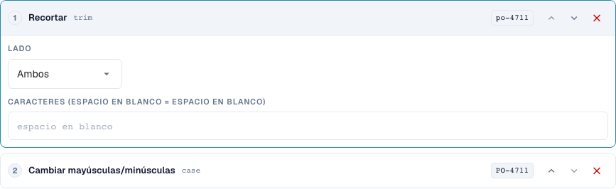
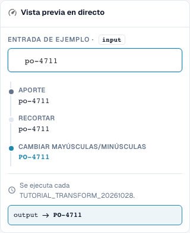
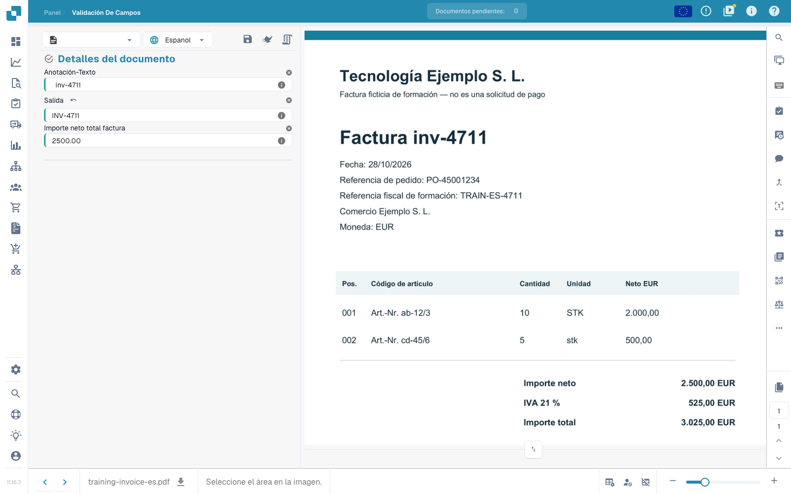

# Fundamentos, ámbitos de aplicación y pruebas seguras

[Volver a la visión general práctica completa](complete-practical-guide.md)

Campo de encabezado · Destino Resultado · Fuente Texto original · Recortar → Mayúsculas → Prefijo INV-.

## Nombres visibles en el editor

Algunas etiquetas de la interfaz actual presentan traducciones imprecisas. La tabla indica el texto que aparece realmente para que puedas encontrar el paso correcto; la explicación funcional usa terminología técnica. Las capturas muestran la interfaz sin modificar.

| Operación | Etiqueta visible |
| --- | --- |
| trim | Recortar |
| case | Cambiar mayúsculas/minúsculas |

## Procedimiento en el editor

1. En el tipo de documento de formación aislado, crear una nueva regla para un **campo de encabezado**. Seleccionar como destino `output` y como fuente separada `header.input`; los nombres de campo reales de su organización pueden diferir.
2. Añadir los pasos **Recortar**, ambos lados, carácter vacío y después **Cambiar mayúsculas/minúsculas**, modo upper. El orden debe ser Recortar → Mayúsculas.
3. Introducir el valor de prueba `  inv-4711  `. El último valor de previsualización debe ser `INV-4711`; los valores intermedios muestran primero `inv-4711`.
4. Activar la regla exclusivamente para el ámbito de formación y guardar. Volver a abrir la entrada y comprobar la fuente, el destino y ambos pasos.
5. Guardar el documento de ejercicio, volver a cargarlo y comprobar ambos campos: la fuente sigue conteniendo los espacios originales, la salida es `INV-4711`. Guardar de nuevo y repetir la misma comprobación.

<figure><figcaption>
Configuración de pasos. Interfaz real en español de España. La vista previa no modifica los documentos almacenados.
</figcaption></figure>


Configuración de pasos. Interfaz real en español de España. La vista previa no modifica los documentos almacenados.


<figure><figcaption>
Vista previa en directo con valores de entrenamiento. Interfaz real en español de España. La vista previa no modifica los documentos almacenados.
</figcaption></figure>


Vista previa en directo con valores de entrenamiento. Interfaz real en español de España. La vista previa no modifica los documentos almacenados.


## 1. Ámbito de aplicación

Una transformación modifica datos ya extraídos. No sustituye el reconocimiento de texto. En el editor selecciono primero el ámbito de aplicación. Un campo de encabezado se procesa una vez por documento. Una columna de tabla se procesa para cada fila. Las reglas de tabla modifican líneas de factura completas. El routing asigna el documento a una suborganización. Estas cuatro tareas tienen objetivos diferentes y pasos diferentes. Creo mis ejemplos en un tipo de documento de prueba propio, para que no se modifiquen facturas productivas.

## 2. Fuente y procesamiento

Después selecciono el campo de destino. La fuente puede ser este campo mismo u otro campo. Los pasos se ejecutan de arriba abajo. Cada valor intermedio se convierte en la entrada del siguiente paso. Mi ejemplo lee un número de factura, elimina espacios exteriores y escribe mayúsculas. Una letra minúscula pasa a ser mayúscula. Con una condición limito la regla al proveedor correspondiente. En una columna de tabla, la condición también puede comprobar valores de la fila actual. Varias condiciones se pueden combinar con Y, O y grupos.

## 3. Comprobar el efecto

La previsualización en vivo aún no guarda nada. Compruebo un valor adecuado, un caso contrario y un resultado ya corregido. A continuación guardo la regla, la vuelvo a abrir y compruebo la configuración guardada. Para el efecto real en el documento necesito además un documento de prueba, una operación de guardado y el resultado recién cargado. Una previsualización no demuestra ni una exportación realizada ni una conciliación de pedido exitosa. Los registros de ejecución me ayudan a distinguir entre condiciones aplicadas y omitidas. En los siguientes episodios revisaremos las transformaciones individuales y sus límites.

## Ejemplos comprobados y casos contrarios

Estos valores se comprobaron en el servidor como prueba en seco. Una prueba así no modifica documentos guardados.

| Caso | Entrada | Resultado del servidor |
| --- | --- | --- |
| copy | `  po-4711  ` | `PO-4711` |

## Aceptación

Compruebe un caso adecuado, un caso contrario, un valor vacío y un resultado ya procesado. Repita la operación de guardado del documento. Compruebe además la conciliación de pedido (PO) y la recepción en el ERP, si corresponden al objetivo funcional.

## Efecto guardado en el documento de ejercicio

<figure><figcaption>
El valor original preparado se conserva; la salida muestra INV-4711. Dos operaciones de guardado nativas, una recarga y una consulta de servidor separada confirman el resultado estable. Esto demuestra el efecto de la regla sobre valores de prueba preparados, no la precisión de una extracción automática.
</figcaption></figure>


El valor original preparado se conserva; la salida muestra INV-4711. Dos operaciones de guardado nativas, una recarga y una consulta de servidor separada confirman el resultado estable. Esto demuestra el efecto de la regla sobre valores de prueba preparados, no la precisión de una extracción automática.


## Vídeo tutorial


Configuración, ejemplos prácticos y casos contrarios.


[Abrir el vídeo con subtítulos en español y capítulos](https://docbits-videos.fra1.cdn.digitaloceanspaces.com/settings-assistant/transformation-rules-01-foundations-preview-admin/v1/es.html). Esta versión de revisión está pendiente de la revisión técnica y de escucha completa.
