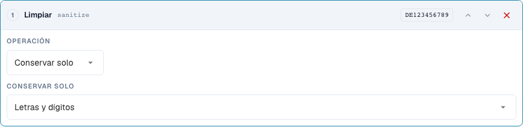
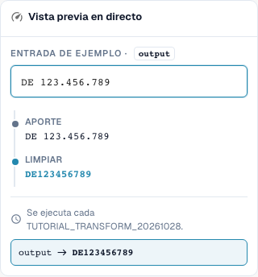

# Limpiar texto: escritura, recorte y caracteres

[Volver a la vista general completa de la práctica](complete-practical-guide.md)

Campo de cabecera · Resultado objetivo · Probar pasos individualmente: case, trim, sanitize.

## Nombres visibles en el editor

Algunas etiquetas de la interfaz actual presentan traducciones imprecisas. La tabla indica el texto que aparece realmente para que puedas encontrar el paso correcto; la explicación funcional usa terminología técnica. Las capturas muestran la interfaz sin modificar.

| Operación | Etiqueta visible |
| --- | --- |
| case | Cambiar mayúsculas/minúsculas |
| trim | Recortar |
| sanitize | Limpiar |

## Procedimiento en el editor

1. Para el campo de cabecera de formación, crear un único paso **Cambiar mayúsculas/minúsculas**. Comprobar los modos upper, lower, title y capitalize sucesivamente con los ejemplos de la tabla.
2. Para el número de factura, iniciar una nueva canalización con **Recortar**. Ambos lados y un campo de caracteres vacío eliminan el espacio exterior; `47 11` debe conservar su espacio interior.
3. Como prueba de contraste separada al recortar, configurar lado izquierdo y carácter `0`: `004711` se convierte en `4711`, `000` queda vacío. No adoptar este paso sin verificar para identificadores reales.
4. Para un número de identificación fiscal, utilizar **Limpiar caracteres** conservando alfanumérico. `DE 123.456.789` debe dar `DE123456789`. Comprobar los demás modos de conservación con `DE-123` y `ACME GmbH!` respectivamente.
5. Para capitalize, comparar explícitamente la vista previa y el servidor: para el `aCME GMBH` verificado, estos resultados son diferentes. El resultado del servidor es `Acme gmbh`; una representación adecuada en el navegador por sí sola no es suficiente.

<figure><figcaption>
Configuración de pasos. Interfaz real en español de España. La vista previa no modifica los documentos almacenados.
</figcaption></figure>


Configuración de pasos. Interfaz real en español de España. La vista previa no modifica los documentos almacenados.


<figure><figcaption>
Vista previa en directo con valores de entrenamiento. Interfaz real en español de España. La vista previa no modifica los documentos almacenados.
</figcaption></figure>


Vista previa en directo con valores de entrenamiento. Interfaz real en español de España. La vista previa no modifica los documentos almacenados.


## 1. Escritura

Las mayúsculas unifican, por ejemplo, un número de factura. Las minúsculas pueden unificar una clave de comparación técnica. Title Case y la mayúscula del primer carácter también pueden modificar el resto de la palabra. Por ello, de una abreviatura de empresa puede resultar otra escritura. Para nombres propios utilizo estas variantes solo con una especificación funcional clara. En el modo Capitalise first existe una desviación en el estado verificado: la vista previa del navegador mantiene la escritura restante, mientras que el servidor pone el resto en minúsculas. Por ello no me fío solo de la vista previa, sino que comparo explícitamente el valor del servidor.

## 2. Recortar

Recortar elimina caracteres en el borde. Ambos lados elimina espacios exteriores, pero ningún espacio en medio de un número. Izquierda con el carácter cero elimina todos los ceros iniciales. Un valor que solo contiene ceros queda vacío por ello. Derecha actúa correspondientemente al final. El campo Carácter es un conjunto de caracteres individuales y no un prefijo completo. Por ello elimino un prefijo de artículo fijo con Afijo. Rellenar y truncar los tratamos en la siguiente entrega.

## 3. Limpiar caracteres

Al limpiar puedo conservar solo letras y dígitos, solo letras, solo dígitos o adicionalmente espacios. Un número de identificación fiscal alemán con espacios y puntos se convierte así en una clave continua. Sin embargo, en un número de artículo los guiones pueden ser funcionalmente importantes. La eliminación de tales caracteres debe corresponder a la escritura en el sistema de destino. La eliminación alternativa de caracteres trabaja con una clase de caracteres de expresión regular. Un guión requiere atención especial en ella. Para mi ejemplo compruebo por ello el valor real del servidor además de la vista previa. Los valores ya limpiados y las entradas vacías deben incluirse en toda prueba.

## Ejemplos verificados y casos de contraste

Estos valores fueron verificados en el servidor como prueba en seco. Una prueba así no modifica los documentos guardados.

| Caso | Entrada | Resultado del servidor |
| --- | --- | --- |
| case-upper | `inv-4711` | `INV-4711` |
| case-upper | `INV-4711` | `INV-4711` |
| case-lower | `INFO@BEISPIEL.DE` | `info@beispiel.de` |
| case-title | `acme gmbh` | `Acme Gmbh` |
| case-capitalize | `aCME GMBH` | `Acme gmbh` |
| trim | `  4711  ` | `4711` |
| trim | `47 11` | `47 11` |
| trim-zero | `004711` | `4711` |
| trim-zero | `000` | `` |
| sanitize | `DE 123.456.789` | `DE123456789` |
| sanitize-alpha | `DE-123` | `DE` |
| sanitize-numeric | `DE-123` | `123` |
| sanitize-space | `ACME GmbH!` | `ACME GmbH` |
| sanitize-strip | `ab-12/3.` | `ab123` |

## Aceptación

Compruebe un caso adecuado, un caso de contraste, un valor vacío y un resultado ya procesado. Repita la operación de guardado del documento. Compruebe además la conciliación de pedidos y la recepción en el ERP si corresponden al objetivo funcional.

## Vídeo tutorial


Configuración, ejemplos prácticos y casos contrarios.


[Abrir el vídeo con subtítulos en español y capítulos](https://docbits-videos.fra1.cdn.digitaloceanspaces.com/settings-assistant/transformation-rules-02-text-cleaning-preview-admin/v1/es.html). Esta versión de revisión está pendiente de la revisión técnica y de escucha completa.
