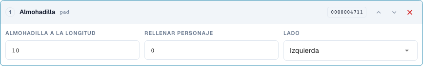
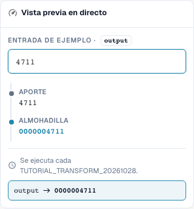

# Dar forma a números: Rellenado, Truncado, Prefijo y Sufijo

> Limitación conocida de la vista previa (comprobada el 29 de octubre de 2026, versión 11.15.2): al añadir el prefijo `INV-`, la vista previa cambia incorrectamente `INV-4711` a `INV-INV-4711`. La prueba independiente del servidor conserva `INV-4711`. Comprueba también la ejecución repetida mediante una prueba del servidor; un resultado correcto en la vista previa por sí solo no demuestra la ejecución completa al guardar.

[Volver a la visión general completa de la práctica](complete-practical-guide.md)

Campo de cabecera · pad: longitud 10, carácter 0, izquierda; truncate: longitud 10; affix: operación exacta de prefijo/sufijo.

## Nombres visibles en el editor

Algunas etiquetas de la interfaz actual presentan traducciones imprecisas. La tabla indica el texto que aparece realmente para que puedas encontrar el paso correcto; la explicación funcional usa terminología técnica. Las capturas muestran la interfaz sin modificar.

| Operación | Etiqueta visible |
| --- | --- |
| pad | Almohadilla |
| truncate | Truncado |
| affix | Afijo |

## Procedimiento en el editor

1. Selecciona el paso de relleno para el número. Establece longitud mínima 10, carácter de relleno `0`, y lado izquierdo. `4711` debe convertirse en `0000004711`.
2. Verificar con una entrada de once dígitos: el rellenado no debe truncar nada. Para complementos a la derecha, probar separadamente longitud 6, carácter `_` y entrada `ABC`.
3. En una regla propia, configurar **Truncado** con longitud máxima 10. `ABCDEFGHIJKL` se convierte en `ABCDEFGHIJ`, `ABC` se mantiene. Verificar si diferentes entradas podrían dar como resultado el mismo identificador.
4. Probar **Affix** con añadir prefijo `INV-`. Posteriormente, verificar la entrada `INV-4711`: el prefijo exacto existente no debe añadirse de nuevo.
5. Configurar separadamente las demás variantes de Affix: añadir sufijo `-DE`, eliminar prefijo `Art.-Nr. ` y eliminar sufijo ` EUR`. Al eliminar, probar también un borde no coincidente y mayúsculas/minúsculas diferentes.
6. Utilizar la salida nuevamente como entrada. Especialmente al eliminar afijos presentes varias veces, una segunda pasada puede modificar aún más.

<figure><figcaption>
Configuración de pasos. Interfaz real en español de España. La vista previa no modifica los documentos almacenados.
</figcaption></figure>


Configuración de pasos. Interfaz real en español de España. La vista previa no modifica los documentos almacenados.


<figure><figcaption>
Vista previa en directo con valores de entrenamiento. Interfaz real en español de España. La vista previa no modifica los documentos almacenados.
</figcaption></figure>


Vista previa en directo con valores de entrenamiento. Interfaz real en español de España. La vista previa no modifica los documentos almacenados.


## 1. Longitud

El rellenado añade un único carácter de relleno a la izquierda o a la derecha hasta alcanzar la longitud mínima. Con diez posiciones y cero a la izquierda, un número de cuatro dígitos se convierte en un identificador de diez dígitos. Un número que ya sea más largo permanece más largo. Por tanto, el rellenado no es una comprobación de longitud. El truncado, en cambio, conserva únicamente los primeros caracteres hasta la longitud máxima seleccionada. Esta información se pierde. Antes de un despliegue en ERP, verifico si distintos números podrían volverse idénticos tras el truncado. Los valores cortos permanecen sin cambios.

## 2. Prefijo y Sufijo

Los siguientes resultados de las operaciones de afijos describen la ejecución verificada del servidor.

Affix ofrece cuatro variantes: añadir prefijo, añadir sufijo, eliminar prefijo y eliminar sufijo. Un prefijo añadido no se complementa de nuevo si el valor ya comienza exactamente con él. Lo mismo aplica para un sufijo. La eliminación, por su parte, verifica exactamente el inicio o el final. Una diferencia en mayúsculas/minúsculas no se equipara automáticamente. Si el texto se encuentra en medio del valor, se conserva. Para hallazgos arbitrarios, utilizo Buscar y Reemplazar.

## 3. Reaplicación

Incluso una canalización simple necesita una prueba de repetición. Si elimino un prefijo de un prefijo duplicamente antepuesto, tras la primera pasada aún queda uno. En la siguiente pasada, también este desaparecería. Por ello, verifico la regla completa y no solo cada paso de forma individual. La canalización típica de números de factura es: recortar, mayúsculas, complementar prefijo. Pruebo un número en bruto, un número ya terminado y un proveedor diferente. La condición garantiza que solo se modifique el caso acordado.

## Ejemplos verificados y casos contrarios

Estos valores fueron verificados en el servidor como prueba en seco. Dicha prueba no modifica los documentos guardados.

| Caso | Entrada | Resultado del servidor |
| --- | --- | --- |
| pad | `4711` | `0000004711` |
| pad | `12345678901` | `12345678901` |
| pad-right | `ABC` | `ABC___` |
| truncate | `ABCDEFGHIJKL` | `ABCDEFGHIJ` |
| truncate | `ABC` | `ABC` |
| prefix-add | `4711` | `INV-4711` |
| prefix-add | `INV-4711` | `INV-4711` |
| suffix-add | `4711` | `4711-DE` |
| suffix-add | `4711-DE` | `4711-DE` |
| prefix-strip | `Art.-Nr. 4711` | `4711` |
| prefix-strip | `ART.-NR. 4711` | `ART.-NR. 4711` |
| prefix-strip | `Art.-Nr. Art.-Nr. 4711` | `Art.-Nr. 4711` |
| suffix-strip | `123 EUR` | `123` |
| suffix-strip | `123 EUR netto` | `123 EUR netto` |

## Aceptación

Verifique un caso apropiado, un caso contrario, un valor vacío y un resultado ya procesado. Repita la operación de guardado del documento. Verifique además la conciliación de pedidos de compra y la recepción en ERP si corresponden al objetivo funcional.

## Vídeo tutorial


Configuración, ejemplos prácticos y casos contrarios.


[Abrir el vídeo con subtítulos en español y capítulos](https://docbits-videos.fra1.cdn.digitaloceanspaces.com/settings-assistant/transformation-rules-03-numbers-and-affixes-preview-admin/v1/es.html). Esta versión de revisión está pendiente de la revisión técnica y de escucha completa.
