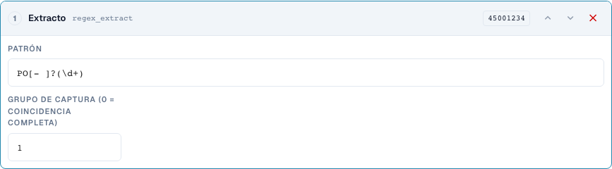
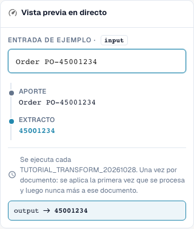

# Fragmentos y patrones: Cortar, extraer, reemplazar

[Volver a la vista general completa del prácticas](complete-practical-guide.md)

Campo de cabecera · Fuente header.input · Destino output · regex_extract: PO[- ]?(\d+), Grupo 1. Fuente y destino permanecen separados.

## Nombres visibles en el editor

Algunas etiquetas de la interfaz actual presentan traducciones imprecisas. La tabla indica el texto que aparece realmente para que puedas encontrar el paso correcto; la explicación funcional usa terminología técnica. Las capturas muestran la interfaz sin modificar.

| Operación | Etiqueta visible |
| --- | --- |
| substring | Toma una rebanada |
| regex_extract | Extracto |
| regex_replace | Buscar y reemplazar |

## Procedimiento en el editor

1. Para los tres pasos, elegir un destino como `output` y una **fuente original separada** como `header.input`. Incluso «Solo una vez por documento» no permite una autofuente.
2. Para **Fragmento** configurar primero Inicio 0 y Longitud 4: `2026-10-28` produce `2026`. Después comprobar Inicio 3 y Fin 7 con `DE-4711-X`; el fin no se cuenta.
3. Como variante propia probar Inicio −4 sin longitud/fin: `INV-4711` produce `4711`. Una entrada más corta es un caso de prueba necesario.
4. Para **Extraer** utilizar patrón `PO[- ]?(\d+)` y grupo de captura 1. `Order PO-45001234` produce `45001234`; `Invoice 4711` produce vacío. El grupo 0 devuelve en cambio toda la coincidencia.
5. Para **Buscar y reemplazar** configurar patrón `\s+`, reemplazo un espacio y cantidad 0. `ACME    GmbH` debe producir `ACME GmbH`. Después comprobar patrón `-`, reemplazo `/`, cantidad 1 con `AB-CD-EF`: solo se reemplaza el primer guion.
6. Probar los patrones concretos también en el servidor. Un patrón exitoso en el navegador por sí solo no garantiza un procesamiento idéntico en el servidor para expresiones complejas.

<figure><figcaption>
Configuración de pasos. Interfaz real en español de España. La vista previa no modifica los documentos almacenados.
</figcaption></figure>


Configuración de pasos. Interfaz real en español de España. La vista previa no modifica los documentos almacenados.


<figure><figcaption>
Vista previa en directo con valores de entrenamiento. Interfaz real en español de España. La vista previa no modifica los documentos almacenados.
</figcaption></figure>


Vista previa en directo con valores de entrenamiento. Interfaz real en español de España. La vista previa no modifica los documentos almacenados.


## 1. Fragmento

Un fragmento se define mediante inicio y longitud o mediante inicio y fin. El primer índice es cero. El fin ya no pertenece al resultado. Un inicio negativo cuenta desde el borde derecho. Para los últimos cuatro caracteres utilizo un inicio de menos cuatro y ningún fin. Elijo una fuente distinta del destino. Así cada ejecución vuelve a leer el texto original. El servidor rechaza estos pasos en el propio campo de destino, porque de lo contrario el valor podría modificarse cada vez más al volver a procesarse. Ejecutar solo una vez no sustituye aquí esa fuente separada.

## 2. Extraer

Extraer busca la primera coincidencia de una expresión regular. Mi patrón reconoce las letras P y O, opcionalmente un guion o un espacio y después dígitos. El grupo uno devuelve solo los dígitos, el grupo cero la coincidencia completa. Sin coincidencia se devuelve una cadena vacía. Por ello establezco una condición adecuada o compruebo deliberadamente si un valor de destino vacío es deseado en este caso. Varios números de pedido en un texto no se convierten automáticamente en varios resultados.

## 3. Reemplazar

Buscar y reemplazar procesa las coincidencias de un patrón. Con una cantidad de cero se reemplazan todas las coincidencias. Con uno solo se modifica la primera coincidencia. Puedo reemplazar espacios múltiples por un único espacio. También aquí utilizo una fuente original separada. La vista previa en el navegador y el procesamiento en el servidor pueden utilizar reglas diferentes para expresiones regulares complejas. Por eso pruebo primero patrones sencillos y comparo después el valor real del servidor. Un caso adecuado, ninguna coincidencia y varias coincidencias forman mi comprobación mínima.

## Ejemplos comprobados y casos contrarios

Estos valores se comprobaron en el servidor como prueba en seco. Una prueba así no modifica los documentos guardados.

| Caso | Entrada | Resultado del servidor |
| --- | --- | --- |
| substring | `2026-10-28` | `2026` |
| substring | `AB` | `AB` |
| substring-end | `DE-4711-X` | `4711` |
| substring-negative | `INV-4711` | `4711` |
| regex-extract | `Order PO-45001234` | `45001234` |
| regex-extract | `Invoice 4711` | `` |
| regex-replace | `ACME    GmbH` | `ACME GmbH` |
| regex-count | `AB-CD-EF` | `AB/CD-EF` |

## Aceptación

Compruebe un caso adecuado, un caso de prueba, un valor vacío y un resultado ya procesado. Repita la operación de guardado del documento. Compruebe además la conciliación de PO y la recepción en ERP si pertenecen al objetivo funcional.

## Vídeo tutorial


Configuración, ejemplos prácticos y casos contrarios.


[Abrir el vídeo con subtítulos en español y capítulos](https://docbits-videos.fra1.cdn.digitaloceanspaces.com/settings-assistant/transformation-rules-04-substrings-and-patterns-preview-admin/v1/es.html). Esta versión de revisión está pendiente de la revisión técnica y de escucha completa.
