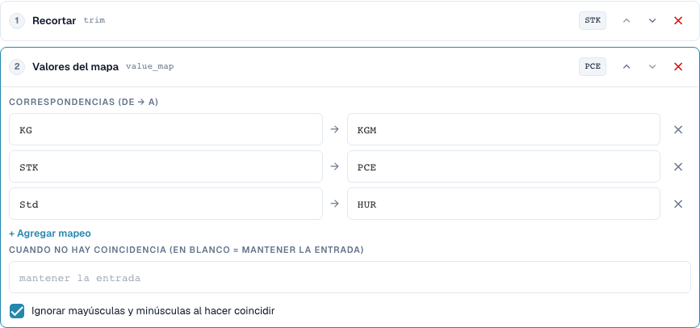
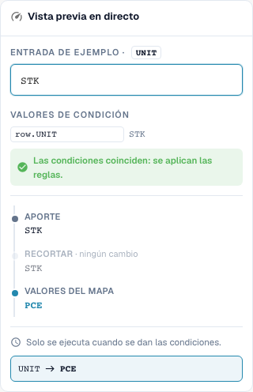

# Asignaciones de valores y reglas por fila de tabla

[Volver a la vista general completa](complete-practical-guide.md)

Columna de tabla UNIT · Trim → value_map: STK→PCE, KG→KGM, Std→HUR · Ignorar mayúsculas/minúsculas.

## Nombres visibles en el editor

Algunas etiquetas de la interfaz actual presentan traducciones imprecisas. La tabla indica el texto que aparece realmente para que puedas encontrar el paso correcto; la explicación funcional usa terminología técnica. Las capturas muestran la interfaz sin modificar.

| Operación | Etiqueta visible |
| --- | --- |
| trim | Recortar |
| value_map | Valores del mapa |

## Procedimiento en el editor

1. Seleccionar **Ámbito de aplicación: columna de tabla**, tabla `INVOICE_TABLE` y columna de destino `UNIT`. Aquí se procesa cada fila de tabla individualmente.
2. Colocar **Trim** antes de **Asignar valores**. Registrar pares `STK→PCE`, `KG→KGM` y `Std→HUR` y activar ignorar mayúsculas/minúsculas.
3. Dejar vacío el campo para el reemplazo sin coincidencia, para que los códigos desconocidos se conserven. `stk` debe dar `PCE`, `BOX` debe permanecer como `BOX`.
4. Comprobar una vista previa con condición de fila coincidente y con condición no coincidente. La condición no debe capturar filas no deseadas.
5. Para una prueba real de varias filas, preparar valores iniciales `STK`, `STK`, `BOX`. En la prueba de servidor verificada se obtiene `PCE`, `PCE`, `BOX`; cantidad y precio deben verificarse funcionalmente de forma separada.
6. Comprobar cada código de destino nuevamente como entrada. Un reemplazo global como `C62` y asignaciones encadenadas pueden ocultar valores desconocidos o modificarlos en ejecuciones posteriores.

<figure><figcaption>
Configuración de pasos. Interfaz real en español de España. La vista previa no modifica los documentos almacenados.
</figcaption></figure>


Configuración de pasos. Interfaz real en español de España. La vista previa no modifica los documentos almacenados.


<figure><figcaption>
Vista previa en directo con valores de entrenamiento. Interfaz real en español de España. La vista previa no modifica los documentos almacenados.
</figcaption></figure>


Vista previa en directo con valores de entrenamiento. Interfaz real en español de España. La vista previa no modifica los documentos almacenados.


## 1. Pares de valores

Una asignación de valores traduce valores de entrada completos. Mi ejemplo asigna la unidad Pieza al código P C E, Kilogramo al código K G M y Horas al código H U R. Introduzco los códigos reales del proveedor y los códigos de destino esperados como pares. Al ignorar las mayúsculas/minúsculas también se reconoce un código en minúsculas. Esto aún no elimina espacios. Por eso coloco un paso de trim antes de la asignación. Pruebo explícitamente un código desconocido.

## 2. Sin coincidencia

Un campo vacío para el valor sin coincidencia significa: conservar entrada. No significa: eliminar entrada. Un valor de reemplazo fijo introducido reemplaza en cambio todo código desconocido. Esto puede ocultar errores. Para unidades funcionalmente diferentes no asignaría un código de reemplazo global. Una asignación tampoco es automáticamente repetible en toda combinación. Si la salida de un par es simultáneamente la entrada de otro par, una ejecución posterior puede seguir asignando. Por eso compruebo también cada código de destino como nueva entrada.

## 3. Por fila de tabla

Para tablas selecciono la tabla concreta y la columna de destino. La pipeline se ejecuta entonces para cada fila. Una condición puede conectar el código de unidad de la fila actual con una característica del proveedor del encabezado. En el ejemplo se modifican dos filas coincidentes, mientras que un código de unidad desconocido se conserva. Esto no modifica cantidades o precios mediante una conversión de unidades. Renombrar una cadena de caracteres no es una conversión matemática. La concordancia real de pedido y una exportación las compruebo separadamente de la transformación.

## Ejemplos verificados y casos contrarios

Estos valores fueron verificados en servidor como prueba en seco. Una prueba así no modifica documentos guardados.

| Caso | Entrada | Resultado del servidor |
| --- | --- | --- |
| map | `stk` | `PCE` |
| map | `PCE` | `PCE` |
| map | `BOX` | `BOX` |
| map-fallback | `BOX` | `C62` |
| item-pipeline | `Art.-Nr. ab-12/3` | `AB123` |

## Aceptación

Compruebe un caso coincidente, un caso contrario, un valor vacío y un resultado ya procesado. Repita la operación de guardado del documento. Compruebe adicionalmente la concordancia de pedido (PO) y la recepción en ERP si corresponden al objetivo funcional.

## Vídeo tutorial


Configuración, ejemplos prácticos y casos contrarios.


[Abrir el vídeo con subtítulos en español y capítulos](https://docbits-videos.fra1.cdn.digitaloceanspaces.com/settings-assistant/transformation-rules-05-value-mapping-preview-admin/v1/es.html). Esta versión de revisión está pendiente de la revisión técnica y de escucha completa.
