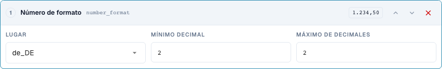
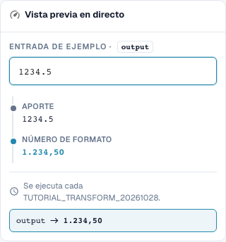

# Formatear correctamente fechas y números

[Volver a la visión general completa de la práctica](complete-practical-guide.md)

Destino de texto · date_format: %d.%m.%Y; number_format: de_DE, mín. 2, máx. 2 decimales.

## Nombres visibles en el editor

Algunas etiquetas de la interfaz actual presentan traducciones imprecisas. La tabla indica el texto que aparece realmente para que puedas encontrar el paso correcto; la explicación funcional usa terminología técnica. Las capturas muestran la interfaz sin modificar.

| Operación | Etiqueta visible |
| --- | --- |
| date_format | Fecha de reformateo |
| number_format | Número de formato |

## Procedimiento en el editor

1. Para un primer intento bien legible, utilizar un **Destino de texto** y el paso **Formatear fecha**. Establecer patrón de salida `%d.%m.%Y` y entrada `2026-10-28`; se espera `28.10.2026`.
2. Comparar las variantes `%m/%d/%Y`, `%Y-%m-%d` y `%d %b %Y` con la misma entrada unívoca respectivamente. Los patrones no son un reconocimiento fiable de cualquier formato de fecha arbitrario.
3. Verificar con `kein Datum` y una entrada ambigua. En el campo de cabecera DATE real, controlar además por separado el valor ISO almacenado y la representación visible.
4. En una regla propia **Formatear número**, seleccionar configuración regional `de_DE`, decimales mínimos y máximos 2 respectivamente. La entrada de servidor `1234.5` debe dar `1234,50`.
5. Comprobar la misma entrada con `en_US`: resultado de servidor `1234.50`. El separador de miles de la vista previa del navegador verificada no se escribe en el lado del servidor.
6. Verificar cero, un importe negativo y decimales adicionales. Posteriormente, volver a procesar la salida y controlar el valor realmente almacenado.

<figure><figcaption>
Configuración de pasos. Interfaz real en español de España. La vista previa no modifica los documentos almacenados.
</figcaption></figure>


Configuración de pasos. Interfaz real en español de España. La vista previa no modifica los documentos almacenados.


<figure><figcaption>
Vista previa en directo con valores de entrenamiento. Interfaz real en español de España. La vista previa no modifica los documentos almacenados. El separador de miles visible pertenece a la vista previa del navegador; el resultado del servidor verificado es 1234,50.
</figcaption></figure>


Vista previa en directo con valores de entrenamiento. Interfaz real en español de España. La vista previa no modifica los documentos almacenados. El separador de miles visible pertenece a la vista previa del navegador; el resultado del servidor verificado es 1234,50.


## 1. Fecha y tipo de datos

Reformatear fecha escribe una fecha según el patrón seleccionado. Una fecha ISO unívoca es una buena entrada de prueba. Día, mes y año se pueden mostrar, por ejemplo, con puntos. En un campo de cabecera de fecha real, el valor interno puede permanecer en formato ISO mientras cambia la visualización. Un campo de texto o una celda de tabla, en cambio, puede contener el texto formateado. Por eso comparo no solo el campo visible, sino también el valor almacenado y el uso posterior.

## 2. Datos ilegibles y ambiguos

Una fecha ilegible no se inventa simplemente. En mi prueba de servidor, el texto permanece inalterado y el resultado indica el motivo. Las indicaciones ambiguas como día y mes con números pequeños necesitan un contexto acordado de forma unívoca. Una fecha formateada no debe leerse como otro día al guardarla de nuevo. Por eso verifico una segunda pasada. Esta transformación no puede obtener una fecha fiable a partir de un texto arbitrario sin fecha válida.

## 3. Formato de números

Formatear números utiliza una configuración regional y un número mínimo y máximo de decimales. Esto cambia la representación y, en su caso, el redondeo, pero no el tipo de cambio ni la unidad de medida. Para mi entrada mil doscientos treinta y cuatro coma cinco, el servidor actual con dos decimales ofrece una escritura con coma alemana o una escritura con punto inglesa. Un separador de miles no está incluido en el resultado de servidor verificado. Por eso no adopto una visualización más elegante del navegador como prueba para la exportación. Cero, importes negativos, decimales adicionales y el valor de resultado almacenado necesitan pruebas propias.

## Ejemplos verificados y casos contrarios

Estos valores se verificaron en el lado del servidor como prueba en seco. Una prueba así no modifica los documentos almacenados.

| Caso | Entrada | Resultado de servidor |
| --- | --- | --- |
| date | `2026-10-28` | `28.10.2026` |
| date | `kein Datum` | `kein Datum` |
| number-de | `1234.5` | `1234,50` |
| number-us | `1234.5` | `1234.50` |

## Aceptación

Verifique un caso adecuado, un caso contrario, un valor vacío y un resultado ya procesado. Repita la operación de guardado del documento. Verifique además la conciliación de pedido y la recepción en ERP si corresponden al objetivo funcional.

En el estado verificado, la vista previa de números y el servidor difieren en los separadores de miles. La tabla indica el valor real de servidor.

## Vídeo tutorial


Configuración, ejemplos prácticos y casos contrarios.


[Abrir el vídeo con subtítulos en español y capítulos](https://docbits-videos.fra1.cdn.digitaloceanspaces.com/settings-assistant/transformation-rules-06-dates-and-numbers-preview-admin/v1/es.html). Esta versión de revisión está pendiente de la revisión técnica y de escucha completa.
