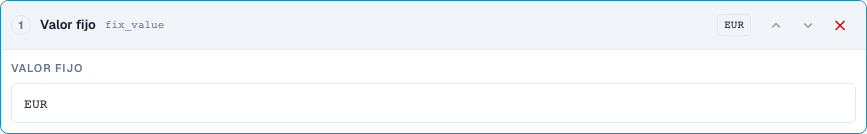
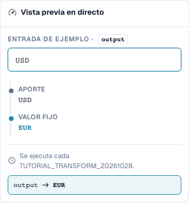
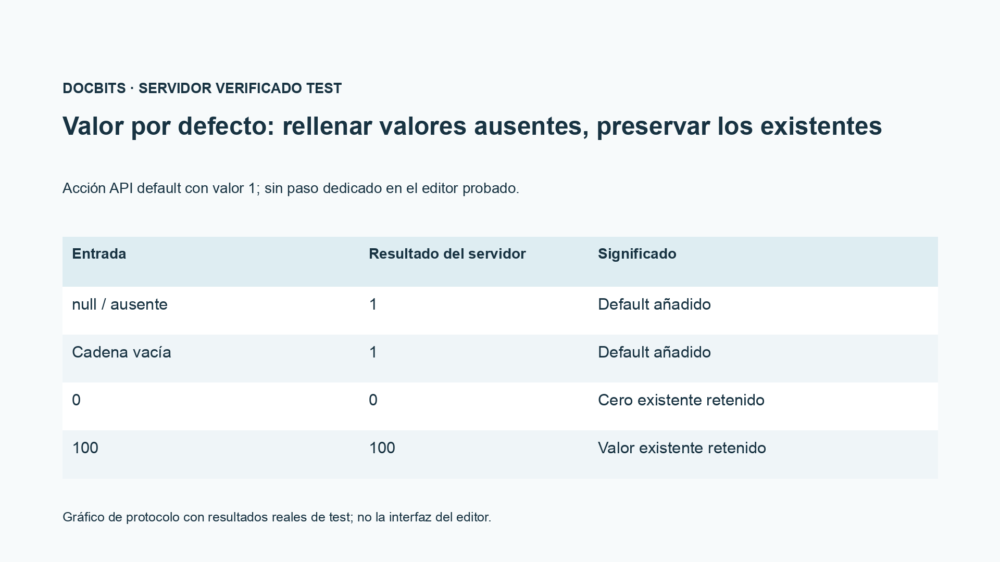

# Campos de origen, valores fijos, vaciado y valores por defecto

[Volver a la vista general completa de la práctica](complete-practical-guide.md)

Objetivo Resultado · Fuente Texto original para la copia de campo; valor fijo solo bajo condición estricta; vaciado probarlo por separado.

## Nombres visibles en el editor

Algunas etiquetas de la interfaz actual presentan traducciones imprecisas. La tabla indica el texto que aparece realmente para que puedas encontrar el paso correcto; la explicación funcional usa terminología técnica. Las capturas muestran la interfaz sin modificar.

| Operación | Etiqueta visible |
| --- | --- |
| trim | Recortar |
| case | Cambiar mayúsculas/minúsculas |
| fix_value | Valor fijo |
| clear | Borrar |

## Procedimiento en el editor

1. Para una **copia de campo**, elegir un campo de origen distinto del campo de destino. En el ámbito del ejercicio, el destino es `output`, el origen `header.input`.
2. Configurar los pasos Recortar → Mayúsculas y probar `  po-4711  `. La salida será `PO-4711`; el origen original no debe vaciarse en el proceso.
3. Para un número de pedido productivo, utilizar una condición adicional que solo se aplique cuando el destino esté vacío. Probar como caso contrario un valor de destino correcto ya existente.
4. En una regla propia, crear un **valor fijo** con `EUR`. Incluso una entrada `USD` será sobrescrita por este; esto no es una conversión de divisas.
5. **Vaciar** probarlo por separado con `Altwert`. La salida es la cadena de caracteres vacía. Tener en cuenta la diferencia funcional entre el vaciado intencionado y un valor de salida ausente.
6. El paso de interfaz `default` probarlo solo mediante el contrato API previsto; en el menú de pasos normales comprobado no existe una entrada propia para ello. El gráfico de registro muestra: ausente y vacío se completan, `0` y `100` se conservan.

<figure><figcaption>
Configuración de pasos. Interfaz real en español de España. La vista previa no modifica los documentos almacenados.
</figcaption></figure>


Configuración de pasos. Interfaz real en español de España. La vista previa no modifica los documentos almacenados.


<figure><figcaption>
Vista previa en directo con valores de entrenamiento. Interfaz real en español de España. La vista previa no modifica los documentos almacenados.
</figcaption></figure>


Vista previa en directo con valores de entrenamiento. Interfaz real en español de España. La vista previa no modifica los documentos almacenados.


## 1. Copia de campo

Para una copia de campo, elijo primero el campo de destino y luego otro origen. Si el número de pedido está en el campo incorrecto, puedo leerlo de ese campo, recortarlo y guardarlo en el campo de destino correcto. Una condición destino está vacío protege un número de pedido ya existente. El origen se conserva. Es una copia con procesamiento y no un traslado. Compruebo un destino vacío, un destino ya relleno y un origen vacío.

## 2. Valor fijo y vaciado

Un valor fijo ignora el contenido anterior. Si establezco la divisa en Euro, la regla también sobrescribe una divisa diferente ya existente. Para ello necesito una condición funcional estricta. Vaciar escribe una cadena de caracteres vacía en el campo de destino. No es una eliminación del campo completo ni del documento. En la vista previa compruebo sobre todo el caso contrario, para que la regla no elimine valores válidos. El solo hecho de guardar la regla no demuestra aún una modificación de un documento.

## 3. Valores por defecto

La interfaz del servidor admite además una acción de valor por defecto. Complementa un valor solo cuando la entrada falta o está vacía. Un cero existente permanece como cero. Esta acción no está disponible como paso propio en la selección de pasos del editor normal comprobada. En el editor, puedo representar frecuentemente el caso por defecto deseado con la condición destino está vacío y un valor fijo. Muestro esta distinción de forma explícita y no afirmo ningún punto de menú adicional. Un valor por defecto es siempre una decisión funcional, especialmente en base de precio, cantidad o divisa.

## Ejemplos comprobados y casos contrarios

Estos valores fueron comprobados en el servidor como prueba en seco. Una prueba de este tipo no modifica documentos guardados.

| Caso | Entrada | Resultado del servidor |
| --- | --- | --- |
| fixed | `USD` | `EUR` |
| fixed | `null` | `EUR` |
| clear | `Altwert` | `` |
| clear | `` | `` |
| default-api | `null` | `1` |
| default-api | `` | `1` |
| default-api | `0` | `0` |
| default-api | `100` | `100` |
| copy | `  po-4711  ` | `PO-4711` |

## Aceptación

Compruebe un caso adecuado, un caso contrario, un valor vacío y un resultado ya procesado. Repita la operación de guardado del documento. Compruebe además la conciliación de pedidos y la recepción en el ERP si corresponden al objetivo funcional.

<figure><figcaption>
Resultados reales de test de servidor y persistencia mostrados como gráfico de protocolo. Esta no es una interfaz de editor recreada.
</figcaption></figure>


Resultados reales de test de servidor y persistencia mostrados como gráfico de protocolo. Esta no es una interfaz de editor recreada.


## Vídeo tutorial


Configuración, ejemplos prácticos y casos contrarios.


[Abrir el vídeo con subtítulos en español y capítulos](https://docbits-videos.fra1.cdn.digitaloceanspaces.com/settings-assistant/transformation-rules-07-field-copy-and-defaults-preview-admin/v1/es.html). Esta versión de revisión está pendiente de la revisión técnica y de escucha completa.
