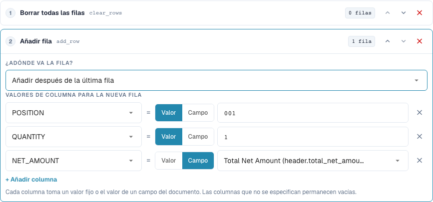
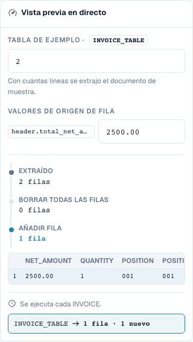

# Reconstrucción de filas de tabla

[Volver a la visión general completa de la práctica](complete-practical-guide.md)

Tabla INVOICE_TABLE · clear_rows → add_row al final · POSITION=001, QUANTITY=1, NET_AMOUNT de header.total_net_amount.

## Nombres visibles en el editor

Algunas etiquetas de la interfaz actual presentan traducciones imprecisas. La tabla indica el texto que aparece realmente para que puedas encontrar el paso correcto; la explicación funcional usa terminología técnica. Las capturas muestran la interfaz sin modificar.

| Operación | Etiqueta visible |
| --- | --- |
| clear_rows | Borrar todas las filas |
| add_row | Añadir fila |

## Procedimiento en el editor

1. Seleccionar el ámbito **Filas de tabla** y la tabla concreta `INVOICE_TABLE`. Una condición de proveedor adecuada limita la reconstrucción completa.
2. Configurar primero **Eliminar todas las filas** y, a continuación, **Añadir fila**. Para la nueva fila establecer valores fijos `POSITION=001`, `QUANTITY=1` y para `NET_AMOUNT` la fuente `header.total_net_amount`.
3. Probar con el importe de cabecera `2500.00` y dos filas existentes: Queda exactamente la nueva fila total definida. Comprobar también un importe de cabecera ausente antes de que la regla se active.
4. Al añadir, comparar la posición antes de la primera fila y después de la última fila. Para esta prueba de posición, eliminar el borrado previo o probarlo por separado; de lo contrario no hay fila existente como referencia.
5. Comprobar deliberadamente el orden inverso de pasos **Añadir → Eliminar** como caso contrario: El resultado está vacío. Restablecer después el orden previsto.
6. Comprobar el doble guardado. Añadir sin eliminar previamente puede multiplicar las filas; una reconstrucción puede eliminar irrecuperablemente las posiciones del proveedor del resultado de trabajo desde el punto de vista funcional. Verificar la conciliación de pedidos por separado.

<figure><figcaption>
Configuración de pasos. Interfaz real en español de España. La vista previa no modifica los documentos almacenados.
</figcaption></figure>


Configuración de pasos. Interfaz real en español de España. La vista previa no modifica los documentos almacenados.


<figure><figcaption>
Vista previa en directo con valores de entrenamiento. Interfaz real en español de España. La vista previa no modifica los documentos almacenados.
</figcaption></figure>


Vista previa en directo con valores de entrenamiento. Interfaz real en español de España. La vista previa no modifica los documentos almacenados.


## 1. Construcción de filas

Eliminar todas las filas elimina las filas existentes de la tabla seleccionada. Añadir fila construye posteriormente una nueva fila. Para cada columna selecciono bien un valor fijo o el valor de un campo de cabecera. En mi ejemplo se genera una posición total con cantidad uno y un importe neto de la cabecera de factura. Las columnas no rellenadas permanecen vacías. La nueva fila puede estar al principio o al final. Esto no es una agrupación o suma automática de posiciones existentes seleccionadas.

## 2. Orden de pasos

El orden es decisivo. Eliminar y después añadir produce la nueva fila deseada. Añadir y después eliminar elimina también la fila recién generada. Sin eliminación previa, otra ejecución añadiría otra fila. Por ello la regla exige una ejecución única adecuada. Una vista previa con un número de filas comprueba la estructura, pero no sustituye aún una prueba con una tabla extraída real. Verifico los valores de columna y el número de filas después de guardar.

## 3. Verificación separada de la conciliación de pedidos

Una regla de tabla se ejecuta antes que las reglas de columna. Por ello una regla de columna posterior puede depurar también las filas recién añadidas. La reconstrucción de posiciones puede modificar los identificadores de filas existentes y las asignaciones de pedidos. Para una factura que se concilia conscientemente con el importe total, necesito además la regla de conciliación de pedidos adecuada. La transformación por sí sola no confirma una conciliación completa. Pruebo esto solo con un documento aislado y verifico tras guardar de nuevo el número de filas y el estado de conciliación por separado.

## Aceptación

Verifique un caso adecuado, un caso contrario, un valor vacío y un resultado ya procesado. Repita la operación de guardado del documento. Verifique la conciliación de PO y la recepción ERP adicionalmente, si pertenecen al objetivo funcional.

## Vídeo tutorial


Configuración, ejemplos prácticos y casos contrarios.


[Abrir el vídeo con subtítulos en español y capítulos](https://docbits-videos.fra1.cdn.digitaloceanspaces.com/settings-assistant/transformation-rules-08-table-rows-preview-admin/v1/es.html). Esta versión de revisión está pendiente de la revisión técnica y de escucha completa.
