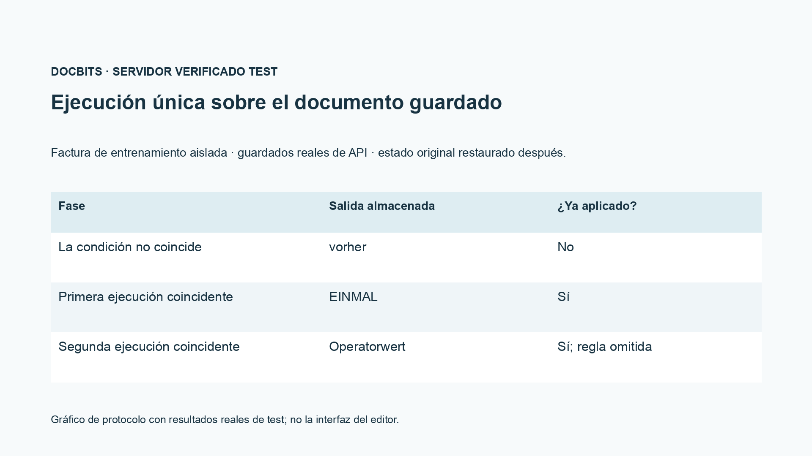
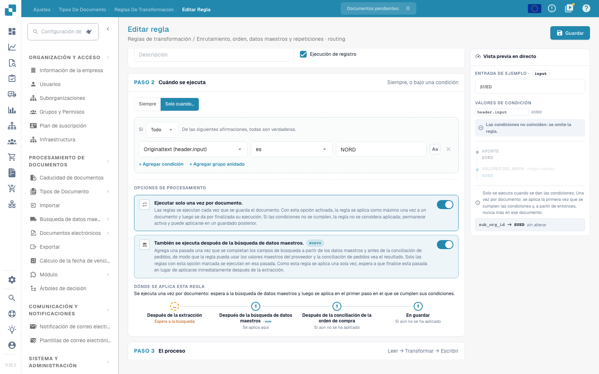

# Enrutamiento, orden, datos maestros y repeticiones

[Volver a la vista general completa de la práctica](complete-practical-guide.md)

Enrutamiento · Destino Suborganización · usar destino existente; condiciones, fases de ejecución y repetición verificar por separado.

En la grabación de vídeo, el nombre y el identificador interno del destino de enrutamiento existente están ocultos. Para la configuración propia, el destino debe provenir de la selección de suborganizaciones realmente existentes.

## Procedimiento en el editor

1. Para **Enrutamiento**, seleccionar el atributo de documento ofrecido `sub_org_id`. Utilizar exclusivamente una suborganización realmente existente como destino fijo o como resultado de una asignación de valores.
2. Añadir una condición de proveedor o de identificación adecuada. En el ejemplo de ejercicio, `NORD` debe cumplir la condición y `SUED` la debe omitir. La grabación muestra solo la vista previa y no desplaza documentos productivos.
3. Comparar la indicación de fases con el flujo Campo de cabecera → Enrutamiento → Filas de tabla → Columna de tabla. Prioridad y clave de regla ordenan únicamente dentro del mismo ámbito.
4. Activar **Ejecutar también tras la búsqueda de datos maestros** y tener en cuenta la fase adicional antes de la conciliación de pedidos. Un origen que proviene primero de los datos maestros necesita un recorrido adecuado.
5. **Solo una vez por documento**: primero verificar con una condición no coincidente, luego ejecutar por primera vez de forma coincidente. En el caso de formación verificado, el primer recorrido omitido no consume la aplicación.
6. Tras la primera aplicación coincidente, introducir un valor de operador y guardar de nuevo. La prueba debe demostrar que la regla de una sola vez no sobrescribe este valor nuevamente; controlar la condición, el resultado, la fase y el comprobante de aplicación en el registro.

## 1. Suborganización

El enrutamiento escribe actualmente la suborganización del documento. Puedo establecer un destino fijo de la selección existente o asignar un valor de origen a una suborganización. Una condición de proveedor adecuada limita la asignación. Esto no es ni un permiso de usuario ni una decisión de liberación. Utilizo solo suborganizaciones existentes válidas y verifico el caso contrario. En esta secuencia, el ejemplo de enrutamiento permanece como vista previa; no desplaza documentos productivos.

## 2. Fases de ejecución

Los ámbitos de validez se ejecutan en el orden campo de cabecera, enrutamiento, filas de tabla y columna de tabla. Dentro de un ámbito rigen la prioridad y la clave de regla. Por tanto, un origen de cabecera depurado ya puede ser leído por el enrutamiento. Con la ejecución adicional tras la búsqueda de datos maestros, una regla puede utilizar valores que se completan primero desde los datos maestros. Esta opción añade un recorrido antes de la conciliación de pedidos. No desplaza todas las demás ejecuciones allí.

## 3. Reglas de una sola vez y comprobante

Ejecutar solo una vez por documento limita una regla realmente aplicada. Una condición no cumplida no consume aún esta ejecución. Junto con la opción de búsqueda, la regla espera en el primer recorrido de extracción a la fase posterior. Para subcadenas y expresiones regulares, el origen separado sigue siendo necesario. Verifico una aplicación por primera vez, un caso no coincidente y un guardado nuevo. En el registro busco la condición, el resultado y la fase de ejecución. Solo un documento recién cargado acredita el efecto guardado. Una entrada en ERP y una conciliación de pedidos necesitan cada uno su propio comprobante.

## Aceptación

Verifique un caso coincidente, un caso contrario, un valor vacío y un resultado ya procesado. Repita la operación de guardado del documento. Verifique la conciliación de pedidos y la recepción en ERP adicionalmente, si corresponden al objetivo funcional.

<figure><figcaption>
Resultados reales de test de servidor y persistencia mostrados como gráfico de protocolo. Esta no es una interfaz de editor recreada.
</figcaption></figure>


Resultados reales de test de servidor y persistencia mostrados como gráfico de protocolo. Esta no es una interfaz de editor recreada.


En la prueba de integración guardada, una condición no coincidente no consumió la ejecución de una sola vez. En el primer guardado coincidente se escribió EINMAL. En el segundo guardado coincidente, el valor de operador preparado se mantuvo, y el comprobante de aplicación guardado siguió establecido. El documento de prueba se restauró posteriormente. La prueba seca del servidor puede seguir calculando un resultado hipotético; verifique por tanto adicionalmente su indicación `already_applied` y el documento realmente guardado.

<figure><figcaption>
Ejecución única y la fase de búsqueda adicional en el editor real. La condición de muestra no coincidente se omite; los identificadores de destino de enrutamiento interno están ocultos. Estas opciones son una vista previa no guardada.
</figcaption></figure>


Ejecución única y la fase de búsqueda adicional en el editor real. La condición de muestra no coincidente se omite; los identificadores de destino de enrutamiento interno están ocultos. Estas opciones son una vista previa no guardada.


## Vídeo tutorial


Configuración, ejemplos prácticos y casos contrarios.


[Abrir el vídeo con subtítulos en español y capítulos](https://docbits-videos.fra1.cdn.digitaloceanspaces.com/settings-assistant/transformation-rules-09-routing-and-execution-preview-admin/v1/es.html). Esta versión de revisión está pendiente de la revisión técnica y de escucha completa.
